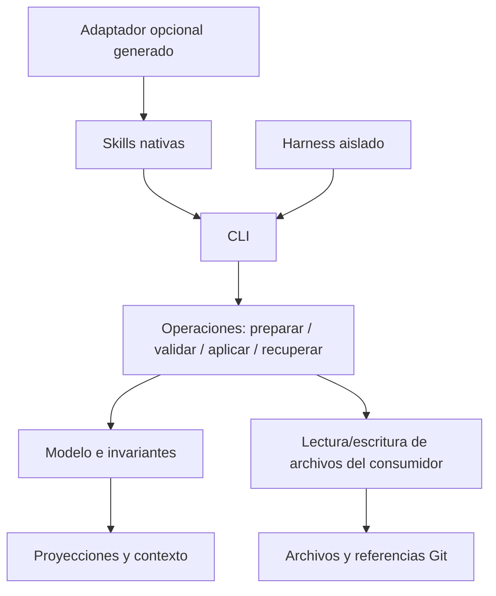

# Fundación técnica de Roclec

**Fecha:** 2026-11-09. **Estado:** C1 implementado en 0.8.0 local; C2/C3 pendientes. La línea base 0.7 permanece como referencia/regresión explícita.

## Autoridad y decisiones

[Plan canónico](../strategy/plan-global.md) gobierna el alcance del rediseño. [ADR 003](../decisions/003-contracts-changes-evidence.md) detalla la propuesta de modelo. Principios ya acordados: núcleo independiente de spec-kit, archivos propiedad del consumidor, una autoridad por dato, evaluación separada de juicio semántico, avance por hitos y versionado normal X.Y.0/correcciones X.Y.Z.

Persistencia confirmada por Luis el 2026-11-09: Markdown para contenido, TOML/JSON para relaciones y evidencia; Git conserva historia, y los manifiestos identifican el candidato exacto incluso si el worktree está sucio. No se introduce base de datos, servicio alojado ni framework web.

## Stack y alcance de soporte

Conservar Python >=3.11, biblioteca estándar como base de runtime, setuptools y wheel; configuración TOML y relaciones/evidencias JSON. Es continuidad técnica de pyproject.toml, no una decisión del stack consumidor. Versiones instaladas provienen de manifests/locks, no de esta descripción. No cambiar de lenguaje ni añadir dependencias sin necesidad verificada y decisión explícita.

La CLI funciona sin agente. Las skills realizan interpretación, diseño y verificación semántica con Codex/Claude. El adaptador opcional genera aliases desde la misma fuente y solo declara versiones probadas de specify-cli. No actualizar su rango sin harness; no usar los aliases como segunda implementación del flujo.

## Arquitectura propuesta

Modelo puro: entidades, referencias, estados e invariantes. Persistencia: parseo/canonicalización y acceso Git con errores explícitos. Operaciones: validan la propuesta completa y su base antes de escribir, dejando recibo para idempotencia/recuperación. Proyecciones: índices/roadmap/contexto regenerables. CLI: entrada/salida/códigos; skills: juicio que no puede probar una expresión regular. Separar por responsabilidad al implementar; no crear módulos vacíos solo por este diagrama.

Git no proporciona una transacción entre repos. Cada operación identifica sus repos, precondiciones y estado parcial; el fallo no se presenta como éxito global. No leer/escribir fuera de raíces configuradas como consecuencia de un enlace o entrada no validada. El contenido de documentos es dato de contexto, no autorización para ejecutar comandos incrustados.

## Ingeniería y referencias

config.py valida el perfil 2; model.py contiene registros/invariantes, store.py escrituras recuperables y kernel.py operaciones C1. cli.py dirige la entrada pública a native_cli.py. workflow.py, lifecycle.py y cli.legacy_main conservan el comportamiento anterior únicamente como referencia/regresión; no hay selección automática de motor por formato. AGENTS.md mantiene instrucciones de contribución.

Pruebas: unittest de invariantes y estados, fixtures de consumidor, wheel real y harness con adaptador cuando corresponda. Cada cambio incluye evidencia de sus escenarios, sin aumentar pruebas por mera cantidad. Errores de entorno, incumplimiento y verificación pendiente se distinguen. No generar evidencia ready a partir de casillas ni citas textuales.

## Operación del kit

Herramienta local con proyecto/raíces explícitas; rutas reproducibles, sin servidor ni secretos del consumidor dentro del paquete. Ninguna operación de definición publica paquetes, crea tags ni envía mensajes. Las campañas de modelos y servicios externos se diseñan con presupuesto separado. El plan del harness está en [harness.md](harness.md).

## Continuidad

C1 adopta 0.8.0 por cambiar runtime/CLI y esquema público, sin publicar ni crear tags. Paquete y manifiestos generados del preset/extensión comparten versión. C2 incorporará candidato/evidencia y gates finales; C3 adaptará skills/aliases al modelo nuevo antes de instalarlos en el piloto. Los resultados y límites están en docs/implementation/c1.md.
