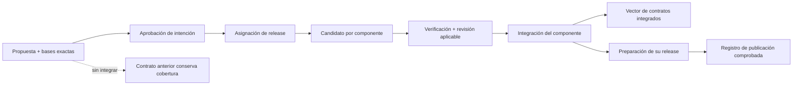

# Interfaces del primer corte de Roclec

**Estado:** C1/C2/C3 implementados en 0.8.0 local. D1–D3 confirmadas en [ADR 004](../decisions/004-first-cut-interface-decisions.md); candidato conjunto en [ADR 005](../decisions/005-final-release-verification.md). **Fecha de actualización:** 2026-11-10. Complementa el [modelo](modelo.md), el [plan](../strategy/plan-global.md) y los [ejemplos](examples/README.md). Ver [C1](../c1.md), [C2](../c2.md) y [C3](../c3.md); no aplicar estas interfaces a un proyecto 0.7.

## 1. Resultado y límites

El corte debe permitir definir una capacidad, proponer un cambio sobre una base exacta, asignarlo a una entrega, verificar un candidato e integrar/publicar su registro con trazabilidad. Una consulta debe distinguir contrato integrado, intención pendiente, implementación por componente y publicación. FUT es descubrimiento; no es requisito ni trabajo aprobado.

La revisión encontró cinco huecos en la propuesta anterior: rutas aún conceptuales; criterios del ejemplo incapaces de diferenciar las conductas; identidad de requisitos demasiado costosa si cambia en cada edición; estado global ambiguo cuando los componentes avanzan por separado; y falta de contrato de errores/recuperación. Este documento concreta esos puntos. Las tres decisiones consultadas están confirmadas en la sección 10.

No se incluye un lenguaje de workflows, base de datos, ejecución distribuida, despliegue, migrador 0.7 ni generación automática del producto. El núcleo verifica relaciones y evidencia; la suficiencia semántica sigue requiriendo evaluación. Spec-kit es un adaptador opcional, sin autoridad propia sobre los datos.

## 2. Autoridad y disposición de archivos

Todas las rutas siguientes son relativas a la raíz del proyecto. `repo` de cada componente es relativo a esa raíz y puede apuntar a otro repositorio explícitamente configurado. Los registros usan nombres de componentes, nunca rutas absolutas de una máquina.

```text
.roclec/project.toml                         Perfil nuevo: schema = 2
.roclec/references.json                      Fuentes, ámbito y decisiones de fundación
.roclec/current.json                         Único índice autoritativo de revisiones integradas
.roclec/identities.json                      Registro permanente de IDs, dueño y cambio de origen
.roclec/contracts/CAP-001/<sha256>/           Snapshot inmutable: contract.json + Markdown
.roclec/changes/CHG-001/                     change.json, proposal.md, contratos propuestos
.roclec/futs/FUT-001.json                     Descubrimiento y decisiones relacionadas
.roclec/runs/RUN-001/                         manifest.json y resultados inmutables
.roclec/evidence/EVD-001.json                 Comprobación o revisión del candidato exacto
.roclec/decisions/<id>.json                   Aprobación, cancelación o política; historial
.roclec/releases/<componente>/vX.Y.Z/         release.json, preparations/, publication.json
.roclec/receipts/<operation-id>.json          Recibos de operaciones completadas
.roclec/runtime/                             Lock y journal locales, ignorados por Git
specs/capabilities/CAP-001.md                 Vista generada; jamás otra fuente editable
```

No crear carpetas vacías para simular progreso. `init` instala el perfil y entradas mínimas; las operaciones crean sus artefactos cuando se necesitan. Las referencias de arquitectura, stack, diseño y verificación permanecen en las rutas propias del consumidor. El índice registra `id`, `path`, `components`, `role`, `decision_id`; la decisión contiene estado/actor/motivo, sin duplicarlos en el índice.

El perfil contiene `name`, `components.<nombre>.repo`, `user_facing`, `inputs`, `generated` y `verification`. `inputs` y `generated` son listas de patrones de rutas relativas al repo; los compartidos se declaran en cada componente aplicable. Los checks de `verification` tienen `id`, `argv` como lista, `cwd` relativo al repo y `timeout_seconds`. No se interpretan comandos mediante shell. Las referencias compartidas también forman parte de las entradas relevantes.

Se conserva la propiedad de plantillas/constituciones del consumidor. Una actualización del paquete no las sobrescribe. Los archivos generados llevan marca y huella de fuentes; `views --write` rechaza sobrescribir contenido ajeno o una vista modificada sin resolver la divergencia. Lectura, validación y regeneración no cambian el contrato vigente.

No hay lectura dual implícita: el runtime futuro reconoce explícitamente el perfil 2; un perfil 0.7 con `schema = 1` produce `UNSUPPORTED_SCHEMA` con instrucciones, sin modificarlo. `model_schema = 1` identifica los registros del modelo nuevo, no la versión del perfil ni la del paquete. La política de una publicación del paquete se decide al implementar, sin usar un patch para el rediseño.

## 3. Contenido, identidad y revisiones

Los IDs tienen prefijos `CAP`, `REQ`, `AC`, `CHG`, `FUT`, `RUN`, `EVD` seguidos por al menos tres dígitos. Son únicos en el proyecto y no se reciclan. Un ID de capacidad/obligación/escenario aparece en muchos snapshots históricos; eso no es duplicación de identidad. Se rechaza su redefinición incompatible en una rama o borrador sin relación explícita con la base. Dos asignaciones concurrentes del mismo ID se resuelven antes de integrar; no renumerar silenciosamente referencias ya usadas.

El descriptor de contrato contiene `model_schema`, `capability_id`, `requirements`, `acceptance`, `references` y `files`. Cada requisito declara `id`, `statement` (ruta Markdown), `components` y `acceptance_ids`. Cada AC declara `id`, `scenario` (ruta Markdown) y `components`, subconjunto del ámbito de su requisito. Una ruta guarda el texto una sola vez; el JSON contiene relaciones y huellas, no una copia del enunciado. Cada archivo referenciado debe existir y coincidir con `files[path] = sha256(bytes)`.

La revisión es SHA-256 del descriptor canónico: JSON de claves ordenadas, separadores `,` y `:`, UTF-8, sin escape ASCII forzado ni salto final. Las listas se ordenan por ID, `components` y referencias lexicográficamente; duplicados son inválidos. Se rechazan claves duplicadas, campos desconocidos, números no finitos y normalizaciones que pierdan contenido. Los bytes Markdown se conservan exactamente. El digest no se incluye a sí mismo ni contiene timestamps/estados administrativos.

El cambio declara bases por par capacidad/componente y deltas `add`, `revise`, `replace` o `retire`, junto con snapshots propuestos completos. Según D1, `revise` conserva el ID de la misma obligación y crea una revisión inmutable; si cambia conducta verificable, crea AC nuevos. Otra obligación usa `replace` con nuevo ID y relación con el retirado, o `retire` explícito. Un fix cita la obligación/AC vigente que restaura; no puede modificar el contrato normativo. Una refactorización conserva el contrato y explicita las comprobaciones de preservación. Un cambio de comportamiento se clasifica como evolución, aunque se haya solicitado como bug.

Para crear la primera capacidad, la base del par usa `revision: null`, que significa ausencia esperada en el índice, no una revisión desconocida. Solo permite adiciones; si otro cambio crea ese par antes de aplicar, se produce conflicto. No hace falta una spec ficticia ya publicada para iniciar un proyecto nuevo. Una dependencia identifica componente + capacidad/revisión o componente + release publicado; no se infiere compatibilidad por un número de versión mayor.

`change.json` contiene `model_schema`, `id`, `kind`, `semantic` y `proposal_digest`. `kind` admite `evolution`, `fix` y `refactor`. El digest de propuesta se calcula sobre `{id, kind, semantic}` y liga intención, bases, deltas, componentes, dependencias, snapshots y referencias semánticas. `semantic` incluye `intention` (ruta), `files`, `components`, `bases`, `deltas`, `proposed`, `dependencies` y `references`; listas vacías son explícitas. Los estados se derivan de decisiones/recibos/runs y no son un `done` editable dentro del descriptor.

Asignaciones de release se resuelven desde `release.json`; no se copian dentro del cambio. Comentarios administrativos se guardan separados. Aprobar exige citar ese digest; editar un borrador no convierte automáticamente su aprobación anterior en aprobación de la nueva revisión. Un fix de una línea anterior usa `semantic.baseline_release` con componente/versión y las revisiones históricas de su tag base publicado; no las sustituye por el contrato actual de otra línea. Su delta normativo está vacío: integrar registra implementación/evidencia y no mueve el contrato actual a una revisión antigua.

## 4. Vigencia y progreso por componente

`current.json` es un mapa `components.<componente>.<capability_id> = revision`, con `model_schema = 1`. No hay un puntero global que haga pasar una implementación parcial por terminada. Una consulta de capacidad muestra el vector completo; para gates e integración se exige componente. Un snapshot puede contener requisitos de varios componentes; se filtran por aplicabilidad y por el puntero del componente consultado.

Integrar un componente avanza únicamente sus pares afectados, en un reemplazo atómico del índice central. Otros componentes conservan sus revisiones. Una dependencia explícita puede exigir que otro contrato/componente alcance una revisión determinada antes de avanzar. Ninguna operación asegura un despliegue atómico entre repositorios.

La propuesta puede tener varios componentes. Cada uno tiene progreso derivado de registros: `not-started`, `in-progress`, `verified`, `integrated`. El cambio agregado se presenta como `partially-integrated` si corresponde y solo como `integrated` cuando todos los participantes terminaron. La base de los participantes pendientes continúa siendo la aprobada: si otro cambio la mueve, se requiere rebase explícito y nueva aprobación de la parte afectada. No se replica una aprobación para resolver ese conflicto.



La aprobación puede preceder a la asignación; comenzar implementación exige ambas. La preparación/publicación de un componente terminado no depende de otro pendiente salvo dependencia declarada.

## 5. Superficie de CLI

Convención: `roclec [--project ROOT] [--json] <comando>`. En automatización se usa `--project` y componente explícitos. Las selecciones locales son comodidad para consulta, no autoridad de una mutación. Si dos componentes comparten repo, se exige selección; no se adivina por el cwd.

| Comando propuesto | Entrada y efecto observable |
| --- | --- |
| `init PATH --profile FILE` | Valida el perfil completo y destinos antes de crear entradas mínimas; no sobreescribe una instalación existente |
| `inspect --capability ID [--component NAME] [--at VERSION]` | Resuelve snapshot integrado o histórico; sin componente muestra vector, no una revisión arbitraria |
| `inspect --change ID` / `--fut ID` / `--release VERSION --component NAME` | Estado, procedencia, criterios, faltantes y una próxima acción; exactamente un selector |
| `foundation check --component NAME [--change ID]` | Existencia, ámbito y decisiones de referencias aplicables; una plantilla vacía no acredita acuerdo |
| `change new --file FILE` | Crea un borrador con IDs explícitos y contenido fuente validado; no toca `current.json` |
| `change approve ID --digest SHA --actor NAME --reason TEXT` | Registra la decisión sobre intención/base exactas; no inicia código, runs ni releases |
| `change start ID --component NAME` | Preflight de aprobación, fundación, asignación única de release y dependencias; registra inicio, sin generar código |
| `change cancel ID --actor NAME --reason TEXT` | Solo alcance todavía no integrado; lo integrado requiere cambio de reversión, sin borrar historia |
| `fut capture --file FILE` | Fuente, hallazgo, impacto/hipótesis y preguntas; estado inicial `captured` |
| `fut decide ID --outcome OUTCOME --actor NAME --reason TEXT [--target ID]` | `evaluating`, `promoted`, `discarded` o `duplicate`; promoción/duplicado exigen destino existente y compatible |
| `release plan NAME VERSION [--kind KIND] (--change ID... | --clear) [--base-tag TAG]` | Reemplaza pertenencia planning en una única autoridad; release es kind predeterminado; clear explícito vacía sin borrar historia |
| `run verify ID --component NAME --base REF` | ID es CHG; asigna RUN, captura candidato y ejecuta checks; registra resultados y límites. Completar el run no declara `verified` si falta revisión aplicable |
| `run verify --release VERSION --component NAME --base REF` | RUN propio del conjunto final, excluyente con ID CHG; captura pertenencia/contratos de la release y cobertura vigente |
| `evidence record --file FILE` | Adjunta observación manual o informe externo a candidato/AC exactos; no inventa un comando ejecutado por Roclec |
| `review policy --change ID --enabled BOOL --actor NAME --reason TEXT` | Decisión explícita de adopción/desactivación; sin eliminar informes o hallazgos |
| `check [--change ID] [--component NAME] [--gate GATE] [--release VERSION]` | Lectura determinista: `approve`, `implement`, `verify`, `integrate`, `release`; salvo `approve`, los gates exigen ámbito inequívoco; `release` exige versión |
| `integrate prepare ID --component NAME --run RUN --out FILE` | Produce plan de integración ligado a bases/candidato; no avanza punteros |
| `release prepare NAME VERSION --run RUN --out FILE` | Produce plan para registrar elegibilidad del candidato integrado; no publica ni crea tags |
| `release record NAME VERSION --preparation SHA --commit REF --tag TAG --remote NAME --actor NAME --reason TEXT --out FILE` | Comprueba referencias publicadas y produce plan del registro; no hace push ni despliega |
| `operation apply FILE` | Revalida y aplica exclusivamente el tipo de operación admitido; recibo idempotente |
| `operation inspect ID` / `operation recover ID` | Diagnóstico o recuperación de una operación interrumpida sin sobrescribir una divergencia |
| `views [--write]` | Comprueba o regenera vistas administradas desde autoridades; no altera fuentes |

Los archivos de entrada se validan contra el tipo de comando. `BOOL` acepta exactamente `true` o `false`; `KIND` es `release`, `hotfix` o `bugfix`; las rutas `--out` deben ser destinos explícitos que no sobrescriban autoridades. `--change ID...` significa repetición de `--change ID`. No se permite un `--force` que eluda gates. `change new --file` recibe un manifiesto acompañado por sus rutas de contenido, contenidas dentro del directorio de entrada; importa una copia validada, sin referencias mutables a archivos externos.

FUT contiene `model_schema`, `id`, `source` (ruta/URI y localizador), `finding`, `impact`, `questions` y decisiones referenciadas. No copia su contenido a un cambio por el solo hecho de promoverlo. Los destinos de promoción son CAP/REQ/CHG o una decisión de fundación existente; `duplicate` exige otro FUT sin ciclos. El índice de decisiones conserva secuencia y razón de una reevaluación, sin borrar el descarte anterior.

`evidence record` distingue `automated-import`, `manual` e `independent-review`. Un informe de revisión contiene ámbito, dictamen `ready|changes-needed|incomplete`, hallazgos con IDs estables, comprobaciones, limitaciones, identidad/contexto declarado, bases y huellas. La CLI puede validar correspondencia y vigencia; no demostrar independencia real ni suficiencia visual. Según D3, cuando se activa la política exige informes `ready` vigentes para declarar verificado el componente, integrarlo o preparar su entrega; ausente, `changes-needed`, `incomplete` o stale bloquean. Desactivar requiere decisión del usuario con motivo y conserva hallazgos e informes.

Las aprobaciones declaran actor y procedencia, sin pretender autenticación criptográfica. Las skills se detienen ante decisiones humanas materiales y solo registran decisiones explícitas. No se ejecuta un modelo para completar automáticamente una aprobación faltante.

## 6. Candidato, evidencia y gates

El manifiesto incluye por repo: identidad configurada, base Git resuelta, HEAD si existe, estado de archivos relevantes, ruta/tipo/modo y SHA-256 o marcador de eliminación; además entradas de contrato/referencias, perfil, checks, herramientas disponibles y artefactos producidos. Nunca basta con HEAD o con archivos elegidos por el autor del informe.

La enumeración parte de rutas configuradas, diff, estado y archivos nuevos. Un archivo fuera de categorías conocidas queda `unclassified` y bloquea una declaración suficiente hasta corregir su clasificación. Los ignorados por Git no se consideran automáticamente irrelevantes: deben existir categorías explícitas para fuentes, salidas y exclusiones; no se leen secretos para fabricar evidencia. Los checks/lockfiles y las dependencias compartidas pertinentes son entradas, no salidas descartables. Los registros de evidencia y diarios locales se excluyen del propio candidato para evitar autorreferencia. El contrato evaluado es el snapshot propuesto o el de preservación explícito; el índice vigente es una precondición de integración, no un archivo de código cuyo avance invalide su propia evidencia.

`run verify` distingue `pass`, `fail`, `incomplete` e interrupción. `pass` de un comando solo acredita su resultado, no todos los AC. La cobertura vincula cada AC aplicable a comprobaciones/resultados y, cuando corresponda, observaciones manuales. Si cambian entradas durante el run, no se declara candidato verificado. Los fallos de entorno/setup se distinguen del fallo del producto. Reintentar crea otro RUN; nunca sobrescribe un resultado anterior.

Un candidato nuevo invalida elegibilidad previa salvo que coincidan todas las entradas relevantes y su política aplicable. Reutilizar evidencia por bytes no evita comprobar de nuevo alcance, bases y ascendencia Git. D2 exige commit y manifiesto, sin cambios staged/unstaged ni untracked no ignorados en los repositorios de código afectados, al integrar o preparar release. Durante desarrollo se admite worktree sucio. Las escrituras de metadatos producidas por la operación son efectos posteriores al preflight; si están en el mismo repo, deben confirmarse antes del siguiente gate final. No se realizan commits automáticamente. Los informes anteriores permanecen históricos; `stale` es una relación derivada, no reescritura de su dictamen.

| Gate | Condición mínima |
| --- | --- |
| approve | IDs y deltas válidos, bases existentes, intención/alcance/criterios y decisiones materiales resueltos |
| implement | Aprobación vigente, referencias suficientes, release asignado por componente, dependencias satisfechas |
| verify | Lo anterior + evidencia suficiente/vigente, cobertura aplicable e informes `ready` vigentes cuando la revisión está activada |
| integrate | Gate verify + candidato por commit/manifiesto, repos de código afectados sin cambios pendientes y base sin conflicto |
| release | Gate verify + componente integrado, candidato final por commit/manifiesto, repos afectados sin cambios pendientes, dependencias, versión válida y fixes realmente incluidos |

Para un fix, resolver commit/PR a commits locales existentes y comprobar inclusión en el candidato, o relación explícita de backport con commit incluido y evidencia de preservación. Una URL/forma de SHA no basta. No se ejecutan checks del consumidor como efecto lateral de `check`: ese comando verifica los registros; `run verify` ejecuta las comprobaciones declaradas. Recoger pruebas sigue permitido si falta el informe que el revisor necesitará: `run.completed` y checks pass no equivalen a `change.component.verified`. El gate verify comprueba el conjunto de evidencia/revisión antes de conceder ese estado.

## 7. Preparar, aplicar y recuperar

El plan exportado contiene `model_schema`, `operation_id`, `kind`, `target`, `expected` (huellas/bases), `inputs`, `writes` (rutas y huellas esperadas), `gate_result`. `operation_id` es el digest canónico de la carga sin el propio ID. No contiene instrucciones de shell ni permisos abiertos de escritura. Solo se admiten `integrate`, `release-prepare` y `release-record`. `apply` reconstruye el resultado desde fuentes canónicas y comprueba que coincide con el plan; no confía en una lista arbitraria de archivos aportada por el llamador.

1. Preflight completo, sin escritura autoritativa. `--out` escribe únicamente el plan solicitado.
2. Al aplicar: lock local por raíz, comparación de precondiciones y preparación temporal. Otro worktree se controla por precondiciones y por la integración en Git; un lock local no coordina máquinas.
3. Persistir snapshots y journal antes del único reemplazo atómico de `current.json` para integración. El plan de publicación registra el archivo inmutable correspondiente. No existe transacción atómica entre todos los archivos/repositorios.
4. Recibo duradero con entradas, resultado y huella final. Si se repite la misma operación ya aplicada, devolver su recibo sin duplicar efectos. Si hubo una operación posterior, no retroceder el estado para fingir idempotencia.
5. Interrupción posterior a una escritura: informar parcial, conservar journal y exigir recuperación. `recover` verifica hashes, completa solo pasos de la misma operación compatibles con el estado o informa conflicto. Una vista derivada pendiente se puede regenerar; no se revierte silenciosamente un puntero ya aplicado.

Las mutaciones pequeñas (`new`, decisiones, planificación y registros de run/evidencia) también validan antes de escribir y usan reemplazo seguro/recibos. No se impone preparar/aplicar a cada edición de borrador. Nunca presentar un error de IO parcial como rechazo limpio sin modificaciones.

## 8. Releases y publicación

`release.json` es la única autoridad de pertenencia por componente/versión. Una asignación señala `change_id` y la revisión de intención aprobada, no copia requisitos. Mientras está en planificación se modifica de forma explícita; invalidar una preparación conserva su historial. Publicado congela pertenencia, revisiones de contrato, candidato, evidencia, tag y commit; se corrige mediante otra entrega/evento, sin editar el registro publicado.

Normal: Z=0; respecto del antecedente publicado del componente, aumentar X y reiniciar Y/Z, o mantener X y aumentar Y con Z=0. Hotfix/bugfix: solo cambios `fix`, X.Y idéntico al tag base realmente publicado y Z mayor al último publicado de esa línea. No exigir incrementos consecutivos. Sin antecedente, una primera release normal usa X.Y.0; una corrección necesita base real. Se leen versiones históricas vX.Y normalizadas como vX.Y.0, sin renombrar archivos ni crear tags retrospectivos.

La preparación fija el candidato exacto y sus contratos integrados. El registro de publicación resuelve commit y tag esperado, comprueba que el tag remoto apunta al commit preparado (incluyendo tags anotados) y conserva evidencia de la consulta. Un tag únicamente local o una red inaccesible no acreditan publicación. La consulta remota es lectura explícita de `release record`, nunca push. Si varios componentes comparten repositorio/tag, deben coincidir en el mismo commit; una colisión incompatible se rechaza.

Publicación de código no demuestra salud de un entorno. El primer corte registra publicación de release en Git; despliegue, smoke checks y rollback por entorno quedan fuera del runtime inicial y no aparecen como completados por este registro.

## 9. Salida y errores

La salida humana usa el mismo resultado estructurado. Con `--json`, stdout contiene exactamente un objeto UTF-8 con `model_schema`, `ok`, `command`, `data`, `issues` y `next_action`. Logs/progreso van a stderr. `next_action` es una recomendación única o `null`, nunca una orden ejecutada automáticamente. Las listas tienen orden estable; timestamps de ejecución se separan de los datos deterministas.

Cada issue incluye `code`, `severity`, `entity`, `path`, `message`, `expected`, `actual`, `remediation`; los campos no aplicables son `null`. No usar texto localizado como clave de automatización. Los códigos mínimos son `UNSUPPORTED_SCHEMA`, `INVALID_REFERENCE`, `ID_COLLISION`, `BASE_CONFLICT`, `APPROVAL_STALE`, `FOUNDATION_INCOMPLETE`, `RELEASE_UNASSIGNED`, `CANDIDATE_INCOMPLETE`, `CANDIDATE_DIRTY`, `EVIDENCE_STALE`, `COVERAGE_MISSING`, `REVIEW_REQUIRED`, `VERSION_INVALID`, `FIX_NOT_INCLUDED`, `TAG_MISMATCH`, `UNMANAGED_FILE`, `OPERATION_CONFLICT`, `IO_PARTIAL`.

| Exit | Significado y garantía |
| --- | --- |
| 0 | Operación/consulta completada; no significa que el producto esté publicado |
| 1 | Rechazo de validación/gate; sin cambios autoritativos en esa operación |
| 2 | Uso, parseo o esquema no admitido; sin cambios autoritativos |
| 3 | Conflicto de base, lock u operación; sin avance nuevo de autoridad |
| 4 | Fallo de IO/operación; `partial` e ID de recuperación obligatorios si hubo escrituras |
| 130 | Interrupción; run incompleto o journal recuperable, nunca pass implícito |

Si un check de producto falla dentro de `run verify`, o tras ejecutar falta revisión favorable para declarar verified, el registro de la ejecución sí se conserva y `data.recorded=true`; exit 1 no convierte los checks pass en verificación integral. La garantía de no escritura ante rechazo se refiere al preflight, no a borrar evidencia de una ejecución real. Los errores de argparse también respetan el sobre JSON cuando se pidió `--json`.

## 10. Decisiones confirmadas y aceptación

| ID | Decisión confirmada por el usuario | Consecuencia |
| --- | --- | --- |
| D1 | Conservar ID de la misma obligación, revisión inmutable y AC nuevos al cambiar conducta; reemplazo/retirada para otra obligación | Trazabilidad estable sin reutilizar evidencia de otra conducta |
| D2 | Candidato final por commit/manifiesto, sin cambios pendientes en repos de código afectados | Integrar/preparar exige limpieza; desarrollo puede estar sucio; reutilizar evidencia solo si entradas verificadas coinciden |
| D3 | Revisión opcional; al activarla, CLI bloquea verificar/integrar/preparar sin informes favorables vigentes | Gate por componente afectado; desactivación por usuario con motivo, sin borrar historia |

D1–D3 fueron confirmadas explícitamente; su procedencia y consecuencias están en ADR 004. También estaban acordados separación contrato/cambio/evidencia, persistencia en Git y avance por hitos. Este registro no implementa comandos ni aprueba automáticamente la totalidad de formatos propuestos o una publicación.

La [matriz de aceptación](aceptacion-interfaces.md) traduce el diseño a escenarios observables. La implementación empezará por lectura/esquema/contrato y rechazo de deltas inválidos; después flujo de candidato/integración y finalmente publicación/reanudación/adaptador. Cada incremento incluye sus rechazos y recuperación; no se deja la integridad para el último paso.

## 11. Alcance implementado en C1

Disponibles: init, inspect, foundation check, change new/approve/start/cancel, fut capture/decide, release plan, check estructural y gates approve/implement, views y operation inspect/recover de diarios C1. `identities.json` reserva identidades y relaciones sin reciclarlas; las aprobaciones conservan copias inmutables bajo `changes/<id>/revisions/<digest>`. La fundación usa decisiones con `sources: {id_referencia: sha256}` para no aceptar acuerdos sobre bytes distintos. C1 no instala skills 0.7 sobre un perfil 2.

En el alcance histórico C1, los planes externos, candidato/evidencia, verificación, revisión, integración y publicación estaban pendientes. Solo init creaba el índice vacío. I-011 se comprobaba como consulta de un vector sintético; su integración efectiva ya se ejecuta en C2. Los lectores históricos validan snapshots/huellas y pertenencia congelada, pero no acreditan una publicación real por generar una fixture.

`--clear` permite retirar pertenencias antes de iniciar; después se exige cancelar explícitamente el trabajo pendiente. Los diarios internos ligan contenido, destinos y demás entradas autoritativas; recuperar rechaza divergencia tanto en el destino como en otros insumos. Un fallo de IO/interrupción conserva journal; rechazos de preflight conservan bytes/permisos de autoridades. Véase [implementación y evidencia](../implementation/c1.md).

## 12. Concreción C2

`run verify`, `evidence record`, `review policy`, gates verify/integrate, `integrate prepare` y `operation apply` para integración están disponibles. `excluded` es una lista opcional de patrones de no-entradas explícitas del componente. Los checks pueden declarar `acceptance_ids` ordenados; si faltan, su pass no cubre automáticamente ningún AC. Los informes manuales/externos pueden aportar observaciones vinculadas al candidato. Formatos exactos y comandos en [C2](../c2.md).

Un run reserva un `start.json` durable antes de lanzar procesos y finaliza con `manifest.json`/logs separados e inmutables. Un intento sin finalizar es incomplete y bloquea la reutilización de un pass anterior del mismo ámbito. Los gates utilizan el último intento por cambio/componente y nunca ejecutan checks. Un informe favorable de otra entrada no se refresca al ejecutar un nuevo run. La ejecución conserva resultados aun cuando el gate de cobertura/revisión rechaza declarar verified.

El plan de integración guarda bases, token de autoridades, candidato final, hashes de escrituras y el resultado de gate. Apply reconstruye todo; el journal y el recibo conservan el mismo operation_id del plan. Recuperación comprueba también entradas/HEAD del repo de código sin exigir que sus propios metadatos posteriores al preflight estén confirmados. No modifica código ni crea commits. Al cerrar C2, publicación y adaptador quedaron para la sección C3 siguiente.

## 13. Concreción C3

C3 completa la preparación/registro Git y la instalación nativa. [ADR 005](../decisions/005-final-release-verification.md) añade un RUN de release con change_id null y release {component, version}; el gate release puede usarse con componente/versión sin un CHG arbitrario. El contrato conjunto se deriva de la publicación anterior y del linaje explícito de los miembros aprobados; una corrección histórica cita su baseline publicado. No hereda automáticamente criterios sustituidos ni scope de otra release por estar en current.json.

Los informes finales añaden el mismo ámbito release y citan la identidad agregada de las políticas adoptadas por miembros. No se crea una política global. Fixes declaran SHA Git completo inmutable, REQ/AC de su base y backport opcional; preparación resuelve inclusión y una observación de preservación vigente, congelando su EVD real. Los campos/formato están en la [guía C3](../c3.md) y el modelo instalado.

Prepare/apply persiste una preparación por SHA. Record/export consulta el remoto configurado y apply reconstruye/revalida antes de registrar publicación. El commit preparado permanece exacto, aunque haya descendientes de metadatos con entradas idénticas. El journal también liga candidato/remoto al recuperar operaciones C3. Lectura histórica no consulta la red ni reinterpreta contratos.

`skills [--into COMPONENT] [--restore]` instala instrucciones nativas y conserva plantillas/principios propios. `speckit` prepara los efectos de archivos del adaptador en staging y los aplica con journal; aliases derivan de skills canónicas. Los assets de perfil 1 están aislados en legacy como regresión explícita. No hay auto-dispatch a ese motor, llamadas a modelos ni publicación/despliegue automático. [Resultados C3](../implementation/c3.md).
