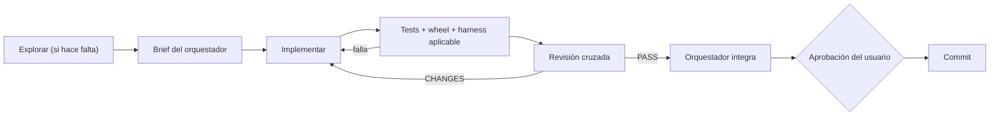

# Desarrollo de Roclec con agentes

Cómo se reparte el trabajo de **este repositorio** entre la sesión principal y los subagentes. Es el modelo operativo del desarrollo de Roclec, no una capacidad del producto: nada de lo que describe se instala en un consumidor. Los roles que Roclec instala en los proyectos consumidores se planifican aparte, en el [plan de evolución del flujo agéntico](strategy/plan-flujo-agentico-2026-11-17.md).

[`AGENTS.md`](../AGENTS.md) es la autoridad del repositorio: fija las zonas críticas y las reglas que todo rol sigue. Las definiciones de los roles son la fuente de su contrato; este documento las describe y registra su validación.

## Roles

Las columnas Claude Code y Codex son el **enlace** de cada rol: el modelo que lo ejecuta hoy. Cambiar el enlace no cambia el contrato (herramientas, responsabilidad y prohibiciones).

| Rol | Definición | Claude Code | Codex | Herramientas | Responsabilidad | Prohibido |
| --- | --- | --- | --- | --- | --- | --- |
| Orquestador | Sesión principal | Opus | Sol (`gpt-6.1-sol`) | Todas | Planificar, redactar briefs, integrar resultados, preparar commits, pedir decisiones | Aprobar en nombre del usuario; commit o push sin aprobación |
| Explorador | `roclec-dev-explorer` | `haiku` | `gpt-6-luna` | Solo lectura | Localizar código, usos e impacto; citar `archivo:línea` | Editar; emitir juicios de diseño |
| Implementador estándar | `roclec-dev-implementer` | `sonnet` | `gpt-6.1-terra` | Lectura, edición, tests | Cambios con especificación cerrada fuera de zonas críticas | Commit; tocar archivos fuera del brief; cambiar interfaces públicas sin aviso |
| Implementador crítico | `roclec-dev-critical-implementer` | `opus` | `gpt-6.1-sol` | Lectura, edición, tests | Cambios en las zonas críticas de `AGENTS.md` | Igual que el estándar |
| Revisor | `roclec-dev-reviewer` | `opus` | `gpt-6.1-sol` | Solo lectura | Revisión independiente del diff contra brief, `AGENTS.md` e invariantes; revisa solo el trabajo del otro host | Editar; revisar su propio trabajo |

La planificación y las decisiones se quedan en la sesión principal porque necesitan todo el contexto y diálogo con el usuario. "Decidir" significa recomendar: las decisiones del usuario, los commits, el remoto y cualquier publicación son del usuario.

## Dónde viven las definiciones

- `.claude/agents/roclec-dev-*.md` y `.codex/agents/roclec-dev-*.toml`, en la raíz del repositorio y versionados con el código. No entran en el wheel ni en el sdist.
- Son autocontenidas: no citan planes, que son temporales. Su única autoridad externa es `AGENTS.md`.
- No copian el contenido de las skills de Roclec: lo referencian.
- El TOML de Codex se genera desde el Markdown de Claude; ambos se mantienen en sincronía.
- Codex necesita `multi_agent` activo y el proyecto marcado como confiable para leer `.codex/agents/`.

## Contrato de traspaso

Cada brief del orquestador incluye:

1. Objetivo y hallazgo que atiende.
2. Archivos permitidos; todo lo demás queda fuera.
3. Criterios de aceptación y escenarios que deben existir o pasar.
4. Comandos de verificación.
5. Prohibiciones específicas de la tarea.

Cada resultado vuelve con:

- **Explorador:** hallazgos con `archivo:línea`, sin propuestas de diseño.
- **Implementador:** resumen del diff, salida de tests y lo que no pudo verificar.
- **Revisor:** veredicto `PASS` o `CHANGES`, y hallazgos con severidad y `archivo:línea`.

## Flujo por tarea

Proporcionalidad: las tareas pequeñas las hace el orquestador solo, porque el traspaso cuesta más que el ahorro.

Escalado:

- Dos iteraciones fallidas de implementación o revisión: la tarea pasa al orquestador.
- Cualquier cambio en interfaz pública (comandos, flags, esquema JSON, `model_schema`, formato de perfil): se detiene y se consulta al usuario.
- Un hallazgo del revisor en zona crítica lo resuelve el orquestador; no se descarta sin motivo escrito.

## Definición de terminado

Una tarea está terminada cuando:

- `PYTHONPATH=src python3 -m unittest discover -s tests -v` pasa;
- el wheel se construye;
- el harness corre sobre ese wheel cuando la tarea toca CLI, operaciones o assets (`--spec-kit` si toca assets o adaptador);
- el revisor dio `PASS`;
- la documentación afectada está actualizada;
- no hay cambios fuera de los archivos del brief.

## Ramas y aprobaciones

- Una rama por pista, en su propio worktree. Ninguna se fusiona sin aprobación del usuario.
- Pistas paralelas solo si no tocan los mismos archivos; las zonas críticas compartidas se ordenan, no se editan a la vez.
- Requieren al usuario siempre: commits, cambios del remoto, mover evidencia fuera del repo, decisiones de planes, campañas semánticas y cualquier acción en el repositorio de un piloto.

## Validación de hosts

Antes de usar un enlace nuevo se comprueba que el host lee las definiciones del proyecto y ejecuta cada rol con su modelo. Última validación: 21 de noviembre de 2026.

| Host | Versión | Formato | Resultado |
| --- | --- | --- | --- |
| Codex | CLI 0.163.0-alpha.10.2 | `.codex/agents/<nombre>.toml` con `name`, `description`, `model`, `sandbox_mode` y `developer_instructions` | Los cuatro roles respondieron como subagentes; los rollouts registran el modelo real de cada uno. `gpt-6.2-sol` figura en la caché de modelos, pero la API lo rechaza con una cuenta ChatGPT (`model_not_found`), por eso Sol usa `gpt-6.1-sol` |
| Claude Code | 2.1.304 | `.claude/agents/<nombre>.md` con frontmatter `name`, `description`, `tools` y `model` | Los cuatro roles respondieron como subagentes con su modelo (`claude-haiku-5-5`, `claude-sonnet-5-5`, `claude-opus-5-5`). El modelo es el declarado por cada subagente; Claude Code no expone un registro por sesión equivalente al rollout de Codex |

## Experimento de reparto de modelos

El reparto por modelos es una hipótesis, no una decisión. Se mide con la regla del plan global: línea base, hipótesis, comparación y decisión.

- **Hipótesis:** explorar con modelo barato e implementar con modelo medio reduce coste sin empeorar la corrección, siempre que haya revisión cruzada.
- **Qué se registra por tarea:** iteraciones de implementación, hallazgos del revisor por severidad, defectos detectados después de terminar la tarea, intervenciones del usuario y tokens o coste si la herramienta los expone (si no, se registra como desconocido).
- **Muestras (propuesta pendiente del usuario):** línea base con el orquestador solo en TD.2 (crítica) y TD.5 (estándar) del plan del flujo agéntico; flujo de subagentes en las tareas comparables TO.1 y TO.5. Se decide al cerrar ambas fases.
- **Umbrales para mantener el reparto (propuesta pendiente del usuario):**
  - defectos escapados de severidad `major` o superior: cero; uno solo obliga a ajustar o abandonar;
  - iteraciones de implementación por tarea: dos como máximo;
  - hallazgos `major` o superiores del revisor: no más que la línea base más uno por tarea;
  - intervenciones del usuario: no más que la línea base;
  - coste: al menos un 20 % menos de tokens o coste que la línea base; si el host no lo expone, se decide solo por los criterios de calidad.
- **Decisión:** se mantiene, ajusta o abandona el reparto. Los defectos escapados pesan más que el ahorro.

## Riesgos

- **Traspaso costoso:** los subagentes empiezan sin contexto. Mitigación: proporcionalidad.
- **Errores sutiles en zonas críticas:** mitigación con implementador crítico, revisión cruzada y harness.
- **Cambio de catálogo de modelos o del soporte de subagentes:** mitigación con la validación de hosts antes de cada fase y contratos que no dependen del modelo.
- **Deriva entre hosts:** dos archivos por rol pueden divergir. Mitigación: el TOML se genera desde el Markdown y la validación de hosts compara ambos.
- **Falsa independencia:** dos modelos distintos pueden compartir sesgos. Mitigación: el revisor de cada host revisa solo el trabajo del otro y declara sus límites.
- **Colisiones entre pistas paralelas:** mitigación con worktrees y orden fijo en las zonas críticas.
