# Flujos de trabajo de Roclec

Esta guía describe el flujo nativo del perfil 3 después de [instalar las skills](c3.md#instalación-nativa-y-aliases). Abre el proyecto en Codex o Claude Code y describe el resultado que buscas. El coordinador consulta los registros del proyecto, elige las skills y ejecuta las operaciones de Roclec.

[Ver o descargar el SVG](diagrams/flujo-roclec.svg)

## Flujo por defecto

Cada proyecto declara su flujo en `.roclec/flow.toml`. Roclec lo siembra una vez con el flujo por defecto, que describe esta sección, y los refrescos no lo sobrescriben. La tabla y el diagrama siguientes se generan a partir del `flow.toml` sembrado (están en inglés, como el archivo). Un proyecto regenera su propia vista con `roclec views --write`, que escribe `docs/flow.md` (o la ruta `view` del flujo). Si el proyecto edita su flujo, su vista deja de coincidir con esta.

| Step | Stage | Description | AI | Role | Skills and model | Deliverables | Human checkpoint | Criteria | On reject |
| --- | --- | --- | --- | --- | --- | --- | --- | --- | --- |
| 1 | foundation | Agree the project references (constitution, ADRs, process) before changes depend on them. | yes | coordinator | session model | — | owner | CR-001 | revise |
| 2 | define | Capture discovery and draft the capability/change bundle with sources and acceptance criteria. | yes | specifier | session model | — | — | — | — |
| 3 | approve | Approve the exact intent of the change; approval freezes its digest. | no: Only a person decides which intent is accepted. | owner | — | — | owner | CR-002, CR-003 | revise |
| 4 | design | Produce and review user-facing design or prototypes before implementation. | yes | coordinator | session model | — | owner | CR-004 | revise |
| 5 | plan | Assign the approved change to a release and plan the implementation work. | yes | implementer | session model | — | — | — | — |
| 6 | implement | Implement the approved change within its declared scope. | yes | implementer | session model | — | — | — | — |
| 7 | verify | Run the configured checks and record evidence covering the acceptance criteria. | yes | implementer | session model | — | — | — | — |
| 8 | review | Independent review of the candidate; findings stay open until resolved or decided. | yes | reviewer | session model | — | — | — | — |
| 9 | integrate | Integrate the verified, reviewed candidate per component. | yes | coordinator | session model | — | — | — | — |
| 10 | release | Verify the combined release, prepare it and record the existing Git publication. | yes | coordinator | session model | — | — | — | — |

Criterios del flujo por defecto:

| ID | Text |
| --- | --- |
| CR-001 | The reference reflects the practice the user agreed. |
| CR-002 | Every origin criterion is covered, excluded or deferred. |
| CR-003 | The proposal states the intended behavior. |
| CR-004 | The prototype matches the approved intention. |

```mermaid
flowchart LR
  S1["1. foundation [checkpoint]"]
  S2["2. define"]
  S3["3. approve [person] [checkpoint]"]
  S4["4. design [checkpoint]"]
  S5["5. plan"]
  S6["6. implement"]
  S7["7. verify"]
  S8["8. review"]
  S9["9. integrate"]
  S10["10. release"]
  S1 --> S2 --> S3 --> S4 --> S5 --> S6 --> S7 --> S8 --> S9 --> S10
  classDef person fill:#fde68a,stroke:#92400e;
  classDef checkpoint stroke:#1d4ed8,stroke-width:3px;
  class S3 person;
  class S1,S3,S4 checkpoint;
```

Las diez etapas son fijas y van en este orden; el proyecto las parametriza, pero no agrega etapas, no las reordena ni quita sus puntos de control obligatorios (fundación, aprobación y diseño). Los puntos de control opcionales de implementar, integrar y release (`pre-implement`, `pre-integrate`, `handoff`) se activan declarándolos en esas etapas. Un gancho nuevo requeriría su propio hallazgo. El detalle del archivo, los acuerdos y los comandos está en [El flujo declarado](c1.md#el-flujo-declarado).

Cada etapa también declara `session_evidence`. El flujo sembrado la exige (`required`) en todas las etapas con IA: el gate que cierra la etapa pide al menos una sesión de agente importada que cite el cambio y la etapa, y falla con `SESSION_REQUIRED` si falta. La etapa de aprobación, al ser `ai = false`, no puede exigirla. El proyecto puede relajarla a `optional` y volver a acordar el flujo. Qué se guarda y cómo se versiona está en [Sesiones de agente](c2.md#sesiones-de-agente-como-evidencia).

La etapa de aprobación es siempre de una persona (`ai = false`). Para una etapa sin IA, Roclec registra el actor declarado y no puede probar quién la ejecutó.

## Iniciar un cambio

> Roclec, añade un filtro de registros por fecha y lleva el cambio hasta la integración.

El coordinador agrupa las etapas del flujo declarado en estas fases y se detiene en cada punto de control y en cada etapa sin IA.

| Fase | Trabajo del coordinador | Resultado que puedes revisar |
| --- | --- | --- |
| Definir | Busca cambios relacionados, consulta el contrato vigente y prepara la propuesta. Aclara las decisiones que afecten el comportamiento, los permisos o el alcance, y redacta como ADR propuesto la decisión de arquitectura que lo merezca. | ID del cambio, propuesta, criterios de aceptación y ADR que aplica, o ninguno con su motivo. |
| Aprobar y preparar | Registra la aprobación explícita de esa propuesta. Reúne las referencias de fundación, incorpora diseño cuando aplica y prepara el plan y las tareas proporcionales al cambio. Asigna la versión acordada o la que determine la política del proyecto. | Propuesta aprobada, referencias aplicables y release asignada por componente. |
| Implementar y verificar | Comprueba los prerrequisitos, implementa en el repositorio del componente y ejecuta las pruebas del perfil, registrando qué rol y qué contexto produjeron el run. Vincula la evidencia al candidato y obtiene la revisión independiente en un contexto distinto cuando la política está habilitada por defecto o explícitamente. | Código, resultados de comprobación y cobertura de los criterios aplicables. |
| Integrar | Sigue el proceso Git autorizado. Con el repositorio de código limpio y el candidato presente en la rama destino configurada, prepara y aplica la integración desde la troncal de specs. | Registro de integración del componente y revisión vigente del contrato. |

La propuesta conserva una copia Markdown de cada origen y relaciona sus criterios con los criterios de aceptación, exclusiones o diferimientos. El coordinador presenta las exclusiones y diferimientos antes de aprobar. Captura solo el texto necesario y redacta datos personales antes de sellar. Si la fuente cambia, incorporar su texto actualizado crea otra revisión que requiere aprobación. Puedes consultar la cobertura con `inspect --change CHG-001` y buscar cambios con `list changes --origin ID`.

Si tienes una idea que todavía quieres investigar, pide «Roclec, registra esta idea para evaluarla». Se puede capturar como FUT con su fuente y sus preguntas. Si luego se promueve, el coordinador sigue el destino registrado y comprueba si el cambio ya tiene aprobación. [Autoría y descubrimiento](c1.md)

## Roles que intervienen

El coordinador es tu propia sesión. Cuando el host admite subagentes, delega etapas acotadas en los roles que instala Roclec y vuelve a inspeccionar el estado registrado después de cada resultado:

| Rol | Etapas | Lo que no puede hacer |
| --- | --- | --- |
| `roclec-specifier` | Definir, aclarar y analizar la propuesta | Aprobar; tocar código o snapshots aprobados |
| `roclec-implementer` | Planificar, desglosar e implementar un componente | Cambiar la intención aprobada; editar otros componentes |
| `roclec-reviewer` | Revisar el candidato y registrar la evidencia | Editar código o specs; revisar su propio trabajo |

- **Decisiones.** Siguen siendo tuyas. Un rol no puede preguntarte: devuelve sus preguntas abiertas al coordinador, que te las presenta.
- **Proporcionalidad.** Un cambio pequeño lo hace el coordinador solo, porque el traspaso costaría más que el trabajo. La revisión independiente nunca la hace él.
- **Sin subagentes.** Si el host no los admite, o Codex no carga los roles porque el proyecto no es de confianza, el coordinador sigue en secuencia y lo declara. Sin un contexto separado, la revisión queda `incomplete`.
- **Independencia declarada.** El gate rechaza una revisión que declara el mismo contexto que el run revisado. Roclec comprueba lo declarado, no la independencia real.

[Roles, archivos y modelo por rol](c3.md#roles-de-agente)

## Sesiones y aprendizaje del flujo

Al cerrar una etapa con `session_evidence = "required"`, el coordinador registra la sesión de cada rol que intervino con `roclec evidence record --kind agent-session`, o te pide la exportación si el agente no puede obtenerla; nunca inventa un transcript. Roclec guarda el archivo sin interpretarlo, con su huella SHA-256. Los registros que esa sesión produjo la citan con `--session`, y la revisión independiente cita en `context` la sesión del revisor. La política `[sessions] storage` decide qué queda en Git (`local`, `versioned-redacted` por defecto o `versioned-raw`). Los transcripts contienen código, rutas, nombres y posibles datos personales: revisa la política antes de versionarlos, porque la redacción solo cubre lo que el perfil declara. [Almacenamiento, privacidad y gates](c2.md#sesiones-de-agente-como-evidencia)

Cuando una etapa te estorba, el coordinador lo captura como FUT de proceso (`scope` `process`) y, al acordar la nueva revisión del flujo, la decisión cita los FUT que atiende y el motivo. `roclec views --write` agrega a la vista del flujo la sección «Flow learning» con lo que muestran los registros, sin juicios: revisiones del flujo, rechazos por etapa, hallazgos, etapas sin IA y sesiones por rol y etapa. `docs/flow-retro.md`, que Roclec siembra una vez y no sobrescribe, es tu espacio para la reflexión que los datos no derivan. [Aprendizaje del flujo](c2.md#aprendizaje-del-flujo)

## Skills de conocimiento

Además de las skills de procedimiento que instala Roclec, el proyecto puede registrar sus propias skills de conocimiento (convenciones, patrones, procedimientos) como referencias de fundación. Entran al flujo en tres puntos:

- **Fundación.** El coordinador inventaría las convenciones del proyecto con `roclec-foundation`, propone registrarlas con `reference add ... --role skill` y las acuerdas con `foundation agree`. Una skill sin acuerdo no se aplica.
- **Coordinador.** Al aprobar, la decisión fija las skills aplicables. En cada etapa el coordinador lee `inspect --change` (sección `skills`) y entrega a cada rol, en su encargo, solo las skills de esa etapa y componente. Si una skill quedó `stale`, el gate de implementación se detiene hasta que la acuerdes de nuevo.
- **Revisión.** El revisor verifica que el candidato respete las skills aplicadas y declara cuáles comprobó.

Los roles aplican las skills recibidas y declaran en su salida de texto las que usaron. La vista del flujo agrega la sección «Knowledge skills» solo cuando hay skills registradas, aunque aún no estén acordadas; el mapa de autoridad de `AGENTS.md`/`CLAUDE.md`, en cambio, solo lista las acordadas. Registro, fijación y mapa de autoridad: [Skills de conocimiento](c1.md#skills-de-conocimiento).

## Hallazgos de revisión

La revisión registra hallazgos con severidad, ubicación, criterios afectados, condición e impacto. Cada hallazgo conserva su clave `EVD-ID#F-n` al cambiar el candidato. El implementador cita las claves que atendió y una revisión posterior declara cuáles quedaron corregidas o siguen abiertas. El coordinador te presenta los hallazgos materiales que no se pueden corregir dentro del alcance para que decidas si aceptas el riesgo, los consideras inválidos o los difieres a un FUT.

La revisión está habilitada por defecto. Un perfil sin configuración de revisión exige revisión y trata `major` y `blocker` como materiales. Con revisión habilitada, verificar e integrar requieren un informe `ready` vigente y ningún hallazgo material abierto. Los hallazgos menores abiertos se informan. Puedes pedir la lista de un cambio o de una release, y la inspección muestra su estado y el registro que lo produjo. [Detalle y comandos](c2.md#ciclo-de-vida-de-hallazgos)

## Retomar o consultar

> Roclec, retoma el cambio del filtro por fecha y llévalo hasta la integración.

También puedes dar el ID del cambio, como `CHG-001`. El coordinador inspecciona la propuesta y su aprobación vigentes, la asignación de release, el progreso por componente y la evidencia. Si un componente ya está integrado, conserva ese resultado y continúa con el que falta. Si se interrumpió una operación, inspecciona el diario de recuperación antes de volver a escribir.

Para consultar únicamente, pide «Roclec, ¿en qué estado está el cambio del filtro por fecha?». La consulta es de solo lectura.

## Cuándo intervienes

- **Alcance o aprobación.** El coordinador muestra la propuesta concreta y pregunta por la decisión pendiente. Si un cambio de alcance genera una revisión nueva, la aprobación debe corresponder a esa revisión.
- **Decisiones de arquitectura.** El coordinador te presenta cada ADR propuesto con sus alternativas y consecuencias. Solo tu acuerdo lo acepta, y la implementación espera a que todos los ADR citados estén aceptados. [ADR](c1.md#decisiones-de-arquitectura-adr)
- **Rechazos y correcciones.** Puedes rechazar una propuesta, ADR, referencia o prototipo indicando qué corregir y si deseas revisar, cancelar o diferir. El coordinador registra tu actor y motivo, conserva el contenido rechazado y presenta la revisión y las correcciones disputadas para tu decisión. [Rechazos y prototipos](c1.md#rechazos-y-prototipos)
- **Puntos de control del flujo.** Fundación, aprobación y diseño, y los ganchos opcionales que declare el proyecto, esperan tu decisión con tu evaluación de los criterios declarados. Ni el gate ni un agente la registran por ti. [El flujo declarado](c1.md#el-flujo-declarado)
- **Diseño, versión o política.** Intervienes si la decisión es material y el proyecto aún no tiene una regla o un acuerdo aplicable.
- **Evidencia o aceptación externa.** Por ejemplo, una validación en un dispositivo al que el agente no tiene acceso, una revisión independiente exigida o una aprobación de Git que depende de otra persona.

El agente puede resolver dentro del alcance tareas como reunir archivos, corregir una prueba o regenerar evidencia después de un cambio. Un bloqueo técnico que persista se informa con su causa y el estado alcanzado. [Verificación, integración y recuperación](c2.md)

## Preparar una release y registrar publicación

> Roclec, verifica y prepara la próxima release del componente con los cambios integrados.

1. El agente inspecciona la versión y sus miembros, y verifica el contrato final del conjunto con una ejecución propia de la release.
2. Si la evidencia está vigente y las comprobaciones se cumplen, aplica la preparación de la release y entrega su identificador.
3. Cuando la publicación Git exista, puedes pedir «Roclec, registra la publicación de esta versión». El agente comprueba el commit y el tag local y remoto antes de registrarlos. La publicación y el despliegue siguen la política del proyecto.

[Guía de release final](c3.md)
