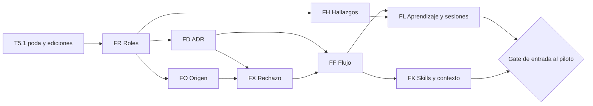

# Plan de evolución del flujo agéntico

Fecha: 17 de noviembre de 2026, revisado el 21 de noviembre de 2026. **Estado: decisiones D9–D37 resueltas por el usuario; ejecución autorizada el 21 de noviembre de 2026.** Cambia el modelo, los gates, el perfil y la instalación que reciben los consumidores.

Relación con otros documentos:

- El [plan de mejoras](plan-mejoras-2026-11-17.md) define los hallazgos M-01…M-27, las fases F0–F5 y las decisiones D1–D8. Este plan agrega los hallazgos M-28…M-35 y las decisiones D9–D37 y, por la excepción D9, amplía el alcance previo al piloto.
- El [plan global](plan-global.md) sigue siendo la autoridad de dirección. Si una tarea no corresponde a un hallazgo, no entra.
- Cómo se reparte el trabajo de este repositorio entre agentes (roles `roclec-dev-*`, traspaso, revisión cruzada, definición de terminado) es el modelo de desarrollo, descrito en [Desarrollo de Roclec con agentes](../desarrollo-con-agentes.md). No forma parte del producto ni de este plan.

Las tareas que dependen de una decisión Dn esperan a que el usuario la resuelva.

### Alcance

Capacidades del flujo agéntico que Roclec ofrece al consumidor: lo que cualquier proyecto que adopte Roclec recibe para trabajar con un flujo agéntico explícito, justificado, trazable y repetible, versionado en ese proyecto.

- Sección 2: roles de agente con responsabilidades separadas y contrato declarado.
- Sección 3: decisiones de arquitectura (ADR) como registro con ciclo de vida y trazabilidad.
- Sección 4: origen del cambio y cobertura de sus criterios como inicio de la cadena de trazabilidad.
- Sección 5: ciclo de vida de los hallazgos de revisión, desde que se registran hasta su resolución.
- Sección 6: rechazo humano como evento con correcciones, consecuencia y vínculo con la revisión que lo atiende.
- Sección 7: flujo explícito y acotado, con uso de IA, roles, entregables y puntos humanos declarados por el proyecto.
- Sección 8: aprendizaje del flujo y evidencia de las sesiones con agentes.
- Sección 9: skills de conocimiento del proyecto y archivo de contexto que gobierna la generación.

### Mapa de capacidades

| Necesidad del flujo agéntico | Sección | Fase | Hallazgo |
| --- | --- | --- | --- |
| Subagentes con responsabilidades separadas y definiciones versionadas | 2 | FR | M-28 |
| Decisiones de arquitectura con contexto, alternativas y consecuencias | 3 | FD | M-29 |
| Cada cambio con su spec antes de implementar, trazable a su origen | 4 | FO | M-30 |
| Revisión con hallazgos y su resolución | 5 | FH | M-31 |
| Evidencia de que la persona corrigió al agente | 6 | FX | M-32 |
| Flujo paso a paso con uso de IA y puntos humanos | 7 | FF | M-33 |
| Ajustes del flujo y evidencia de las sesiones | 8 | FL | M-34 |
| Skills con conocimiento del proyecto y contexto global con sus convenciones | 9 | FK | M-35 |

La trazabilidad completa origen → spec → ADR → código → pruebas → revisión resulta de combinar las secciones 3 a 5 con los registros existentes de candidato, run y cobertura por AC.

Principio común (sección 2.1): el contrato del rol es neutral y versionado en el proyecto; el modelo concreto y el formato del host son un enlace que no forma parte del contrato. El [modelo de desarrollo](../desarrollo-con-agentes.md) aplica el mismo principio a los roles `roclec-dev-*` de este repositorio.

### Hallazgos que incorpora esta revisión

| ID | Hallazgo | Evidencia | Fase |
| --- | --- | --- | --- |
| M-28 | El flujo instalado en el consumidor usa un solo agente: el coordinador ejecuta todas las skills en su propio contexto. No hay roles con responsabilidades separadas ni definiciones (instrucciones, herramientas, entradas y salidas) versionadas en el proyecto. El revisor exige un contexto independiente sin que el framework provea un mecanismo para obtenerlo. | [roclec-coordinator](../../src/roclec_spec_kit/assets/skills/roclec-coordinator/SKILL.md) («A separate agent is unnecessary»), [roclec-reviewer](../../src/roclec_spec_kit/assets/skills/roclec-reviewer/SKILL.md), [installation.py](../../src/roclec_spec_kit/installation.py) (solo instala skills e instrucciones) | FR, antes del piloto (D9) |
| M-29 | Las decisiones de arquitectura no son un registro propio. Viven como secciones dentro de la spec, el plan o la constitución de cada cambio, sin formato común, sin estados (propuesta, aceptada, sustituida), sin supersesión y sin vínculo consultable entre un cambio y las decisiones que aplica. Ningún rol de referencia corresponde a un ADR y ningún gate impide avanzar con una decisión sustituida o sin aceptar. El plan global propone ADRs con supersesión y la ruta `decisions/NNN-titulo.md` como convención no implementada. | [plan-global.md §10](plan-global.md) («convenciones propuestas, no cambios ya implementados»), [kernel.py](../../src/roclec_spec_kit/kernel.py) (roles válidos de referencia), [model.md](../../src/roclec_spec_kit/assets/project/model.md) (`references.json`), [plantillas](../../src/roclec_spec_kit/assets/templates/) («Decisions and alternatives») | FD, antes del piloto (D9) |
| M-30 | El cambio no tiene origen estructurado. Solo el FUT registra `source {location, locator}` y su promoción enlaza FUT → CHG; un cambio pedido directamente (historia de usuario, ticket, incidente o pedido en el chat) deja su origen como texto libre en «Context and provenance». Una fuente externa puede editarse después de aprobar sin registro del texto aprobado. No se mapean los criterios del origen a AC, no se distingue qué AC surgió de un hueco detectado en el origen y no hay consulta de qué cambios provienen de un origen. | [model.md](../../src/roclec_spec_kit/assets/project/model.md) (semántica del cambio sin origen; «A PR URL or SHA-shaped string alone is insufficient»), [kernel.py](../../src/roclec_spec_kit/kernel.py) (`source` solo en FUT), [roclec-idea](../../src/roclec_spec_kit/assets/skills/roclec-idea/SKILL.md), [spec-template.md](../../src/roclec_spec_kit/assets/templates/spec-template.md) | FO, antes del piloto (D9) |
| M-31 | Los hallazgos de revisión no tienen ciclo de vida. Solo admiten `{id, description}` con ID único dentro de su EVD, así que severidad, ubicación y AC quedan en prosa. Una revisión posterior no puede citar un hallazgo anterior ni declarar su resolución; cuando cambia el candidato, la revisión previa pasa a historial y sus hallazgos dejan de existir para el gate. Un `ready` con hallazgos abiertos los oculta. Aceptar un riesgo o diferir un hallazgo no tiene actor ni motivo, y la política de revisión es opcional por cambio, sin valor por defecto en el proyecto. | [verification.py](../../src/roclec_spec_kit/verification.py) (validación de `findings` y gate `REVIEW_REQUIRED`), [report-template.md](../../src/roclec_spec_kit/assets/skills/roclec-reviewer/references/report-template.md), [model.md](../../src/roclec_spec_kit/assets/project/model.md) (evidencia importada) | FH, antes del piloto (D9) |
| M-32 | El rechazo humano no se registra. Existen aprobación (`change-approve`), acuerdo (`foundation`), cancelación (`change-cancel`) y descarte de FUT, pero no un rechazo de propuestas de cambio, ADR, referencias o prototipos. Al revisar un borrador rechazado se crea otro digest y el contenido rechazado se pierde, porque solo las revisiones aprobadas se congelan y el borrador puede no haber llegado a Git. No hay vínculo entre lo que la persona pidió corregir y la revisión que lo atendió, ni una consecuencia declarada del rechazo. La aprobación visual de prototipos no tiene registro propio. | [kernel.py](../../src/roclec_spec_kit/kernel.py) (`approve`, `cancel`, tipos de decisión), [native_cli.py](../../src/roclec_spec_kit/native_cli.py) (sin `reject`), [roclec-prototype](../../src/roclec_spec_kit/assets/skills/roclec-prototype/SKILL.md) («record the user's decision with provenance» sin registro definido) | FX, antes del piloto (D9) |
| M-33 | El flujo no está declarado por el proyecto. Las etapas y los gates están fijos en el código y descritos en prosa en un `workflow.md` administrado que el consumidor no edita; la guía y el diagrama del flujo documentan el framework, no cada proyecto. Ningún registro indica por etapa si usa IA (o por qué no), qué rol la ejecuta, qué entrega, quién aprueba, con qué criterios y qué ocurre si rechaza. Las aprobaciones registran actor y motivo, pero no los criterios evaluados. El proyecto no puede agregar puntos de control humanos propios ni comprobar que un cambio pasó por ellos. | [kernel.py](../../src/roclec_spec_kit/kernel.py) (`gate`), [workflow.md](../../src/roclec_spec_kit/assets/project/workflow.md), [roclec-coordinator](../../src/roclec_spec_kit/assets/skills/roclec-coordinator/SKILL.md), [flujo-roclec.md](../flujo-roclec.md) | FF, antes del piloto (D9) |
| M-34 | No queda evidencia de las sesiones con agentes ni del aprendizaje del flujo. Solo se capturan los logs de los checks del perfil; ningún registro conserva la sesión que produjo un bundle, run, revisión o decisión, y el campo `context` de la revisión es texto libre. Los FUT no distinguen fricciones del proceso de las del producto, las revisiones del flujo no enlazan la fricción que las motivó y no hay vista que reúna rechazos, hallazgos, ajustes del flujo y etapas sin IA, ni un lugar para la reflexión humana sobre el flujo. | [run_logs.py](../../src/roclec_spec_kit/run_logs.py) (captura solo de checks), [verification.py](../../src/roclec_spec_kit/verification.py) (`context` libre), [kernel.py](../../src/roclec_spec_kit/kernel.py) (FUT sin ámbito), [semantic_record.py](../../scripts/semantic_record.py) (telemetría solo de desarrollo) | FL, antes del piloto (D9) |
| M-35 | Roclec no distingue skills de procedimiento de skills de conocimiento del proyecto. Instala sus 17 skills y restaura skills externas, pero las skills propias del consumidor quedan invisibles: no se registran, acuerdan ni fijan en el cambio, no se asignan a etapas ni componentes y pueden divergir entre hosts. El bloque administrado de `AGENTS.md`/`CLAUDE.md` solo enruta al coordinador y no muestra las convenciones acordadas que todos los agentes deben seguir; el mapa de entrada que propone el plan global no está implementado. No hay plantilla para skills de conocimiento. | [installation.py](../../src/roclec_spec_kit/installation.py) (bloque administrado y skills instaladas), [agent-instructions.md](../../src/roclec_spec_kit/assets/project/agent-instructions.md), [external_skills.py](../../src/roclec_spec_kit/external_skills.py), [plan-global.md §10](plan-global.md) («mapa breve de entrada y enlaces») | FK, antes del piloto (D9) |

## 1. Ejecución

Las tareas de la sección 11 se ejecutan con el [modelo de desarrollo](../desarrollo-con-agentes.md): su columna «Rol» indica el rol responsable, cada tarea sigue el contrato de traspaso y la definición de terminado de ese documento, y las tareas en zonas críticas usan implementador crítico y revisión cruzada. Este plan no redefine esos roles.

## 2. Roles que Roclec instala en el proyecto consumidor

Objetivo: que un proyecto que adopta Roclec reciba roles de agente con responsabilidades separadas y un contrato declarado (instrucciones, herramientas, entradas y salidas), versionados en su propio repositorio desde que ejecuta `roclec skills`. Atiende M-28.

### 2.1 Contrato y enlace

- **Contrato** (neutral, versionado): responsabilidad, skills que usa, permisos expresados como capacidades (leer, editar dentro de las rutas del componente, ejecutar los checks del perfil, registrar evidencia), entradas, salidas, prohibiciones y reglas de escalado. Vive como asset canónico en el wheel (`assets/agents/`) y no menciona proveedores ni modelos.
- **Enlace** (por host, generado): el archivo con el formato que cada host lee, generado desde el contrato durante la instalación, igual que hoy se copian las skills a `.claude/` y `.agents/`.
- **Modelo:** no forma parte del contrato. Según D10, el perfil del consumidor puede fijarlo de forma opcional por rol y por host; la instalación lo escribe en el enlace generado. Si el perfil no lo indica, el rol hereda el modelo de la sesión del host. Roclec no valida nombres de modelo: los pasa al host, que los acepta o rechaza.

  ```toml
  # profile.toml (opcional)
  [agents.implementer]
  claude = "nombre-de-modelo-del-host"
  codex = "nombre-de-modelo-del-host"
  ```

  El campo es una extensión compatible del perfil 3: un perfil sin `[agents]` sigue siendo válido. Un rol que no existe o un host no soportado se rechazan con remedio.

Esta separación sustituye el motivo original para dejar las definiciones fuera de los repositorios: el cambio de nombres de modelo ya no obliga a cambiar el contrato.

### 2.2 Roles

| Rol | Skills | Capacidades | Entrada | Salida | Prohibido |
| --- | --- | --- | --- | --- | --- |
| Coordinador | `roclec-coordinator` | Todas las del flujo; delegar | Pedido del usuario y estado registrado (`status`, `inspect`) | Delegaciones con brief, decisiones pedidas al usuario, informe final con IDs | Aprobar en nombre del usuario; integrar, publicar o desplegar sin autorización |
| Especificador | `roclec-specify`, `roclec-clarify`, `roclec-analyze`, `roclec-checklist` | Leer; escribir solo en la carpeta de trabajo del cambio | Intención, contrato vigente y referencias acordadas | Bundle sellado listo para aprobar, preguntas abiertas | Aprobar; editar snapshots aprobados; tocar código |
| Implementador | `roclec-plan`, `roclec-tasks`, `roclec-implement` | Leer; editar en las rutas de entrada del componente; ejecutar checks del perfil | CHG aprobado, componente, digest aprobado, AC aplicables | Candidato, run y resumen de lo no verificado | Commit fuera de la política Git del proyecto; tocar otros componentes; cambiar la intención aprobada |
| Revisor | `roclec-reviewer` | Solo lectura; registrar evidencia | CHG o release, componente, run y candidato | EVD de revisión con veredicto `ready`, `changes-needed` o `incomplete` y hallazgos | Editar código o specs; revisar trabajo propio |

Las demás skills (`roclec-foundation`, `roclec-constitution`, `roclec-ux`, `roclec-prototype`, `roclec-converge`, `roclec-release`, `roclec-idea`, `roclec-amend`) permanecen en el coordinador, porque requieren diálogo con el usuario o escriben en la troncal.

### 2.3 Ubicación en el consumidor

Todo vive dentro de la carpeta del proyecto consumidor y queda versionado en su Git:

```text
<consumidor>/
├── .claude/
│   ├── skills/roclec-*/        (ya instalado)
│   └── agents/roclec-*.md      (nuevo: enlace para Claude Code)
├── .codex/
│   └── agents/roclec-*         (nuevo: enlace para Codex; ruta y formato se confirman en TR.1)
├── .agents/skills/roclec-*/    (ya instalado)
└── AGENTS.md / CLAUDE.md       (bloque administrado que menciona los roles)
```

- Con `skills --into COMPONENTE`, los roles se instalan también en el repositorio de código del componente, porque el implementador trabaja ahí.
- Los archivos son administrados: llevan el marcador `managed by roclec-spec-kit`, se refrescan con `skills` y respetan la poda y la detección de ediciones locales de M-19.
- Un consumidor puede añadir roles propios junto a los de Roclec; la instalación no los toca.

### 2.4 Contrato de traspaso en el consumidor

El brief del coordinador a un rol incluye: CHG o release, componente, `proposal_digest` aprobado, AC aplicables, rutas permitidas (las de entrada del componente según el perfil), comandos de verificación del perfil y prohibiciones de la tarea. Cada salida se expresa como registro de Roclec (bundle, run o EVD) más un resumen de lo no verificado, de modo que el CLI pueda comprobar alcance y vigencia.

### 2.5 Delegación, proporcionalidad y degradación

- El coordinador delega a los roles instalados cuando el host lo soporta y reinspecciona el estado tras cada resultado. Sustituye la regla actual «A separate agent is unnecessary».
- Proporcionalidad: los cambios pequeños los hace el coordinador solo, porque el traspaso cuesta más que el ahorro. El criterio queda escrito en la skill.
- Degradación: en un host sin subagentes el flujo sigue secuencial en una sola sesión y lo declara como limitación. Nunca se presenta una autorrevisión como revisión independiente.

### 2.6 Independencia del revisor

La evidencia de revisión registra el rol y el contexto que la produjeron. El gate rechaza un informe cuyo contexto declarado coincide con el del implementador del mismo run. El CLI comprueba lo declarado, no la independencia real; esa limitación se mantiene explícita, como ya hace `roclec-reviewer`.

### 2.7 Decisiones del usuario

| ID | Decisión | Estado | Resolución |
| --- | --- | --- | --- |
| D9 | Si FR entra antes del piloto o después con disparador | Resuelta por el usuario el 20 de noviembre de 2026; ratificada el 21 de noviembre de 2026 | FR completa (TR.1–TR.8), incluida la independencia verificable, entra **antes del piloto**. Es una excepción explícita a la regla 2 del plan de mejoras, que impide subsistemas nuevos antes del piloto. La excepción cubre también los cambios que se incorporen a este plan para las demás capacidades del flujo agéntico. El 21 de noviembre se evaluó una FR mínima: delegación con el mecanismo nativo de cada host (`context: fork` en las skills de Claude Code, `spawn_agent` con `fork_turns="none"` en Codex) más TR.4 y TR.6, con TR.2, TR.3 y TR.7 pospuestas. El usuario la descartó y mantuvo FR completa. |
| D10 | Si el modelo puede fijarse por rol en la configuración del consumidor | Resuelta por el usuario el 20 de noviembre de 2026 | **Opcional en el perfil**, por rol y por host. Si falta, el rol hereda el modelo de la sesión del host. El asset canónico sigue sin nombrar modelos (sección 2.1). |

## 3. Decisiones de arquitectura (ADR) en el proyecto consumidor

Objetivo: que un proyecto que adopta Roclec registre sus decisiones de arquitectura con contexto, alternativas y consecuencias, con un ciclo de vida derivado y un vínculo verificable con los cambios que las aplican. Atiende M-29. Modelo elegido: híbrido (D11).

### 3.1 Registro

- Un ADR es un archivo Markdown propiedad del consumidor, en la ruta configurada en el perfil (D13, por defecto `docs/adr/`), con ID `ADR-NNN`.
- Se registra como referencia con el rol nuevo `decision` mediante `reference add`. `references.json` gana el campo `supersedes`, una lista de IDs de ADR, vacía por defecto y válida solo para ese rol.
- Registrar, actualizar y aceptar un ADR son operaciones solo de troncal, como el resto de la fundación (D2).
- Los ADR no se confunden con `.roclec/decisions/`, que guarda aprobaciones y acuerdos. La documentación lo explica y los IDs `ADR-` los distinguen.

### 3.2 Estado derivado

No hay campo de estado editable. El estado se calcula:

| Estado | Condición |
| --- | --- |
| `proposed` | Registrado sin acuerdo |
| `accepted` | Con acuerdo (`foundation agree`) cuya huella coincide con el archivo, y sin un ADR acordado que lo sustituya |
| `stale` | El archivo cambió después del acuerdo |
| `superseded` | Otro ADR con acuerdo registrado lo incluye en `supersedes` |
| `rejected` | La última decisión sobre su huella vigente es un rechazo (sección 6) |
| `withdrawn` | Un rechazo con consecuencia `cancel`; una nueva propuesta requiere otro ID |

Un ADR sustituido se conserva como historial. `check` rechaza ciclos de supersesión y referencias a ADR inexistentes.

### 3.3 Plantilla

`.roclec/templates/adr-template.md`, propiedad del consumidor y preservada por los refrescos, adaptada del formato que Roclec ya usa en sus propios `docs/decisions/`:

1. Contexto y problema.
2. Factores de decisión.
3. Opciones consideradas, al menos dos, con ventajas y desventajas.
4. Decisión.
5. Consecuencias: positivas, negativas y riesgos.
6. Verificación de cumplimiento: cómo comprobar que el código respeta la decisión.
7. Relaciones: ADR que sustituye y cambios relacionados.

Las secciones obligatorias se declaran en el perfil, con un valor por defecto igual a la plantilla. Un consumidor que adapte la plantilla ajusta esa lista.

### 3.4 Trazabilidad

- La semántica del cambio gana `architecture_decisions` (D12): una lista de IDs de ADR, o una declaración explícita de que no aplica ninguno con su motivo.
- Los ADR declarados quedan fijados por huella al aprobar, igual que las demás referencias del cambio.
- `inspect --change` muestra los ADR del cambio con su estado derivado. El selector nuevo `inspect --adr ADR-NNN` muestra el estado, la cadena de supersesión y los cambios que lo citan.

### 3.5 Gates

- **Aprobar:** exige que `architecture_decisions` esté declarado, ya sea como lista o como «ninguno» con motivo.
- **Implementar e integrar:** bloquean con remedio si un ADR citado está en `proposed`, `stale` o `superseded`.
- **Sustitución posterior:** un cambio ya integrado conserva la huella histórica del ADR que aplicó, sin invalidación retroactiva. Los cambios nuevos deben citar el reemplazo. El gate de release informa como limitación a los miembros que aplicaron un ADR ya sustituido, sin bloquear.

### 3.6 Comprobación estructural

Para cada referencia con rol `decision`, `check` comprueba que estén las secciones obligatorias, que haya al menos dos opciones y que la supersesión sea válida. Es una comprobación estructural: no certifica la calidad de la decisión.

### 3.7 Skills y roles

Criterio para crear un ADR: la decisión afecta a más de un cambio o componente, es costosa de revertir o tiene alternativas reales con consecuencias materiales. Las demás decisiones siguen en «Decisions and alternatives» del plan.

| Skill o rol | Responsabilidad sobre los ADR |
| --- | --- |
| `roclec-foundation` | Inventaría los ADR existentes y los registra sin reescribirlos |
| `roclec-specify`, `roclec-clarify` | Detectan decisiones que cumplen el criterio, redactan el ADR desde la plantilla y declaran `architecture_decisions` |
| `roclec-plan` | Cita los ADR en «Decisions and alternatives» y deja allí solo las decisiones locales |
| `roclec-analyze` | Revisa la coherencia entre spec, plan y ADR citados |
| `roclec-reviewer` | Registra como hallazgo el código que contradice un ADR citado, usando su sección de verificación de cumplimiento |
| Especificador (sección 2.2) | Redacta ADR propuestos; nunca los acepta |
| Coordinador | Pide al usuario la aceptación; solo `foundation agree` con actor real los acepta |

### 3.8 Decisiones del usuario

| ID | Decisión | Estado | Resolución |
| --- | --- | --- | --- |
| D11 | Modelo de ADR: rol nuevo de referencia, entidad nueva o híbrido | Resuelta por el usuario el 20 de noviembre de 2026 | Híbrido: Markdown del consumidor registrado como referencia con rol `decision`, `supersedes` y estado derivado |
| D12 | Exigencia por cambio | Resuelta por el usuario el 20 de noviembre de 2026 | Cada cambio declara los ADR que aplican o «ninguno» con motivo |
| D13 | Ruta por defecto | Resuelta por el usuario el 20 de noviembre de 2026 | Configurable en el perfil; por defecto `docs/adr/`. Al incorporar este plan al plan global se sustituye la convención `decisions/NNN-titulo.md` de su sección 10 |

## 4. Origen del cambio y cobertura de sus criterios

Objetivo: que todo cambio declare de dónde viene, conserve el texto exacto que se aprobó y muestre cómo cada criterio del origen quedó cubierto, excluido o diferido, y qué AC agregó la spec por huecos detectados. Atiende M-30. Modelo elegido: campo `origins` en la semántica del cambio (D14).

### 4.1 Origen

La semántica del cambio gana `origins`, una lista con al menos un elemento (D15). Cada origen declara:

| Campo | Contenido |
| --- | --- |
| `kind` | `fut`, `story`, `issue`, `incident` o `request` |
| `id` | Identificador en la fuente (por ejemplo, el ID de la historia o del ticket) o el `FUT-NNN` |
| `locator` | Ubicación de la fuente: ruta en el repositorio o dirección externa |
| `captured` | Ruta a una copia en Markdown del texto del origen dentro del bundle (D17) |
| `criteria` | IDs estables de los criterios que trae el origen, cuyo texto está en la copia capturada; lista vacía si no trae criterios |

- La copia capturada forma parte de `semantic.files`, así que el `proposal_digest` la fija al aprobar. Si la fuente cambia después, el cambio conserva el texto aprobado; incorporar el texto nuevo crea otra revisión que requiere otra aprobación.
- Un origen `fut` debe existir y estar promovido hacia este cambio, o marcado como duplicado de él.
- Un pedido en el chat usa `request`, con el actor que lo hizo y el texto capturado. Así ningún cambio queda sin origen.
- Un mismo origen puede aparecer en varios cambios y un cambio puede tener varios orígenes.

### 4.2 Cobertura

La semántica del cambio gana `coverage`, que relaciona criterios de origen y AC en ambos sentidos (D16):

- **Criterio → AC.** Cada criterio de cada origen queda `covered` (con IDs de AC), `excluded` (con motivo) o `deferred` (con el `FUT-NNN` que lo captura). En borrador también puede quedar `gap` con su pregunta; la aprobación exige que no quede ningún `gap`.
- **AC → criterio.** Cada AC del cambio cita al menos un criterio que cubre, o se declara `derived` con motivo: un requisito que la spec agregó porque detectó un hueco en el origen.

La comprobación es estructural: no juzga si el AC cubre bien el criterio.

### 4.3 Gate de aprobación

Exige al menos un origen; que cada copia capturada exista y esté en `semantic.files`; que los orígenes `fut` estén promovidos hacia el cambio o marcados como duplicados de él; que la cobertura esté completa sin `gap`; y que los `deferred` citen FUT existentes. Cada fallo informa el origen o criterio afectado y su remedio.

### 4.4 Consultas

- `inspect --change` muestra los orígenes, la cobertura y los AC `derived`.
- `list changes --origin ID` devuelve los cambios que citan ese origen, en cualquier estado.
- `change seal` incorpora las copias capturadas a `semantic.files` y calcula sus huellas.

### 4.5 Skills y roles

| Skill o rol | Responsabilidad sobre el origen |
| --- | --- |
| `roclec-specify` | Captura el origen, declara sus criterios y arma la cobertura; marca como `derived` los AC que agrega |
| `roclec-clarify` | Convierte cada `gap` en una pregunta al usuario y lo resuelve como `covered`, `excluded` o `deferred` |
| `roclec-idea` | Un FUT promovido se convierte en origen `fut` del cambio |
| `roclec-analyze` | Revisa que la cobertura sea coherente con la spec y los AC |
| `roclec-reviewer` | Puede citar el criterio de origen en sus hallazgos |
| Especificador (sección 2.2) | Prepara orígenes y cobertura; nunca aprueba exclusiones en nombre del usuario |
| Coordinador | Pregunta cuando el origen es ambiguo y presenta al usuario las exclusiones y diferimientos antes de aprobar |

La plantilla `spec-template.md` sustituye «Context and provenance» por una sección de origen y cobertura que enlaza `origins` y `coverage` sin duplicarlos.

### 4.6 Privacidad

La copia capturada puede arrastrar datos personales o confidenciales de la fuente. El consumidor es responsable de su contenido; la documentación y `roclec-specify` indican capturar solo el texto necesario y redactar datos personales antes de sellar el bundle.

### 4.7 Decisiones del usuario

| ID | Decisión | Estado | Resolución |
| --- | --- | --- | --- |
| D14 | Modelo de origen: FUT obligatorio, campo en el cambio o referencia | Resuelta por el usuario el 20 de noviembre de 2026 | Campo `origins` en la semántica del cambio; el FUT es un tipo de origen |
| D15 | Exigencia de origen al aprobar | Resuelta por el usuario el 20 de noviembre de 2026 | Al menos un origen; el trabajo pedido en el chat usa `request` |
| D16 | Mapeo de criterios a AC | Resuelta por el usuario el 20 de noviembre de 2026 | Obligatorio cuando el origen trae criterios, en ambos sentidos; comprobación estructural |
| D17 | Copia del texto del origen | Resuelta por el usuario el 20 de noviembre de 2026 | Siempre capturado dentro del bundle; el consumidor responde por los datos personales que contenga |

## 5. Ciclo de vida de los hallazgos de revisión

Objetivo: que cada hallazgo de revisión tenga identidad estable, estructura consultable y un estado derivado hasta su resolución, de modo que se pueda seguir qué se encontró, cómo se resolvió, quién lo verificó y quién decidió aceptarlo o diferirlo. Atiende M-31. Modelo elegido: hallazgo estructurado dentro de la EVD con estado derivado (D18).

### 5.1 Hallazgo estructurado

| Campo | Contenido |
| --- | --- |
| `id` | `F-n`, único dentro de la EVD; la clave estable del hallazgo es `EVD-ID#F-n` |
| `severity` | `blocker`, `major`, `minor` o `info` (D19) |
| `location` | Archivo y línea, o `null` cuando el hallazgo no tiene una ubicación concreta |
| `acceptance_ids` | AC afectados; lista vacía si no aplica |
| `condition` | Cuándo falla |
| `impact` | Consecuencia observable |
| `description` | Explicación y, si la hay, recomendación |

### 5.2 Estado derivado

No hay campo de estado editable. El estado de cada hallazgo se calcula a partir de registros posteriores del mismo alcance:

| Estado | Registro que lo produce |
| --- | --- |
| `open` | El hallazgo registrado, sin resolución posterior |
| `still-open` | Una revisión posterior confirma que sigue |
| `fixed` | Una revisión posterior **de un revisor** lo declara corregido, citando el candidato donde lo verificó |
| `accepted` | Decisión del usuario de aceptar el riesgo |
| `invalid` | Decisión del usuario de que el hallazgo no aplica |
| `deferred` | Decisión del usuario de diferirlo, con el `FUT-NNN` que lo captura |

- Las resoluciones de revisor viajan en el campo `resolutions` de la EVD de revisión: `[{finding, status, candidate_digest, note}]`.
- Las decisiones del usuario son una EVD de tipo `finding-decision` con actor, motivo y hallazgos afectados. Usa `evidence record`, que ya se admite en ramas (D2), así que no hace falta una escritura nueva fuera de la troncal.
- Un hallazgo `fixed` que vuelve a aparecer se registra como hallazgo nuevo que cita el anterior; el historial del primero no se reescribe.

### 5.3 Obligaciones

- **Revisor:** cada revisión debe dar estado a todos los hallazgos `open` o `still-open` de su alcance. Una revisión que omite alguno es inválida y `evidence record` la rechaza con la lista de hallazgos faltantes.
- **Cruce de candidatos:** cuando la revisión que registró un hallazgo pasa a historial por un candidato nuevo, el hallazgo sigue vigente hasta su resolución.
- **Independencia:** `fixed` solo cuenta si lo declara un revisor cuyo contexto declarado difiere del implementador (sección 2.6). El implementador cita la clave del hallazgo que corrige, pero no lo marca como corregido.

### 5.4 Gates

- **Verificar e integrar**, con revisión habilitada: además de exigir un `ready` vigente, bloquean si queda algún hallazgo de severidad material (`major` o superior por defecto, D19) en `open` o `still-open`. El error lista las claves de los hallazgos.
- Los hallazgos no materiales abiertos se informan como limitación sin bloquear.
- **Release:** el gate lista los hallazgos abiertos, aceptados y diferidos de sus miembros y de la propia release.

### 5.5 Política de revisión por defecto

El perfil declara si la revisión está habilitada por defecto para los cambios, y viene habilitada (D21). Un cambio puede desactivarla solo con la decisión `review policy` existente, con actor y motivo. Es una ruptura de 0.9.0 documentada: un perfil sin el campo exige revisión.

### 5.6 Consultas

- `inspect --change` muestra la tabla de hallazgos con clave, severidad, ubicación, estado y el registro que produjo ese estado.
- `list findings --change ID [--open]` y `list findings --release VERSION --component NAME` devuelven los hallazgos del alcance.

### 5.7 Skills y roles

| Skill o rol | Responsabilidad sobre los hallazgos |
| --- | --- |
| `roclec-reviewer` | Registra hallazgos estructurados y resuelve todos los abiertos de su alcance; la plantilla del informe incluye `resolutions` |
| `roclec-implement` | Corrige y cita en su resumen las claves de hallazgo atendidas; nunca declara `fixed` |
| `roclec-converge` | Comprueba antes de integrar que no queden hallazgos materiales abiertos |
| Revisor (sección 2.2) | Único rol que puede declarar `fixed` o `still-open` |
| Implementador (sección 2.2) | Atiende hallazgos; no puede resolverlos |
| Coordinador | Presenta al usuario los hallazgos materiales que el revisor no considera corregibles en el alcance y registra su decisión (`accepted`, `invalid` o `deferred`) |

### 5.8 Decisiones del usuario

| ID | Decisión | Estado | Resolución |
| --- | --- | --- | --- |
| D18 | Modelo de hallazgos: campos y resoluciones en la revisión, entidad nueva o híbrido con estado derivado | Resuelta por el usuario el 20 de noviembre de 2026 | Híbrido: hallazgo estructurado en la EVD, estado derivado de revisiones posteriores y de EVD `finding-decision` |
| D19 | Severidad y umbral material | Resuelta por el usuario el 20 de noviembre de 2026 | `blocker`, `major`, `minor`, `info`; material desde `major`, configurable en el perfil |
| D20 | Quién cierra un hallazgo | Resuelta por el usuario el 20 de noviembre de 2026 | `fixed` y `still-open` solo los declara un revisor en una revisión posterior; `accepted`, `invalid` y `deferred` solo los decide el usuario con actor |
| D21 | Revisión por defecto | Resuelta por el usuario el 20 de noviembre de 2026 | Habilitada por defecto en el perfil; un cambio la desactiva con decisión registrada con actor y motivo |

## 6. Rechazo humano como evento

Objetivo: que cada rechazo de una persona quede registrado con lo que pidió corregir y su consecuencia, que el contenido rechazado se conserve y que la revisión siguiente declare cómo atendió cada corrección. Así se puede mostrar en qué punto la persona corrigió al agente. Atiende M-32. Modelo elegido: rechazo genérico añadido a las aprobaciones existentes (D22).

Los criterios con los que se aprueba o rechaza en cada punto de control pertenecen al flujo explícito; esta sección cubre el evento y su consecuencia.

### 6.1 Sujetos

Se pueden rechazar (D23):

| Sujeto | Identificado por | Aprobación existente |
| --- | --- | --- |
| Propuesta de cambio | `CHG-NNN` y `proposal_digest` | `change approve` |
| ADR | `ADR-NNN` y huella del archivo | `foundation agree` |
| Referencia de fundación | ID de la referencia y huella | `foundation agree` |
| Prototipo | Ruta y huella del artefacto | Ninguna: se agrega la decisión `checkpoint` (sección 6.5) |

Las exclusiones de cobertura, los diferimientos y el plan forman parte de la propuesta de cambio y se rechazan a través de ella.

### 6.2 Registro del rechazo

`reject` registra una decisión de tipo `rejection`, solo en la troncal como las aprobaciones (D2), con:

- `subject`: tipo, entidad y digest o huella exactos rechazados.
- `actor` real y `reason`.
- `corrections`: lista con IDs estables (`R-1`, `R-2`…) y lo que debe cambiar (D25). Obligatoria salvo con consecuencia `cancel`.
- `criteria`: evaluación de los criterios declarados para ese punto de control; un rechazo cita al menos uno `not-met` (sección 7.4).
- `consequence`:
  - `revise`: se espera una revisión nueva que atienda las correcciones.
  - `cancel`: en un cambio, se registra junto con el `change-cancel` existente en la misma operación; en un ADR, referencia o prototipo, el sujeto queda `withdrawn` y una nueva propuesta requiere otro ID.
  - `defer`: con el `FUT-NNN` que captura el trabajo.

Solo una persona rechaza. El agente registra la decisión con el actor real y nunca rechaza ni aprueba en nombre del usuario.

### 6.3 Contenido preservado

El contenido rechazado se congela en `.roclec/…/rejected/<digest>/`, igual que las revisiones aprobadas se congelan en `revisions/` (D24). Para ADR, referencias y prototipos se guarda la copia exacta de los bytes rechazados. El contenido congelado es inmutable.

### 6.4 Corrección enlazada

- La revisión siguiente del mismo sujeto declara `addresses`: el rechazo que atiende y, por cada corrección, `addressed` o `disputed` con motivo.
- Aprobar o acordar un sujeto con un rechazo `revise` previo exige que su versión vigente declare todas las correcciones. Un `disputed` vuelve al usuario, que aprueba igual o vuelve a rechazar.
- La comprobación es estructural: no juzga si la corrección es suficiente.
- El estado del sujeto se deriva de su historia: `draft → rejected → revised → approved`, con cada paso enlazado por digest.

### 6.5 Punto de control para prototipos

La decisión `checkpoint` registra `approved` o `rejected` sobre la huella exacta de un prototipo, con actor y motivo. Un cambio que cita un prototipo exige, en el gate de implementar, un `checkpoint` aprobado sobre su huella vigente. La aprobación visual deja de depender de una ruta libre. La sección 7.3 generaliza `checkpoint` a las etapas de un cambio.

### 6.6 Consultas

`inspect --change`, `inspect --adr` y la inspección de referencias muestran la historia de rechazos con sus correcciones, la revisión que las atendió y el estado de cada una. `list rejections [--open]` devuelve los rechazos `revise` cuya corrección aún no tiene revisión.

### 6.7 Skills y roles

| Skill o rol | Responsabilidad |
| --- | --- |
| Coordinador | Presenta el sujeto concreto, registra el rechazo o la aprobación con el actor real y deriva al rol que debe revisar |
| Especificador (sección 2.2) | Produce la revisión con `addresses`; marca `disputed` solo con motivo |
| `roclec-specify`, `roclec-clarify` | Convierten cada corrección en cambios de la propuesta |
| `roclec-prototype` | Registra la decisión del usuario con `checkpoint` en lugar de una ruta libre |
| `roclec-analyze` | Comprueba que cada corrección se refleje en la revisión |

### 6.8 Decisiones del usuario

| ID | Decisión | Estado | Resolución |
| --- | --- | --- | --- |
| D22 | Modelo de rechazo: solo para cambios, decisión genérica que reemplaza las aprobaciones, o híbrido | Resuelta por el usuario el 20 de noviembre de 2026 | Híbrido: se mantienen `approve` y `agree`; se agregan `rejection` genérico y `checkpoint` para prototipos |
| D23 | Sujetos que se pueden rechazar | Resuelta por el usuario el 20 de noviembre de 2026 | Propuesta de cambio, ADR, referencia de fundación y prototipo |
| D24 | Conservación del contenido rechazado | Resuelta por el usuario el 20 de noviembre de 2026 | Congelado en `.roclec`, inmutable |
| D25 | Correcciones obligatorias | Resuelta por el usuario el 20 de noviembre de 2026 | Al menos una corrección con ID salvo con `cancel`; la revisión siguiente declara cada una como `addressed` o `disputed` |

## 7. Flujo explícito y acotado

Objetivo: que cada proyecto declare cómo recorre el flujo de Roclec, desde el origen del cambio hasta la entrega a QA: qué etapas usan IA y por qué otras no, qué rol ejecuta cada una, qué entrega, quién decide, con qué criterios y qué ocurre si rechaza; que esa declaración genere la vista del flujo y que cada cambio muestre su conformidad. Atiende M-33. Modelo elegido: flujo acotado y parametrizable (D26).

El plan de mejoras y el plan global excluyen un motor de workflows arbitrarios. Esta sección **parametriza** el flujo existente: el proyecto no puede crear etapas, reordenarlas ni quitar gates obligatorios.

### 7.1 Etapas canónicas

Orden fijo: fundación → definir → aprobar → diseñar (solo componentes `user_facing`) → planificar → implementar → verificar → revisar → integrar → release. Cada etapa tiene un gate o registro del framework que no cambia.

### 7.2 Declaración del flujo

`.roclec/flow.toml` es propiedad del consumidor (D27). Se siembra con un flujo por defecto en `init` y `skills`, y los refrescos lo preservan, como las plantillas. Por etapa declara:

| Parámetro | Contenido |
| --- | --- |
| `description` | Qué ocurre y por qué |
| `ai` | `true`, o `false` con `reason` obligatorio; con `false` el agente no ejecuta la etapa: el coordinador la presenta y espera el registro |
| `role` | Rol de la sección 2.2 o rol propio del consumidor (sección 2.3); para `ai = false`, el rol humano responsable. El modelo sale del perfil (D10) |
| `deliverables` | Los registros los fija el framework (bundle, run, EVD, integración); el proyecto agrega rutas de artefactos de apoyo |
| `checkpoint` | Quién decide (rol humano), `criteria` con IDs estables `CR-NNN` y la consecuencia por defecto del rechazo (`revise`, `cancel` o `defer`) |
| `session_evidence` | `required` u `optional`: si la etapa exige evidencia de la sesión del agente (sección 8.4) |
| `skills` | Skills de conocimiento del proyecto que aplican a la etapa (sección 9.2) |

```toml
# .roclec/flow.toml (fragmento ilustrativo)
[stages.approve]
description = "La persona responsable aprueba la propuesta exacta"
ai = false
reason = "La aprobación de intención es una decisión humana"
role = "product-owner"
checkpoint = { decider = "product-owner", criteria = ["CR-001", "CR-002"], on_reject = "revise" }

[criteria.CR-001]
text = "Cada criterio del origen está cubierto, excluido con motivo o diferido"
```

- `check` valida la declaración contra los invariantes: etapas conocidas, gates obligatorios presentes, motivos para `ai = false`, roles existentes y criterios definidos.
- El archivo del flujo se registra como referencia con el rol nuevo `process` y se acuerda con `foundation agree`. Al aprobar, cada cambio fija su huella; editarlo después lo deja `stale` y el gate de implementar exige volver a acordarlo, como cualquier referencia.

### 7.3 Puntos humanos propios

El proyecto puede agregar puntos de control en tres enganches fijos:

| Enganche | Bloquea |
| --- | --- |
| `pre-implement` | El gate de implementar |
| `pre-integrate` | El gate de integrar |
| `handoff` (entrega a QA) | La inclusión del cambio en una preparación de release |

Cada punto usa la decisión `checkpoint` de la sección 6.5, generalizada a la etapa de un cambio, con aprobación o rechazo según la sección 6. Un enganche nuevo requiere un hallazgo propio; no se agregan por configuración.

### 7.4 Criterios en las decisiones

`approve`, `foundation agree`, `checkpoint` y `reject` registran la evaluación de cada criterio declarado para ese punto: `met`, `not-met` o `n/a` con motivo (D28). Una aprobación no puede tener criterios `not-met`; un rechazo cita al menos uno, y sus correcciones pueden apuntar a esos criterios. La evaluación es declarada por la persona: Roclec comprueba su presencia y coherencia, no su verdad.

### 7.5 Vista generada

`views --write` genera el documento del flujo en la ruta configurada en `flow.toml` (D29, por defecto `docs/flow.md`): una tabla por etapa (paso, descripción, uso de IA, rol, skill y modelo, entregable, punto humano, criterios y consecuencia del rechazo) y un diagrama Mermaid. Es una vista generada: se marca como tal y no se edita a mano. `check` informa cuando está desactualizada respecto de `flow.toml`. La sección 8.6 agrega a esta vista el aprendizaje del flujo.

### 7.6 Conformidad

`inspect --change` muestra cada etapa con el registro que la cumplió, el actor declarado, los criterios evaluados y los puntos humanos pendientes. Roclec no puede probar quién ejecutó una etapa con `ai = false`: registra el actor declarado y mantiene esa limitación explícita.

### 7.7 Skills y roles

| Skill o rol | Responsabilidad |
| --- | --- |
| Coordinador | Lee `flow.toml` para decidir qué delega, dónde se detiene, a quién pregunta y qué criterios presenta; no ejecuta etapas con `ai = false` |
| `roclec-foundation` | Siembra o adapta `flow.toml` con el usuario y pide su acuerdo |
| Todas las skills de etapa | Entregan lo declarado en `deliverables` y presentan los criterios del punto de control |
| `flujo-roclec.md` | Pasa a describir el flujo por defecto, generado desde el `flow.toml` sembrado |

### 7.8 Decisiones del usuario

| ID | Decisión | Estado | Resolución |
| --- | --- | --- | --- |
| D26 | Modelo de flujo: vista generada, flujo declarativo libre o flujo acotado | Resuelta por el usuario el 20 de noviembre de 2026 | Acotado: etapas y gates fijos; el proyecto parametriza cada etapa y agrega puntos humanos en enganches fijos |
| D27 | Dónde se declara | Resuelta por el usuario el 20 de noviembre de 2026 | `.roclec/flow.toml`, propiedad del consumidor, sembrado y preservado por los refrescos, acordado como referencia `process` |
| D28 | Criterios en las decisiones | Resuelta por el usuario el 20 de noviembre de 2026 | Cada decisión evalúa los criterios declarados; un rechazo cita al menos uno `not-met` |
| D29 | Vista generada | Resuelta por el usuario el 20 de noviembre de 2026 | Documento con tabla y Mermaid, ruta configurable con `docs/flow.md` por defecto, regenerado por `views --write` |

## 8. Aprendizaje del flujo y evidencia de sesiones

Objetivo: que cada proyecto conserve evidencia verificable de las sesiones con agentes que produjeron sus registros, enlace cada ajuste del flujo con la fricción que lo motivó y disponga de una vista que reúna lo que no funcionó y cómo se ajustó, junto con un espacio para la reflexión humana. Atiende M-34. Modelo elegido: sesión como evidencia opaca, FUT de proceso, vista generada y plantilla de retrospectiva (D30).

### 8.1 Sesión como evidencia

`evidence record --kind agent-session` importa el archivo exportado por el host **sin interpretarlo**:

- El original se copia a `.roclec/runtime/sessions/`, fuera de Git, con huella SHA-256 y tamaño calculados al importar. Esa huella permite comprobar después que el original no se editó.
- Metadatos declarados: host, ID de sesión en el host, actor, rol (sección 2.2), modelo, inicio y fin, cambio y etapa.
- Una cuota por sesión limita el tamaño, como la de logs (D3). Si se supera, la importación se rechaza con remedio; nunca se trunca en silencio.
- Funciona en ramas, porque usa `evidence record` (D2).
- Roclec no conoce los formatos de cada host. La documentación y las skills indican cómo exportar la sesión en Claude Code y en Codex.

### 8.2 Almacenamiento y redacción

El perfil elige la política (D31):

| Política | Qué queda en Git |
| --- | --- |
| `local` | Solo metadatos, huella y tamaño |
| `versioned-redacted` (por defecto) | Una copia cuyo único cambio es la redacción de `secret_env` y `redact_patterns`, con el número de reemplazos y la huella del original |
| `versioned-raw` | El original sin cambios; requiere declararlo explícitamente y `check` advierte que puede contener secretos |

En un clon sin el original local, `check` informa `SESSION_RAW_UNAVAILABLE` como limitación y los gates siguen evaluando el registro versionado, igual que `LOG_UNAVAILABLE`.

### 8.3 Vínculo con los registros

Bundles, runs, EVD y decisiones pueden citar los IDs de las sesiones que los produjeron. En la revisión independiente, el campo `context` pasa a citar la sesión del revisor, lo que además alimenta la comprobación de independencia (sección 2.6). `inspect --change` muestra por etapa las sesiones que intervinieron.

### 8.4 Exigencia por etapa

Cada etapa declara `session_evidence` en `flow.toml` (D32). El flujo sembrado la declara `required` en las etapas con `ai = true`. Con `required`, el gate que cierra la etapa exige al menos una sesión que cite el cambio y la etapa; por ejemplo, aprobar exige la sesión de definición y verificar exige la de implementación.

### 8.5 Aprendizaje del flujo

- El FUT gana `scope`: `product` o `process` (D33). Una fricción del flujo (un gate que estorba, un rol que no rinde, una etapa que convendría hacer sin IA) se captura como FUT `process`.
- Al acordar una revisión de `flow.toml`, la decisión cita los FUT `process` que atiende y el motivo. Así queda la cadena fricción → ajuste del flujo → motivo, con actor real.
- Un FUT `process` atendido por un acuerdo del flujo se resuelve con `fut decide`, enlazando ese acuerdo.

### 8.6 Vista y retrospectiva

- `views --write` agrega a la vista del flujo (sección 7.5), sin juicios: revisiones del flujo con sus FUT y motivos, rechazos por etapa (sección 6), hallazgos por severidad y estado (sección 5), etapas con `ai = false` y su motivo, y sesiones por rol y etapa.
- Se siembra `docs/flow-retro.md`, plantilla propiedad del consumidor que los refrescos preservan y la vista enlaza, para las reflexiones que los datos no derivan: qué no funcionó como se esperaba, qué cambiaría con un equipo más grande y qué decisiones de uso de IA se revisarían.

### 8.7 Privacidad

Los transcripts contienen código, rutas, nombres y posibles datos personales. La redacción solo cubre lo configurado; el consumidor es responsable del resto, igual que en la copia del origen (sección 4.6). La documentación indica revisar la política antes de versionar sesiones.

### 8.8 Skills y roles

| Skill o rol | Responsabilidad |
| --- | --- |
| Coordinador | Al cerrar una etapa con `session_evidence = required`, registra la sesión de cada rol que intervino, o pide al usuario la exportación si el agente no puede obtenerla |
| Roles de la sección 2.2 | Declaran en su salida el ID de sesión en el host para que el coordinador la registre |
| `roclec-idea` | Clasifica las fricciones del flujo como FUT `process` |
| `roclec-foundation` | Al revisar `flow.toml`, cita los FUT `process` que atiende |
| `roclec-reviewer` | Cita su sesión en `context` |

### 8.9 Decisiones del usuario

| ID | Decisión | Estado | Resolución |
| --- | --- | --- | --- |
| D30 | Modelo: plantilla manual, entidades con parser por host o híbrido | Resuelta por el usuario el 20 de noviembre de 2026 | Híbrido: sesión como EVD opaca, FUT de proceso, vista generada y plantilla de retrospectiva |
| D31 | Almacenamiento de sesiones | Resuelta por el usuario el 20 de noviembre de 2026 | Configurable entre `local`, `versioned-redacted` y `versioned-raw`; por defecto `versioned-redacted`; `versioned-raw` solo explícito y con advertencia |
| D32 | Exigencia de sesión por etapa | Resuelta por el usuario el 20 de noviembre de 2026 | `session_evidence` por etapa en `flow.toml`; el flujo sembrado la exige en las etapas con IA |
| D33 | Enlace entre fricción y ajuste del flujo | Resuelta por el usuario el 20 de noviembre de 2026 | `scope` en el FUT, acuerdo del flujo que cita los FUT `process` y plantilla de retrospectiva del consumidor |

## 9. Skills de conocimiento y contexto del proyecto

Objetivo: que el proyecto encapsule su conocimiento reutilizable (convenciones, plantillas y procedimientos propios) en skills registradas, acordadas, asignadas a etapas y componentes y fijadas en cada cambio, y que el archivo de contexto global muestre a todos los agentes las autoridades que deben seguir. Atiende M-35. Modelo elegido: skill de conocimiento como referencia con rol `skill` (D34).

### 9.1 Dos tipos de skill

| Tipo | Dueño | Ejemplos | Gestión |
| --- | --- | --- | --- |
| Procedimiento | Roclec | `roclec-specify`, `roclec-implement` | Administradas, instaladas y refrescadas por `skills` |
| Conocimiento | Consumidor | Convenciones de un componente, plantillas de código, procedimientos de dominio | Registradas, acordadas y fijadas como referencias |

Las skills externas del `skills-lock.json` siguen como hoy. Un consumidor puede además registrarlas como conocimiento si quiere asignarlas a etapas y fijarlas en el cambio.

### 9.2 Registro, asignación y fijación

- `reference add --role skill` registra el directorio de la skill. Su huella es un manifiesto de todos sus archivos, no solo de `SKILL.md`.
- Se acuerda con `foundation agree`, con actor y motivo.
- Se asigna a componentes con el campo `components` de la referencia y a etapas con el parámetro `skills` de `flow.toml` (D37).
- Al aprobar un cambio se fijan las huellas de las skills que aplican a sus componentes. Editar una skill después la deja `stale` y el gate de implementar exige volver a acordarla.
- El brief de cada rol (sección 2.4) incluye las skills que aplican a su etapa y componente, y la vista del flujo las muestra por etapa.

### 9.3 Ubicación y copias por host

La fuente canónica es `.agents/skills/<nombre>/` (D36). `skills` copia cada skill de conocimiento registrada a `.claude/skills/<nombre>/` sin alterar su contenido y registra la copia en `installation.json`. `check` informa si las copias divergen o si existe una skill propia sin registrar.

### 9.4 Contexto que gobierna la generación

El bloque administrado de `AGENTS.md` y `CLAUDE.md` genera, además del enrutamiento al coordinador, un **mapa de autoridades** (D35):

- referencias acordadas por rol, con ruta y componentes;
- ADR aceptados (sección 3);
- skills de conocimiento por etapa y componente;
- la regla de seguir esas autoridades y de no crear otras sin registrarlas.

El mapa enlaza, nunca copia contenido. El texto propio del consumidor fuera del bloque se preserva. `skills` y `views --write` regeneran el bloque, y `check` informa cuando está desactualizado respecto de `references.json` y `flow.toml`.

### 9.5 Plantilla

`.roclec/templates/skill-template.md`, propiedad del consumidor y preservada por los refrescos:

1. Propósito.
2. Aplica a: etapas y componentes.
3. Autoridad: referencias y ADR que pone en práctica, citados, no repetidos.
4. Convenciones o procedimiento.
5. Ejemplos.
6. Verificación: cómo comprueba el revisor que se cumplió.

### 9.6 Duplicación y cumplimiento

- Una skill de conocimiento cita las referencias que pone en práctica. `roclec-analyze` revisa que no reformule una autoridad existente; Roclec no detecta la duplicación semántica.
- `roclec-reviewer` puede registrar un hallazgo por incumplir una skill aplicable, usando su sección de verificación, igual que con un ADR.

### 9.7 Skills y roles

| Skill o rol | Responsabilidad |
| --- | --- |
| `roclec-foundation` | Inventaría skills propias existentes, propone registrarlas y pide su acuerdo |
| Coordinador | Entrega a cada rol las skills de su etapa y componente |
| Roles de la sección 2.2 | Aplican las skills recibidas y declaran en su salida cuáles usaron |
| `roclec-analyze` | Revisa duplicación entre skills y referencias |
| `roclec-reviewer` | Verifica el cumplimiento de las skills aplicables |

### 9.8 Decisiones del usuario

| ID | Decisión | Estado | Resolución |
| --- | --- | --- | --- |
| D34 | Modelo: guía, registro nuevo o referencia con rol `skill` | Resuelta por el usuario el 21 de noviembre de 2026 | Referencia con rol `skill`, huella de directorio, acuerdo y fijación en el cambio |
| D35 | Mapa de autoridades en el contexto | Resuelta por el usuario el 21 de noviembre de 2026 | El bloque administrado genera un mapa con enlaces, nunca el contenido |
| D36 | Ubicación canónica y copias | Resuelta por el usuario el 21 de noviembre de 2026 | Canónica en `.agents/skills/<nombre>/`, copiada a `.claude/skills/` por `skills`, con detección de divergencia |
| D37 | Asignación y fijación | Resuelta por el usuario el 21 de noviembre de 2026 | `skills` por etapa en `flow.toml` y `components` en la referencia; huella fijada al aprobar; skill `stale` bloquea implementar |

## 10. Ramas, paralelismo y aprobaciones

- Las reglas generales de ramas, worktrees y aprobaciones son las del [modelo de desarrollo](../desarrollo-con-agentes.md#ramas-y-aprobaciones). Aquí solo se fija el orden de este plan.
- Una rama por pista (`mejoras/f0`, `mejoras/f1`, …).
- Antes de que exista remoto (T0.6) todo es local; después, una PR por fase.
- Paralelismo posible tras F0: F1 en un worktree y F2 en otro. Para no chocar en `kernel.py`, `change seal` y los comandos de fundación se implementan en un módulo nuevo (por ejemplo `authoring.py`) que solo lee del kernel.
- F2 y F3 tocan `store.py`: los cambios de F3 en el store (T3.4, T3.5) van después de T2.3 y T2.4.
- Las decisiones Dn de este plan son del usuario.

## 11. Tareas

Columnas: rol responsable según el [modelo de desarrollo](../desarrollo-con-agentes.md#roles) (O orquestador, X explorador, S implementador estándar, C implementador crítico, R revisor, U usuario).

La preparación del modelo de desarrollo (validación de hosts, definiciones `roclec-dev-*` y umbrales del experimento de reparto de modelos) se registra en el [modelo de desarrollo](../desarrollo-con-agentes.md) y no bloquea las tareas de este plan.

### F0 — Consolidación

| ID | Tarea | Hallazgo | Rol | Depende | Verificación |
| --- | --- | --- | --- | --- | --- |
| T0.4 | Inventariar cambios pendientes y agruparlos por bloque | M-01 | X | — | Lista de archivos por bloque, sin huérfanos |
| T0.5 | Proponer y crear commits por bloque | M-01 | O + U | T0.4 | `git status` limpio; usuario aprueba cada commit |
| T0.6 | Crear remoto privado | M-01 | U | T0.5 | `git remote -v` |
| T0.7 | CI: matriz 3.11–3.13, Ubuntu y macOS, identidad Git, job de harness sobre wheel | M-01 | S | T0.6 | CI verde en el remoto |
| T0.8 | Normalizar rutas personales en evidencia y excluir `docs/*/evidence` del sdist | M-02 | S | T0.5 | Búsqueda de rutas personales sin resultados; sdist sin evidencia |
| T0.9 | Mover evidencia pesada fuera de Git según D7 | M-02 | U | D7 | Resumen con huellas en el repo |
| T0.10 | Corregir estado del plan global y enlace externo | M-03 | O | — | Sin contradicciones de estado |
| T0.11 | Versión única, AGENTS.md actualizado, wheel reconstruido | M-04 | S | — | Wheel construido con la versión correcta |
| T0.12 | Revisión de F0 | — | R | T0.7–T0.11 | `PASS` |

### F1 — Autoría y estado

| ID | Tarea | Hallazgo | Rol | Depende | Verificación |
| --- | --- | --- | --- | --- | --- |
| T1.1 | Mapear puntos de extensión de la CLI y funciones de digest reutilizables | M-05, M-06 | X | F0 | Informe con `archivo:línea` |
| T1.2 | Especificar interfaces de los comandos nuevos | M-05–M-07 | O + U | T1.1, D4 | Interfaces aprobadas |
| T1.3 | `change seal` en módulo nuevo, con escenarios de idempotencia y rechazo de snapshots aprobados | M-05 | C | T1.2 | Escenarios nuevos en `c1_scenarios.py`; harness |
| T1.4 | `reference add\|update` y `foundation agree` con operaciones journaled nuevas en el store | M-06 | C | T1.2 | Escenario: agree habilita, edición posterior bloquea |
| T1.5 | `status` y `list`, salida legible y `next_action` por estado | M-07 | S | T1.2 | Escenario sobre el fixture C2 |
| T1.6 | `change start --actor`; `INTERNAL_ERROR` con `--debug` | M-08, M-09 | S | T1.2 | Tests de error inducido |
| T1.7 | Actualizar skills y `model.md` para usar los comandos nuevos | M-05, M-06 | S | T1.3, T1.4 | Harness `--spec-kit` |
| T1.8 | Revisión cruzada de F1 | — | R | T1.3–T1.7 | `PASS` |

### F2 — Ramas Git e integración

| ID | Tarea | Hallazgo | Rol | Depende | Verificación |
| --- | --- | --- | --- | --- | --- |
| T2.1 | Inventariar usos de `identifier`, `next_id`, `sequence`, `current.json` e `identities.json` | M-10, M-11 | X | F0 | Informe con `archivo:línea` |
| T2.2 | Diseñar formato de IDs, cadena causal de decisiones y subida de `model_schema` | M-10 | O + U | T2.1, D1 | Diseño aprobado |
| T2.3 | Implementar IDs y cadena causal; regenerar fixtures | M-10 | C | T2.2 | Escenarios C1–C3 actualizados en verde |
| T2.4 | Implementar opción D2: regla troncal con detección en `check` o layout por archivo | M-11 | C | T2.2, D2 | Escenario de merge |
| T2.5 | Comprobar duplicados sobre el conjunto completo de decisiones | M-12 | C | T2.3 | Test de regresión |
| T2.6 | `target_ref` por componente en perfil, integrate y gate de release | M-13 | C | T2.2 | Integrar desde rama no fusionada se rechaza sin escrituras |
| T2.7 | Escenarios de dos worktrees con runs, evidencias y decisiones paralelas | M-10, M-11 | S | T2.3, T2.4 | Merge sin conflictos textuales; `check` en verde |
| T2.8 | Revisión cruzada de F2 | — | R | T2.3–T2.7 | `PASS` |

### F3 — Logs, seguridad y escala

| ID | Tarea | Hallazgo | Rol | Depende | Verificación |
| --- | --- | --- | --- | --- | --- |
| T3.1 | Tope de logs con huella completa, redacción y `env` explícito por check | M-14 | C | D3 | Secreto de prueba no llega al repo; log truncado verificable |
| T3.2 | Documentar frontera de confianza; aviso en `check` si cambian los `argv` | M-15 | S | — | Docs y test del aviso |
| T3.3 | Fijar versión del instalador de skills y verificar `computedHash` | M-16 | S | — | Test con hash alterado |
| T3.4 | Token acotado, `check` en una pasada, `inspect --deep` | M-17 | C | T2.3, T2.4 | Suite completa en verde |
| T3.5 | Lock con dueño y `operation unlock --if-stale` | M-18 | C | T2.3, T2.4 | Lock de proceso muerto se libera; vivo no |
| T3.6 | Fijar umbrales y escribir escenario de escala en el harness | M-17 | O + S | T3.4 | Tiempos registrados contra umbrales previos |
| T3.7 | Revisión cruzada de F3 | — | R | T3.1–T3.6 | `PASS` |

### Gate de entrada al piloto

| ID | Tarea | Rol | Verificación |
| --- | --- | --- | --- |
| TG.1 | Comprobar checklist: F0 y F1 completas; T2.4 y T2.6; T3.1 y T3.2; T5.1; FR completa (TR.1–TR.8), FD completa (TD.1–TD.10), FO completa (TO.1–TO.9), FH completa (TH.1–TH.10), FX completa (TX.1–TX.10), FF completa (TF.1–TF.11), FL completa (TL.1–TL.10) y FK completa (TK.1–TK.10) según D9 | O | Checklist con enlaces a evidencia |
| TG.2 | Decidir si se ejecuta la campaña semántica preparada, con alcance y coste | U | Decisión registrada |

### F4 — Adopción en el piloto

| ID | Tarea | Hallazgo | Rol | Depende | Verificación |
| --- | --- | --- | --- | --- | --- |
| T4.1 | Incorporar plan de mejoras al plan global y mover contenido del piloto a su repo | M-27 | O | TG.1 | Plan global sin contenido específico del piloto |
| T4.2 | Resolver elementos prometidos no modelados | M-25 | O + U | D5 | Cada elemento modelado, pospuesto con disparador o recortado |
| T4.3 | Registro no autoritativo de tiempos y eventos; línea base | M-26 | S | TG.1 | Línea base registrada antes del primer cambio real |
| T4.4 | Recorrer un cambio real del piloto hasta integración, en el repo del piloto | — | U + O | T4.3 | CHG integrado con evidencia vigente; fricciones como FUTs del framework |

### F5 — Instalación, empaquetado y legacy

| ID | Tarea | Hallazgo | Rol | Depende | Verificación |
| --- | --- | --- | --- | --- | --- |
| T5.1 | Poda de archivos retirados y detección de ediciones locales en instalación | M-19 | C | — | Refresh poda una skill retirada y rechaza una editada |
| T5.2 | Adaptador con rutas relativas y licencia coherente | M-20 | S | D6 | Harness `--spec-kit` |
| T5.3 | Licencia, metadatos y plataformas soportadas | M-21 | S | D6 | Metadatos en el wheel |
| T5.4 | Sacar el oráculo legacy del wheel y eliminar `product` | M-22 | S | F4 | Wheel sin `assets/legacy` ni módulos 0.7 |
| T5.5 | Partir `kernel.py` e inyectar guardas de recuperación en el store, sin cambio de conducta | M-23 | C | F4 | Harness idéntico antes y después |
| T5.6 | Subtests con nombre, cobertura en CI y tests de propiedades | M-24 | S | — | Cobertura publicada; propiedades en verde |
| T5.7 | Revisión cruzada de F5 | — | R | T5.1–T5.6 | `PASS` |

T5.1 y T5.2 pueden adelantarse si bloquean el piloto.

### FR — Roles para el consumidor

| ID | Tarea | Hallazgo | Rol | Depende | Verificación |
| --- | --- | --- | --- | --- | --- |
| TR.1 | Confirmar en las versiones instaladas la ruta de proyecto y el formato de definición de subagentes de Claude Code y Codex, partiendo de la [validación de hosts](../desarrollo-con-agentes.md#validación-de-hosts) del modelo de desarrollo | M-28 | O | — | Un rol definido en la carpeta de un consumidor sintético responde en cada host |
| TR.2 | Redactar los contratos canónicos de la sección 2.2 en `assets/agents/`, referenciando las skills sin copiarlas | M-28 | S | TR.1 | Revisión del usuario; ningún asset nombra proveedor ni modelo |
| TR.7 | Campo opcional `[agents.<rol>]` por host en el perfil 3 (D10) | M-28 | S | TR.2 | Perfil sin el campo sigue válido y el enlace no fija modelo; con el campo, el enlace del host lleva ese modelo; rol inexistente o host no soportado se rechazan con remedio; documentado en `c3.md` y en el perfil de ejemplo |
| TR.3 | Generar los enlaces por host, con el modelo del perfil cuando exista, e instalarlos con `skills` y `skills --into`, como archivos administrados | M-28 | C | TR.2, TR.7, T5.1 | Harness `--spec-kit`: los roles aparecen en `.claude/agents/` y `.codex/agents/` del consumidor y del repo de componente; un refresh poda un rol retirado y rechaza uno editado; un rol propio del consumidor queda intacto; cambiar el modelo en el perfil y refrescar actualiza solo el enlace |
| TR.4 | Actualizar `roclec-coordinator` y el bloque de `AGENTS.md`/`CLAUDE.md`: delegación, proporcionalidad y degradación (sección 2.5) | M-28 | S | TR.2 | Harness `--spec-kit`; la regla «A separate agent is unnecessary» ya no existe |
| TR.5 | Documentar roles, ubicación y contrato en README, `c3.md` y `flujo-roclec.md` | M-28 | S | TR.3, TR.4 | Enlaces válidos; tabla de roles coincide con los assets |
| TR.6 | Registrar rol y contexto en la evidencia de revisión y rechazar en el gate una autorrevisión declarada (sección 2.6) | M-28 | C | TR.3 | Escenario: informe con el mismo contexto que el implementador se rechaza; con contexto distinto pasa. Si cambia el esquema de evidencia, se consulta al usuario |
| TR.8 | Revisión cruzada de FR | — | R | TR.1–TR.7 | `PASS` |

Orden: TR.1 → TR.2 → TR.7 → TR.3 → TR.4 y TR.6 → TR.5 → TR.8. TR.3 depende de T5.1 (M-19), que se adelanta antes del piloto: sin poda ni detección de ediciones, un rol retirado o editado quedaría inconsistente en el consumidor. Toda FR entra antes del piloto según D9.

### FD — Decisiones de arquitectura en el consumidor

| ID | Tarea | Hallazgo | Rol | Depende | Verificación |
| --- | --- | --- | --- | --- | --- |
| TD.1 | Plantilla de ADR, secciones obligatorias por defecto y ruta por defecto `docs/adr/` en el perfil (D13) | M-29 | S | — | La plantilla se instala en `.roclec/templates/` y un refresco no la sobrescribe si el consumidor la editó; perfil sin los campos nuevos sigue válido |
| TD.2 | Rol `decision`, ID `ADR-NNN`, campo `supersedes` en `references.json` y `reference add\|update --supersedes`; estado derivado (sección 3.2) | M-29 | C | TD.1 | Escenarios: proposed → accepted → stale al editar → accepted al volver a acordar; sustitución por otro ADR acordado; ciclo y referencia inexistente rechazados |
| TD.3 | `architecture_decisions` en la semántica del cambio, fijación por huella al aprobar y exigencia en el gate de aprobación (D12) | M-29 | C | TD.2 | Aprobar sin declaración se rechaza; «ninguno» sin motivo se rechaza; la huella del ADR queda en el cambio aprobado |
| TD.4 | Gates de implementar e integrar bloquean ADR citados no aceptados; limitación informada en el gate de release (sección 3.5) | M-29 | C | TD.3 | Escenarios por cada estado bloqueante; un cambio integrado conserva su huella tras sustituir el ADR; el gate de release informa sin bloquear |
| TD.5 | `inspect --adr ADR-NNN`, ADR en `inspect --change` y en `list`/`status` | M-29 | S | TD.2, TD.3 | Consulta inversa lista los cambios que citan el ADR; salida JSON estable |
| TD.6 | Comprobación estructural en `check` (sección 3.6) | M-29 | S | TD.1, TD.2 | ADR sin opciones suficientes o sin una sección obligatoria se informa; con plantilla adaptada y lista ajustada pasa |
| TD.7 | Skills, `model.md` y `workflow.md` según la sección 3.7, alineadas con los roles de FR | M-29 | S | TD.3, TR.2, TR.4 | Harness `--spec-kit`; las skills citan el criterio de ADR y no duplican la plantilla |
| TD.8 | Escenarios en `c1_scenarios.py`–`c3_scenarios.py` y harness sobre el wheel | M-29 | S | TD.2–TD.6 | Suite, wheel y harness en verde |
| TD.9 | Documentar ADR en README, `c1.md` y `flujo-roclec.md`, incluida la diferencia con `.roclec/decisions/` | M-29 | S | TD.7 | Enlaces válidos; ejemplos coinciden con el CLI |
| TD.10 | Revisión cruzada de FD | — | R | TD.1–TD.9 | `PASS` |

Orden: TD.1 → TD.2 → TD.3 → TD.4, TD.5 y TD.6 → TD.7 → TD.8 → TD.9 → TD.10. TD.2, TD.3, TR.6, TO.1 y TO.2 cambian el modelo: se agrupan en una sola subida de `model_schema`, documentada como ruptura de 0.9.0. FD entra antes del piloto según D9.

### FO — Origen del cambio y cobertura

| ID | Tarea | Hallazgo | Rol | Depende | Verificación |
| --- | --- | --- | --- | --- | --- |
| TO.1 | `origins` en la semántica del cambio: tipos, campos, copia capturada en `semantic.files` y validación de orígenes `fut` (sección 4.1) | M-30 | C | — | Escenarios: cambio sin origen rechazado; copia capturada ausente o fuera de `semantic.files` rechazada; editar la copia cambia el digest y exige aprobar de nuevo; `fut` no promovido hacia el cambio rechazado |
| TO.2 | `coverage` en ambos sentidos con `covered`, `excluded`, `deferred`, `gap` y AC `derived` (sección 4.2) | M-30 | C | TO.1 | Criterio sin estado, `excluded` sin motivo, `deferred` sin FUT existente y AC sin criterio ni `derived` se rechazan |
| TO.3 | Gate de aprobación según la sección 4.3 | M-30 | C | TO.2 | `gap` abierto bloquea la aprobación con el criterio afectado; cobertura completa pasa |
| TO.4 | `change seal` incorpora las copias capturadas y calcula sus huellas | M-30 | S | TO.1 | Dos ejecuciones dan bytes idénticos; copia nueva aparece en `semantic.files` |
| TO.5 | Orígenes y cobertura en `inspect --change`; `list changes --origin ID` | M-30 | S | TO.2 | Consulta inversa con un origen en dos cambios y un cambio con dos orígenes |
| TO.6 | Skills, `model.md` y plantilla de spec según la sección 4.5, alineadas con los roles de FR | M-30 | S | TO.3, TR.2, TR.4 | Harness `--spec-kit`; la plantilla enlaza `origins` y `coverage` sin duplicarlos |
| TO.7 | Escenarios en `c1_scenarios.py`–`c3_scenarios.py` y harness sobre el wheel | M-30 | S | TO.1–TO.5 | Suite, wheel y harness en verde |
| TO.8 | Documentar origen, cobertura y privacidad de la copia capturada en README, `c1.md` y `flujo-roclec.md` | M-30 | S | TO.6 | Enlaces válidos; ejemplos coinciden con el CLI |
| TO.9 | Revisión cruzada de FO | — | R | TO.1–TO.8 | `PASS` |

Orden: TO.1 → TO.2 y TO.4 → TO.3 y TO.5 → TO.6 → TO.7 → TO.8 → TO.9. TO.1 y TO.2 comparten la subida de `model_schema` con FR y FD. FO entra antes del piloto según D9.

### FH — Ciclo de vida de los hallazgos

| ID | Tarea | Hallazgo | Rol | Depende | Verificación |
| --- | --- | --- | --- | --- | --- |
| TH.1 | Hallazgo estructurado (sección 5.1) y severidades con umbral material configurable en el perfil (D19) | M-31 | C | — | Hallazgo sin severidad o con severidad desconocida rechazado; perfil sin umbral usa `major` |
| TH.2 | Campo `resolutions` en la revisión y obligación de resolver todos los hallazgos abiertos del alcance (sección 5.3) | M-31 | C | TH.1, TR.6 | Revisión que omite un hallazgo abierto rechazada con la lista; `fixed` declarado por el contexto del implementador rechazado |
| TH.3 | EVD `finding-decision` con actor y motivo; `deferred` exige FUT existente | M-31 | C | TH.1 | Escenarios para `accepted`, `invalid` y `deferred`; decisión sin actor o `deferred` sin FUT rechazados; funciona en un worktree |
| TH.4 | Estado derivado entre candidatos y gates de verificar, integrar y release (secciones 5.2 y 5.4) | M-31 | C | TH.2, TH.3 | Hallazgo `major` abierto en una revisión que pasó a historial bloquea; `minor` abierto se informa sin bloquear; gate de release lista abiertos, aceptados y diferidos |
| TH.5 | Política de revisión habilitada por defecto en el perfil (D21) | M-31 | S | — | Perfil sin el campo exige revisión; desactivar por cambio exige actor y motivo |
| TH.6 | Tabla de hallazgos en `inspect --change` y `list findings` (sección 5.6) | M-31 | S | TH.4 | Consulta por cambio y por release; filtro `--open` |
| TH.7 | Skills, plantilla del informe del revisor y `model.md` según la sección 5.7, alineadas con los roles de FR | M-31 | S | TH.4, TR.2, TR.4 | Harness `--spec-kit`; la plantilla incluye `resolutions` y los campos nuevos |
| TH.8 | Escenarios en `c2_scenarios.py`, `c3_scenarios.py` y harness sobre el wheel, incluido el merge de revisiones en ambos órdenes | M-31 | S | TH.1–TH.6 | Suite, wheel y harness en verde; el estado derivado coincide en ambos órdenes de merge |
| TH.9 | Documentar el ciclo de vida en README, `c2.md` y `flujo-roclec.md` | M-31 | S | TH.7 | Enlaces válidos; ejemplos coinciden con el CLI |
| TH.10 | Revisión cruzada de FH | — | R | TH.1–TH.9 | `PASS` |

Orden: TH.1 y TH.5 → TH.2 y TH.3 → TH.4 → TH.6 → TH.7 → TH.8 → TH.9 → TH.10. TH.2 depende de TR.6 (contexto declarado del revisor). TH.1–TH.4 comparten la subida de `model_schema` con FR, FD y FO. FH entra antes del piloto según D9.

### FX — Rechazo humano

| ID | Tarea | Hallazgo | Rol | Depende | Verificación |
| --- | --- | --- | --- | --- | --- |
| TX.1 | Decisión `rejection` y comando `reject` para los sujetos de la sección 6.1, con correcciones y consecuencia | M-32 | C | TD.2 | Rechazo sin actor, sin correcciones con `revise` o con digest que no coincide rechazados; `reject` fuera de la troncal devuelve `OFF_TRUNK` |
| TX.2 | Congelar el contenido rechazado (sección 6.3) | M-32 | C | TX.1 | El contenido congelado coincide byte a byte con lo rechazado; editarlo hace fallar `check` |
| TX.3 | Consecuencias `revise`, `cancel` y `defer`: `cancel` junto con `change-cancel` en una operación; `withdrawn` para los demás sujetos; `defer` exige FUT | M-32 | C | TX.1 | Escenarios por consecuencia, incluida la recuperación de una operación interrumpida |
| TX.4 | Campo `addresses` en la revisión siguiente y exigencia en `approve` y `foundation agree` (sección 6.4) | M-32 | C | TX.1, TO.1 | Aprobar sin declarar todas las correcciones se rechaza con la lista; `disputed` sin motivo se rechaza |
| TX.5 | Decisión `checkpoint` para prototipos y exigencia en el gate de implementar (sección 6.5) | M-32 | C | TX.1 | Cambio que cita un prototipo sin `checkpoint` aprobado sobre su huella vigente se bloquea; editar el prototipo después de aprobar vuelve a bloquear |
| TX.6 | Historia de rechazos en `inspect` y `list rejections` (sección 6.6) | M-32 | S | TX.4 | Historia `draft → rejected → revised → approved` visible con sus digests |
| TX.7 | Skills y `model.md` según la sección 6.7, alineadas con los roles de FR | M-32 | S | TX.4, TX.5, TR.2, TR.4 | Harness `--spec-kit`; `roclec-prototype` ya no usa una ruta libre |
| TX.8 | Escenarios en `c1_scenarios.py`–`c3_scenarios.py` y harness sobre el wheel | M-32 | S | TX.1–TX.6 | Suite, wheel y harness en verde |
| TX.9 | Documentar rechazo, consecuencias y `checkpoint` en README, `c1.md` y `flujo-roclec.md` | M-32 | S | TX.7 | Enlaces válidos; ejemplos coinciden con el CLI |
| TX.10 | Revisión cruzada de FX | — | R | TX.1–TX.9 | `PASS` |

Orden: TX.1 → TX.2 y TX.3 → TX.4 y TX.5 → TX.6 → TX.7 → TX.8 → TX.9 → TX.10. TX.1 depende de TD.2 para rechazar ADR. TX.1–TX.5 comparten la subida de `model_schema` con FR, FD, FO y FH. FX entra antes del piloto según D9.

### FF — Flujo explícito

| ID | Tarea | Hallazgo | Rol | Depende | Verificación |
| --- | --- | --- | --- | --- | --- |
| TF.1 | Esquema de `flow.toml` y validación contra los invariantes de la sección 7.2 | M-33 | S | TR.2 | Etapa desconocida, gate obligatorio ausente, `ai = false` sin motivo, rol o criterio inexistente rechazados con remedio |
| TF.2 | Flujo por defecto sembrado en `init` y `skills`, preservado por los refrescos | M-33 | C | TF.1, T5.1 | Un refresco no sobrescribe un `flow.toml` editado; un proyecto nuevo recibe el flujo por defecto válido |
| TF.3 | Rol de referencia `process`, acuerdo del flujo y huella fijada al aprobar; flujo editado bloquea implementar | M-33 | C | TF.1, TD.2 | Escenario: acordar → aprobar cambio → editar flujo → implementar bloqueado → volver a acordar → desbloqueado |
| TF.4 | Evaluación de criterios en `approve`, `foundation agree`, `checkpoint` y `reject` (sección 7.4) | M-33 | C | TF.1, TX.1, TX.5 | Aprobación con `not-met` rechazada; rechazo sin `not-met` rechazado; `n/a` sin motivo rechazado |
| TF.5 | Puntos humanos en los enganches `pre-implement`, `pre-integrate` y `handoff` | M-33 | C | TF.4 | Cada enganche declarado bloquea su gate hasta un `checkpoint` aprobado; `handoff` bloquea la preparación de release |
| TF.6 | Vista generada del flujo con tabla y Mermaid; aviso de vista desactualizada | M-33 | S | TF.1 | La vista coincide byte a byte entre dos ejecuciones; editar `flow.toml` sin regenerar produce aviso en `check` |
| TF.7 | Conformidad por etapa en `inspect --change` (sección 7.6) | M-33 | S | TF.3, TF.5 | Cambio con un punto humano pendiente lo muestra con su criterio; cambio completo muestra cada registro |
| TF.8 | Coordinador y skills leen `flow.toml`; el coordinador no ejecuta etapas con `ai = false` (sección 7.7) | M-33 | S | TF.1, TR.4 | Harness `--spec-kit`; la skill del coordinador remite al flujo declarado |
| TF.9 | Escenarios en `c1_scenarios.py`–`c3_scenarios.py` y harness sobre el wheel | M-33 | S | TF.1–TF.7 | Suite, wheel y harness en verde |
| TF.10 | Documentar el flujo declarado en README, `c1.md` y `flujo-roclec.md`, que pasa a mostrar el flujo por defecto generado | M-33 | S | TF.6, TF.8 | Enlaces válidos; el diagrama de la guía coincide con la vista generada del flujo por defecto |
| TF.11 | Revisión cruzada de FF | — | R | TF.1–TF.10 | `PASS` |

Orden: TF.1 → TF.2, TF.3 y TF.6 → TF.4 → TF.5 → TF.7 y TF.8 → TF.9 → TF.10 → TF.11. TF.3 y TF.4 dependen de FD y FX y comparten con ellas la subida de `model_schema`. FF entra antes del piloto según D9.

### FL — Aprendizaje del flujo y evidencia de sesiones

| ID | Tarea | Hallazgo | Rol | Depende | Verificación |
| --- | --- | --- | --- | --- | --- |
| TL.1 | EVD `agent-session`: importación opaca, copia local con huella y tamaño, metadatos y cuota (sección 8.1) | M-34 | C | — | Importar en un worktree funciona; superar la cuota se rechaza sin truncar; la huella registrada coincide con el original |
| TL.2 | Política de almacenamiento y redacción de sesiones en el perfil (sección 8.2) | M-34 | C | TL.1 | Con `versioned-redacted`, un secreto de prueba del transcript no llega a archivos rastreados y el registro cuenta los reemplazos; `versioned-raw` produce advertencia en `check`; clon sin original informa `SESSION_RAW_UNAVAILABLE` |
| TL.3 | Citar sesiones desde bundles, runs, EVD y decisiones; `context` de la revisión como vínculo a la sesión (sección 8.3) | M-34 | C | TL.1, TR.6 | Cita a una sesión inexistente rechazada; `inspect --change` lista sesiones por etapa |
| TL.4 | `session_evidence` por etapa y exigencia en el gate que cierra la etapa (sección 8.4) | M-34 | C | TL.3, TF.1, TF.5 | Etapa `required` sin sesión bloquea su gate; con sesión pasa; `optional` no bloquea |
| TL.5 | `scope` en el FUT y acuerdo del flujo que cita FUT `process` (sección 8.5) | M-34 | C | TF.3 | Acuerdo que cita un FUT `product` o inexistente rechazado; la cadena fricción → ajuste aparece en la inspección del FUT |
| TL.6 | Aprendizaje en la vista del flujo y plantilla `docs/flow-retro.md` sembrada y preservada (sección 8.6) | M-34 | S | TL.5, TF.6, TH.6, TX.6 | La vista agrega rechazos, hallazgos, ajustes y etapas sin IA de forma determinista; un refresco no sobrescribe la retrospectiva editada |
| TL.7 | Skills y documentación de exportación por host según la sección 8.8, alineadas con los roles de FR | M-34 | S | TL.3, TR.4, TF.8 | Harness `--spec-kit`; el coordinador registra la sesión al cerrar una etapa `required` |
| TL.8 | Escenarios en `c1_scenarios.py`–`c3_scenarios.py` y harness sobre el wheel | M-34 | S | TL.1–TL.6 | Suite, wheel y harness en verde |
| TL.9 | Documentar sesiones, políticas, privacidad y aprendizaje del flujo en README, `c2.md` y `flujo-roclec.md` | M-34 | S | TL.7 | Enlaces válidos; ejemplos coinciden con el CLI |
| TL.10 | Revisión cruzada de FL | — | R | TL.1–TL.9 | `PASS` |

Orden: TL.1 → TL.2 y TL.3 → TL.4 y TL.5 → TL.6 → TL.7 → TL.8 → TL.9 → TL.10. TL.1, TL.3 y TL.5 comparten la subida de `model_schema` con FR, FD, FO, FH, FX y FF. FL entra antes del piloto según D9.

### FK — Skills de conocimiento y contexto

| ID | Tarea | Hallazgo | Rol | Depende | Verificación |
| --- | --- | --- | --- | --- | --- |
| TK.1 | Rol de referencia `skill` con huella de manifiesto de directorio (sección 9.2) | M-35 | C | TD.2 | Editar cualquier archivo de la skill cambia la huella; un symlink o una ruta que escapa se rechaza |
| TK.2 | Asignación por etapa en `flow.toml`, fijación al aprobar y bloqueo de implementar con skill `stale` | M-35 | C | TK.1, TF.1, TF.3 | Escenario: acordar → aprobar → editar la skill → implementar bloqueado → volver a acordar → desbloqueado; skill asignada a una etapa sin registrar rechazada por `check` |
| TK.3 | Copia de `.agents/skills/` a `.claude/skills/` y detección de divergencia o de skills propias sin registrar (sección 9.3) | M-35 | C | TK.1, T5.1 | La copia coincide byte a byte; editar solo una copia produce aviso; la skill no registrada se informa sin bloquear |
| TK.4 | Mapa de autoridades en el bloque administrado y aviso de bloque desactualizado (sección 9.4) | M-35 | C | TK.1, TD.2, TF.1 | El bloque lista referencias, ADR aceptados y skills por etapa; el texto del consumidor fuera del bloque queda intacto; editar `references.json` sin regenerar produce aviso |
| TK.5 | Plantilla de skill de conocimiento sembrada y preservada | M-35 | S | — | Un refresco no sobrescribe una plantilla editada |
| TK.6 | Skills incluidas en el brief de los roles y en la vista del flujo | M-35 | S | TK.2, TR.4, TF.6 | El brief generado para implementar lista las skills de su componente; la vista las muestra por etapa |
| TK.7 | Skills `roclec-*` y `model.md` según la sección 9.7 | M-35 | S | TK.4, TR.2 | Harness `--spec-kit` |
| TK.8 | Escenarios en `c1_scenarios.py`–`c3_scenarios.py` y harness sobre el wheel | M-35 | S | TK.1–TK.6 | Suite, wheel y harness en verde |
| TK.9 | Documentar tipos de skill, registro, copias y mapa de autoridades en README, `c1.md`, `c3.md` y `flujo-roclec.md` | M-35 | S | TK.7 | Enlaces válidos; ejemplos coinciden con el CLI |
| TK.10 | Revisión cruzada de FK | — | R | TK.1–TK.9 | `PASS` |

Orden: TK.1 y TK.5 → TK.2 y TK.3 → TK.4 → TK.6 → TK.7 → TK.8 → TK.9 → TK.10. TK.1 comparte la subida de `model_schema` con las demás fases. FK entra antes del piloto según D9.

### Orden entre fases



FD, FO y FH pueden avanzar en paralelo tras FR si no tocan los mismos archivos; las tareas críticas en `kernel.py` y `verification.py` se coordinan entre ellas. Todos los cambios de modelo de FR, FD, FO, FH, FX, FF, FL y FK forman **una sola** subida de `model_schema`, documentada como ruptura de 0.9.0, con los fixtures regenerados una vez al final.

## 12. Riesgos de ejecución

- **Traspaso costoso en el consumidor:** los roles empiezan sin contexto; en cambios pequeños el traspaso cuesta más que el ahorro. Mitigación: regla de proporcionalidad del coordinador (sección 2.5).
- **Cambio de catálogo de modelos o del soporte de subagentes:** mitigación con TR.1 al inicio de cada fase, y con contratos que no nombran modelos (sección 2.1).
- **Formatos de host divergentes:** Claude Code y Codex leen definiciones distintas. Mitigación: un solo contrato canónico y enlaces generados, verificados por el harness en ambos hosts.
- **Duplicación entre roles y skills:** dos fuentes de instrucciones pueden contradecirse. Mitigación: el contrato referencia las skills y solo añade responsabilidad, capacidades, entradas, salidas y prohibiciones.
- **Modelo inválido en el perfil:** Roclec no conoce los catálogos de cada host. Mitigación: el valor se pasa sin interpretar, el host lo rechaza al cargar el rol, y la documentación indica cómo volver a heredar quitando el campo.
- **Más trabajo antes del piloto (D9):** FR completa y T5.1 retrasan la primera adopción real. Mitigación: FR se ejecuta en su propio worktree en paralelo con lo que quede de F1–F3 cuando no comparta archivos; el piloto mide después si los roles reducen o aumentan la fricción.
- **ADR para todo:** exigir un ADR por cambio generaría documentos vacíos. Mitigación: criterio explícito en las skills (sección 3.7) y declaración «ninguno» con motivo.
- **Plantillas adaptadas que rompen la comprobación:** un consumidor cambia los títulos y `check` falla sin defecto real. Mitigación: secciones obligatorias configurables en el perfil.
- **Cobertura como trámite:** mapear criterios a AC puede volverse mecánico sin mejorar la spec. Mitigación: `analyze` revisa la coherencia y el coordinador presenta exclusiones y diferimientos al usuario antes de aprobar.
- **Datos personales en la copia capturada:** el texto del origen queda en Git. Mitigación: indicación de capturar solo lo necesario y redactar datos personales antes de sellar (sección 4.6).
- **Revisiones más costosas:** resolver todos los hallazgos abiertos en cada revisión alarga el trabajo del revisor. Mitigación: la plantilla lista los abiertos del alcance y `inspect --change` los entrega listos para resolver.
- **Severidad inflada o rebajada:** el umbral material depende del criterio del revisor. Mitigación: la severidad queda registrada y el usuario puede reclasificarla con una decisión `finding-decision`; las rebajas quedan visibles en el historial.
- **Revisión obligatoria por defecto:** proyectos pequeños pueden percibirla como fricción. Mitigación: desactivación por cambio con motivo registrado; el piloto mide su costo.
- **Rechazos informales:** el usuario puede decir «no» en el chat sin que el agente lo registre. Mitigación: el coordinador registra todo rechazo de un sujeto de la sección 6.1 antes de producir otra revisión, y `approve` exige `addresses` cuando hubo un rechazo previo.
- **Crecimiento de `.roclec` por contenido congelado:** muchos rechazos de bundles grandes. Mitigación: se congela solo el contenido semántico del sujeto; el piloto mide el crecimiento.
- **Deriva hacia un motor de workflows:** cada pedido de etapa o enganche nuevo empuja la configuración hacia lo excluido. Mitigación: etapas y enganches fijos en el código; uno nuevo exige hallazgo y decisión del usuario.
- **Fatiga de configuración:** declarar criterios y roles por etapa cuesta en proyectos pequeños. Mitigación: flujo por defecto sembrado y válido sin edición.
- **Etapas sin IA no verificables:** Roclec no sabe quién ejecutó realmente una etapa con `ai = false`. Mitigación: actor declarado en el registro y limitación explícita en la conformidad.
- **Secretos en transcripts:** la redacción solo cubre lo configurado. Mitigación: `versioned-redacted` por defecto, advertencia con `versioned-raw` y escenario con secreto de prueba.
- **Sesiones que el agente no puede exportar:** algunos hosts no permiten al agente leer su propio transcript. Mitigación: el coordinador pide la exportación al usuario y la etapa queda bloqueada solo si declara `required`.
- **Tamaño del repositorio:** las sesiones versionadas crecen rápido. Mitigación: cuota por sesión, política `local` disponible y medición en el piloto.
- **Skills de conocimiento que repiten referencias:** dos autoridades para la misma convención. Mitigación: la plantilla exige citar la autoridad y `analyze` revisa la duplicación.
- **Bloque de contexto extenso:** un mapa con muchas referencias y skills consume contexto de cada agente. Mitigación: solo enlaces agrupados por rol y etapa; el contenido se carga cuando la etapa lo requiere.
- **Alcance acumulado antes del piloto:** ocho fases nuevas retrasan la primera adopción real. Mitigación: orden entre fases con paralelismo explícito, una sola subida de `model_schema` y revisión de alcance por el usuario si una fase supera dos iteraciones.
- **Varias rupturas del modelo:** FR, FD, FO, FH, FX, FF, FL y FK cambian evidencia, referencias, decisiones y semántica del cambio. Mitigación: una sola subida de `model_schema` y fixtures regenerados una vez.
- **Falsa independencia:** un mismo modelo en otro contexto puede repetir los sesgos del implementador. Mitigación: la evidencia declara contexto y limitaciones; el gate solo garantiza que no se declare autorrevisión.
- **Colisiones entre pistas paralelas:** mitigación con worktrees, módulo nuevo para autoría y orden fijo de cambios en el store.
- **Decisiones pendientes que bloquean:** D1–D4 bloquean F1 y F2. Conviene resolverlas al aprobar el plan de mejoras.
