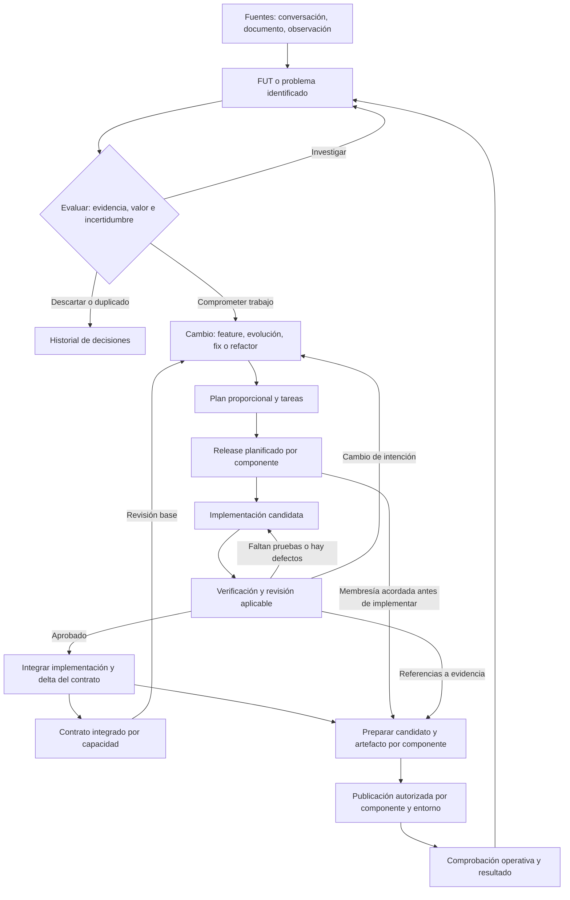
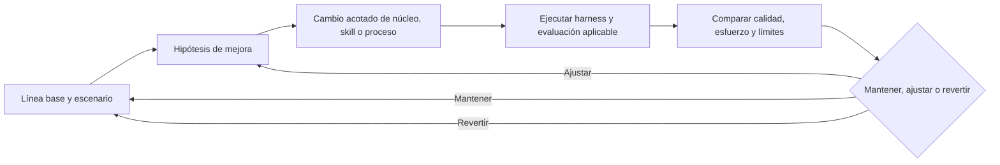

# Plan global — Evolución de Roclec

Estado al 19 de noviembre de 2026. C1–C3 se implementaron localmente en 0.8.0. Se ejecutaron tres campañas semánticas sintéticas con límites documentados. El Hito 02 y el recorrido real del piloto siguen pendientes. [Hito 01](../definition/hito-01.md) · [C3](../implementation/c3.md) · [Evaluación](../evaluation/semantic-c1-c3.md)

## 1. Destino

Construir un framework independiente de spec-kit que permita explicar qué necesita un producto, qué comportamiento está acordado, qué cambios se están preparando, cómo se verificaron y qué versión entrega cada componente. El proceso debe ser proporcional al riesgo y recuperable después de interrupciones.

Conservar la CLI determinista, skills nativas, adaptador opcional generado, Git y archivos propiedad del consumidor. Reemplazar el uso de una carpeta de feature como contrato vigente, expediente histórico y ejecución a la vez por conceptos diferenciados con relaciones verificables.

El kernel no incluirá nombres, stack, precios, reglas comerciales ni releases de polish-car. El proyecto piloto contendrá esa información y sus decisiones.

## 2. Hechos y decisiones pendientes

La línea base histórica corresponde a 0.7.0. El primer corte 0.8.0 incorpora el modelo nativo, integración, registro de publicación Git e instalación. Las verificaciones históricas de ambas versiones se localizan mediante el [inventario](../evaluation/evidence-inventory.md).

El consumidor piloto es el repositorio privado polish-car. Sus antecedentes y acuerdos de producto pertenecen a ese repositorio.

El piloto conserva sus fuentes de producto y sus discrepancias hasta que las resuelva su responsable.

Decisiones confirmadas por el usuario:

1. polish-car será un piloto real por etapas: primero definición/validación y después una funcionalidad real.
2. La propuesta básica es el punto de partida; aprobación comercial todavía por confirmar.
3. Roclec no tiene consumidores reales anteriores. No se construirá un migrador ni compatibilidad permanente con el modelo 0.7 como prerrequisito del primer piloto. Los artefactos previos se preservarán como referencia recuperable, sin convertirlos en una restricción de diseño.

4. Se adopta un contrato vigente por capacidad, con cambios e historial, evidencia y releases separados.
5. Se avanza por hitos: los pasos mecánicos se automatizan; se consulta ante alcance ambiguo, cambios de contrato, decisiones materiales de diseño o publicación. No se vuelven a pedir decisiones ya resueltas ni se detiene por elecciones técnicas rutinarias dentro del alcance aprobado.

6. Persistencia confirmada el 9 de noviembre: Markdown para contenido, TOML/JSON para relaciones/evidencia, Git para historia y manifiestos para identificar candidatos; sin base de datos del framework.

No quedan decisiones estratégicas bloqueantes para iniciar la especificación del primer hito. No se da por aprobado el alcance comercial, arquitectura ni ejecución del producto. Las interfaces detalladas y criterios numéricos de evaluación deben acordarse con evidencia, antes de implementar cada hito.

La carta del piloto define la primera capacidad candidata y registra su alcance y aprobación.

## 3. Modelo conceptual propuesto



Un bug o tarea técnica puede entrar directamente como cambio con origen propio; no se obliga a crear un FUT artificial. FUT es descubrimiento no comprometido, no una etapa obligatoria de toda incidencia.

### Conceptos y autoridad

| Concepto | Responsabilidad | No debe confundirse con |
| --- | --- | --- |
| Fuente | Evidencia original y sus límites | Requisito aprobado |
| FUT | Necesidad o idea sin compromiso | Tarea ya autorizada |
| Capacidad | Límite estable de comportamiento del producto | Repo o componente técnico |
| Requisito | Obligación identificable y su aplicabilidad | Texto de tarea o nota de release |
| Cambio | Intención concreta, base e impacto | Estado actual del producto |
| Ejecución | Plan, tareas, candidato y verificaciones de un cambio | Historial de toda la capacidad |
| Evidencia | Resultado vinculado a entradas y revisión exactas | Una cita AC o una casilla marcada |
| Release | Selección por componente y versión | Integración en rama principal |
| Publicación | Artefacto exacto y entorno de destino | Existencia local de un commit |
| Decisión | Aprobación, rechazo, excepción o sustitución con motivo | Inferencia del agente |

Propuesta: contrato integrado que describe el comportamiento acordado en la base del proyecto; historial de cambios preservado; cada release referencia la revisión exacta que entrega. No afirmar que lo integrado ya está disponible para usuarios.

Un requisito podrá añadirse, reemplazarse o retirarse mediante cambios explícitos. IDs permanentes; supersesión relaciona obligaciones antiguas y nuevas. Al especificar el modelo se fijará el identificador de revisión y su relación verificable con Git; no mantener dos autoridades editables para la misma verdad. El contrato vigente será la única autoridad del comportamiento integrado. Cada cambio preservará la base, intención, delta aprobado y decisión de integración; el archivo histórico no será una segunda fuente editable del estado actual.

## 4. Construcción por fases y criterios de salida

### Fase 0 — Línea base, fundación del proyecto y carta del piloto

Qué: inventariar cambios previos de Roclec y fuentes del piloto, acordar alcance y responsables de decisiones, conservar un estado recuperable revisable sin atribuir cambios ajenos. Registrar qué es conversación, propuesta, supuesto o aprobación. Fijar versión del kit usada por el piloto.

Por qué: no evaluar un framework sobre un alcance contradictorio ni perder material durante su instalación. Esta fase debe producir valor antes de escribir aplicación.

Salida: mapa de fuentes y contradicciones, carta del piloto, fundación mínima revisada, primera capacidad candidata y decisiones abiertas con propietario. La fundación incluye contexto, principios, stack/arquitectura, diseño aplicable y verificación/operación. No se requiere documentar todo el futuro producto. Los contratos de la primera capacidad pueden elaborarse en paralelo a la fundación; no se implementa hasta resolver las decisiones que afecten al cambio.

### Fase 1 — Invariantes y modelo de evolución

Qué: reproducir los tres defectos confirmados en fixtures aislados: reasignación de un AC original que elimina cobertura, informe ready que omite archivos relevantes nuevos y cierre con referencia de fix no verificada. Añadir regresiones, definir entidades, autoridades y relación entre revisión integrada y entregada. Separar modelo/parser, reglas de validación, operaciones, proyecciones y adaptadores.

Por qué: no construir nuevas automatizaciones sobre garantías falsas. Los documentos de diseño deben reflejar las decisiones del modelo antes de elegir nuevos comandos o carpetas.

Salida: tabla de entidades/identidades/revisiones, estados y transiciones; ejemplos persistidos con validación y errores esperados; matriz de invalidación de aprobaciones/evidencia; invariantes comprobables, ADRs de autoridad/supersesión/evidencia, diagnóstico reproducible del núcleo actual y protocolo de operación que prepare el delta antes de escribir. El diagnóstico registra defectos observados, no los presenta como corregidos. El modelo anterior se conserva como referencia, pero no se exige soportar proyectos 0.7 en el nuevo motor. Primero validar la representación mínima del nuevo modelo y luego adaptar la CLI y sus skills.

### Fase 2 — FUTs y definición de cambios

Qué: captura y evaluación de FUT con procedencia, problema, valor esperado, incertidumbres, alternativas y motivo de decisión. Permitir investigar, promover, descartar y marcar duplicado con relación permanente. Validar origen/destino y detectar asignaciones concurrentes de IDs. Promover a un cambio o investigación; no asumir siempre una spec nueva.

Qué más: rutas feature, evolución, fix y refactor. Rigor según impacto. Fix: reproducción, comportamiento esperado y preservado; refactor: invariantes y equivalencia. Las aprobaciones de intención no se deducen de presupuestos ni del código existente.

Por qué: capturar aprendizajes sin ampliar silenciosamente el trabajo ni crear ceremonias innecesarias para cambios pequeños.

Salida: una necesidad real del piloto evaluada y convertida en un cambio de alcance aprobado.

### Fase 3 — Contrato y primer incremento del piloto

Qué: elegir una primera capacidad vertical pequeña y mapear requisitos, UX, tareas y verificación. Integrar el contrato con una operación que muestre el delta y rechace bases desactualizadas o superposiciones sin resolver.

Por qué: probar el modelo con una necesidad real y obtener una implementación verificable antes de desarrollar todo polish-car o todo Roclec.

Salida: primer recorrido ejecutable en entorno local o de prueba, criterios verificables y contexto del coordinador reconstruible desde archivos. La tecnología se confirma en el piloto y nunca se codifica en el kernel.

### Fase 4 — Evolución, evidencia y entrega

Qué: ejecutar un cambio de comportamiento que sustituya un criterio, una corrección con preservación y una intervención técnica sin cambio observable. Los defectos y refactors pueden ser ejercicios sintéticos en copias aisladas, nunca fallos provocados en el producto real. Probar requisitos por componente/plataforma/entorno y evidencia automática/manual con límites explícitos.

Qué más: asociar alcance revisado, archivos nuevos/modificados/eliminados, tests y candidato Git; la vigencia no depende solo de una lista autoelegida de hashes. Vincular fixes a cambios incluidos o cherry-picks identificados; verificar artefactos cuando haya build. Mantener participación opcional de revisión independiente, y declarar qué verifica la máquina y qué juzga el humano/agente.

Por qué: resolver la contradicción entre historial acumulado y obligación vigente, y evitar un cierre basado en evidencia de otro código.

Salida: la versión normal usa X.Y.0; hotfix/bugfix solo incrementa Z y contiene fixes. La integración no declara publicación; el ensayo de release no crea tags ni envía mensajes reales. Una publicación real requiere autorización explícita posterior.

### Fase 5 — Recuperación ampliada, adopción y evaluación

Qué: ampliar y comprobar las operaciones recuperables introducidas desde el primer corte, con validación completa y precondiciones de revisión. Ensayar fallos entre pasos, reintentos y concurrencia; no prometer transacciones atómicas de Git entre varios repos. Reportar publicación parcial sin convertirla en éxito global.

Adopción: instalación limpia desde wheel y esquema identificado desde el primer consumidor. Preservar las fuentes originales del piloto y las plantillas propias; gestionar futuros cambios del formato mediante detección de versión y migraciones revisables cuando exista esa necesidad. No desarrollar hoy un migrador de consumidores 0.7 inexistentes. Validar multirrepo con fixtures aislados, porque el monorepo propuesto para polish-car no basta para probarlo. No ampliar el rango de spec-kit por analogía con documentación actual; probar versiones concretas en el adaptador.

Por qué: el primer consumidor permite simplificar el diseño, pero necesita operaciones recuperables y una política explícita de actualización desde el inicio.

Salida: instalación desde wheel, flujo nativo, integración opcional con Codex/Claude, guía de adopción y recuperación y evaluación documentada. El primer corte local fue 0.8.0 y el alcance técnico posterior apunta a 0.9.0.

## 5. Qué mediremos

No asignar porcentajes, fechas ni puntos de madurez inventados. Medir durante el piloto:

- Minutos de definición/revisión y corrección por cambio, separando esperas del cliente.
- Defectos relevantes detectados y falsos positivos con motivo.
- Requisitos aplicables sin evidencia suficiente o con evidencia obsoleta.
- Tiempo para reconstruir el contexto y determinar qué revisión entrega un componente.
- Conflictos de intención detectados antes de escribir y recuperaciones exitosas tras fallos inducidos.
- Trabajo repetido y documentos duplicados que el proceso exige mantener.

Comparar resultados del piloto y de fixtures con la línea base. No afirmar mejora estadística a partir de un proyecto ni equiparar éxito del harness con calidad de un agente.

## 6. Validación

- Unitarias y casos de estado: IDs, supersesión, cancelación, duplicados, orígenes, asignaciones y aplicabilidad.
- Propiedades: idempotencia de proyecciones; rechazo sin cambios; obligaciones históricas preservadas; nueva evidencia no valida otro candidato.
- Integración: wheel real, proyecto nuevo, adaptador opcional, plantillas propias y adopción limpia, con detección de esquema.
- Fallos: interrupción antes/después de cada escritura, cambios concurrentes, repo ausente y operación parcial.
- Semántica de skills: ambigüedad sin inventar aprobación; fix sin nuevo contrato; sustitución sin exigir dos comportamientos incompatibles; evidencia ausente no se declara aprobada.
- Producto: validar la primera capacidad con sus responsables y condiciones acordadas; datos de prueba y notificaciones simuladas hasta habilitación explícita.

Cada fase termina con evidencia y una decisión de continuar, ajustar o detener. Los resultados alimentan FUTs del framework o del producto según su naturaleza, sin mezclar ambos backlogs.

## 7. Fundamento investigado

- OpenSpec: specs mantenidas frente a propuestas y deltas: https://raw.githubusercontent.com/Fission-AI/OpenSpec/main/docs/concepts.md
- Spec Kit: política explícita de persistencia: https://github.github.io/spec-kit/how-to/persisting-specs.html
- Kiro: recorridos por tipo de trabajo: https://kiro.dev/blog/specs-bugfix-and-design-first/
- Kiro: reparación y preservación: https://kiro.dev/docs/specs/bugfix-specs/
- Kiro: propiedades ejecutables y sus límites: https://kiro.dev/docs/specs/correctness/
- Spec Kit: ejecución reanudable y límites de efectos repetidos: https://github.github.io/spec-kit/workflows/overview.html
- Evidencia empírica y costes de mantenimiento: https://arxiv.org/abs/2608.25202v4

Estas fuentes orientan decisiones, no acreditan la eficacia de nuestro diseño ni compatibilidad con versiones aún no probadas.

## 8. Límites del núcleo y subsistemas

| Subsistema | Cambio propuesto | Motivo |
| --- | --- | --- |
| Modelo de dominio | Capacidades, requisitos, cambios, evidencia y entregas diferenciadas | Evitar estados y autoridades ambiguos |
| Persistencia | Archivos versionados con esquema y referencias estables | Revisiones humanas, portabilidad y evolución controlada |
| Validadores | Estructura, relaciones, revisiones base y aplicabilidad | Rechazar inconsistencias comprobables |
| Operaciones | Preparar delta, validar, aplicar y recuperar | Evitar escrituras parciales o basadas en contexto obsoleto |
| Proyecciones | Roadmap, índices y contexto por componente | No mantener manualmente copias del mismo dato |
| CLI | Interfaces del modelo, no prompts duplicados | Núcleo utilizable sin agente ni spec-kit |
| Skills | Descubrimiento, interpretación, diseño y revisión semántica | Separar juicio de validación determinista |
| Adaptadores | Aliases generados e integraciones opcionales | Evitar dependencia de un proveedor |
| Harness | Escenarios de estados, concurrencia, interrupciones y wheel | Verificar propiedades del framework |
| Evaluación | Casos de interpretación y utilidad en el piloto | No confundir archivos instalados con buen comportamiento del agente |

### Decisiones reservadas al producto

Las decisiones de alcance, diseño y arquitectura se documentan en el repositorio privado del consumidor.

### Entregables del siguiente hito

- Carta del piloto con fuentes, candidatos y decisiones de alcance pendientes.
- Fundación del proyecto y componentes: contexto, principios, decisiones técnicas y diseño aplicable; cada decisión distingue propuesta, acuerdo o incertidumbre.
- ADR del modelo: autoridad del contrato, supersesión, base e integración.
- Tres escenarios de regresión y un ejemplo sintético con estado actual, cambio y evidencia esperada.
- Plano de operaciones y revisión del impacto antes de modificar el núcleo.
- Plan inicial del harness: escenarios, oráculos/rúbricas, datos aislados, comandos, línea base y evidencias esperadas; ampliación progresiva en cada hito.

El resultado de este hito será revisable y suficientemente detallado para autorizar la primera implementación. No se inicia el desarrollo completo de polish-car a partir de este plan global.

## 9. Fundación al iniciar un proyecto

### Propósito y alcance

Antes de la primera implementación, establecer el contexto duradero que permite a personas y agentes tomar decisiones coherentes. No limitar foundation al diseño visual ni a componentes user-facing, como ocurre en su alcance actual. Aplicar una fundación compartida al proyecto y añadir decisiones específicas de cada componente cuando corresponda. El contexto de producto precede a la elección del stack; el diseño detallado de una capacidad puede revelar decisiones que requieran revisar la fundación.

| Área | Decisiones mínimas | Por qué |
| --- | --- | --- |
| Contexto de producto | Problema, actores, alcance inicial y exclusiones; fuentes y aprobaciones | Evitar elegir herramientas para un problema no acordado |
| Principios del proyecto | Compatibilidad, seguridad, privacidad, simplicidad y calidad aplicables | Orientar decisiones sin codificar el dominio en el kernel |
| Arquitectura | Componentes y responsabilidades, límites de datos, contratos e integraciones | Evitar que cada feature invente otra estructura |
| Stack | Tecnologías y runtime por componente, versiones/restricciones compatibles, motivos y alternativas | Dar contexto reproducible sin imponer un stack universal |
| Diseño de interfaz | Audiencia, dispositivos, marca, tokens, componentes, estados y accesibilidad aplicable | Mantener consistencia y verificar interacción, no solo apariencia |
| Ingeniería y verificación | Estructura, convenciones, contratos/tipos, pruebas, comandos y criterios de aceptación | Poder construir y verificar sin depender del historial del chat |
| Operación | Entornos, configuración/secretos, entrega, observación y recuperación aplicables | Preparar una entrega comprobable y operable |

Estas áreas no implican siete documentos obligatorios. Reutilizar fuentes canónicas ya existentes y referenciarlas; no duplicar stack, requisitos o principios para satisfacer una plantilla. La constitución contiene principios duraderos; decisiones técnicas concretas y sus alternativas viven en registros de decisión. Diseño tiene una autoridad por interfaz/componente, con primitivas compartidas cuando realmente correspondan.

### Evolución y estado

Cada decisión relevante identifica ámbito (proyecto/componente), estado (propuesta/acordada/sustituida), razón, alternativas, procedencia y responsable de la decisión. Las preguntas sin resolver indican propietario e impacto; no se presentan como aprobaciones.

La fundación es una base versionada, no una especificación exhaustiva ni congelada. Cambiar stack, principios, contratos de integración o sistema de diseño exige una decisión revisable y análisis de impacto en capacidades, planes y evidencia. Los cambios puramente técnicos no se convierten artificialmente en nuevos requisitos funcionales. No se prescribe todavía una nueva CLI para estos registros: se definirá junto con el modelo.

### Criterio de salida proporcional

Para comenzar un cambio, deben existir fuentes y decisiones suficientes para su alcance: contexto y principios acordados; responsabilidades y tecnología aplicables definidas; un método ejecutable de verificación; diseño base para la interfaz que se vaya a implementar. La operación necesaria se concreta antes de la entrega correspondiente. Las incógnitas que afectan seguridad, comportamiento, contratos o decisiones técnicas difíciles de revertir bloquean ese trabajo hasta resolverse.

Las áreas no aplicables se justifican brevemente. Un componente sin UI no requiere sistema visual. Una investigación aislada puede explorar una tecnología con hipótesis y límites explícitos, sin hacer pasar el experimento por implementación aprobada. Las cuestiones futuras no bloquean todo el proyecto.

### Aplicación a polish-car

Revisar las fuentes candidatas contra el alcance y los acuerdos del piloto.

Las decisiones específicas de producto se conservan en el repositorio piloto.

## 10. Archivos de referencia del consumidor

La fundación produce o adopta referencias canónicas versionadas del proyecto. La existencia de una plantilla vacía no acredita una decisión. Roclec ofrece una estructura inicial configurable; primero inventaría archivos existentes y propone un mapa de autoridad, sin renombrarlos, sobrescribirlos ni duplicarlos automáticamente.

### Estructura inicial propuesta

```text
product/core.md                          Contexto, usuarios, alcance y restricciones
.roclec/constitution.md                   Principios duraderos del proyecto
docs/reference/index.md                  Mapa de referencias, ámbito y autoridad
docs/reference/architecture.md           Componentes, límites, datos y contratos
docs/reference/tech-stack.md             Tecnologías elegidas por componente
docs/reference/engineering.md            Prácticas, convenciones y verificación
docs/reference/operations.md             Entornos, entrega, observación y recuperación
docs/reference/design-system.md          Primitivas visuales compartidas, si aplican
components/<nombre>/DESIGN.md             Decisiones específicas de una interfaz
decisions/NNN-titulo.md                   Decisiones materiales y sus alternativas
```

Estas rutas son convenciones propuestas para un proyecto nuevo, no cambios ya implementados en el instalador ni obligación de migrar rutas propias. Los documentos específicos por componente se separan solo cuando el contenido lo justifica; en proyectos pequeños bastan secciones dentro de una referencia compartida. No crear design-system.md ni DESIGN.md para componentes sin UI, ni dos autoridades de diseño si hay una sola interfaz: el índice señala si la autoridad es compartida o específica.

### Contenido y límites de autoridad

- Arquitectura: mapa de componentes y repositorios, responsabilidades, dependencias, flujos de datos, fronteras de confianza y dueño de cada contrato. No duplicar el esquema de API o las entidades mantenidas en código.
- Stack: elecciones y restricciones por componente, razones y referencias a ADRs. Los manifests y lockfiles son autoridad sobre versiones efectivamente instaladas; la referencia expresa política y compatibilidad, evitando repetir listas que envejecen.
- Prácticas de ingeniería: reglas concretas de estructura, nombres, errores, pruebas y revisión. Referenciar comandos y configuración ejecutable mantenidos en el proyecto, sin crear un manual genérico ni copiar el contenido completo de skills de terceros.
- Diseño: tokens, tipografía, espaciado, componentes/estados, interacción y accesibilidad; enlazar librerías o tokens ejecutables cuando existan. Las excepciones de una pantalla pertenecen a su UX; las reglas compartidas pertenecen a la referencia de diseño.
- Operación: entornos y responsabilidades, configuración sin secretos, procedimiento de entrega, señales de observación, backups/restauración y rollback cuando correspondan. No colocar credenciales ni instrucciones que impliquen autorización para publicar.
- ADRs: explican por qué se decidió algo; la referencia vigente indica qué decisión aplica ahora. Una decisión sustituida permanece histórica y apunta a su reemplazo.

El índice registra propósito, ámbito y autoridad de cada referencia, además de distinguir contenido escrito de vistas generadas. Estado/autoría de decisiones se conserva en su registro canónico; no mantener una segunda lista editable del mismo dato. No repetir el stack en PRODUCT.md: las fuentes de producto enlazan la referencia técnica y, si una herramienta necesita un resumen, este se deriva o se identifica como vista subordinada.

### Uso durante el ciclo

AGENTS.md y CLAUDE.md contienen un mapa breve de entrada y enlaces; las skills cargan solo las referencias aplicables al cambio. Cada plan/evidencia identifica las revisiones de referencia que utilizó. Si una decisión de stack, arquitectura, principios o diseño cambia, analizar el impacto y actualizar las referencias afectadas antes de declarar vigente la evidencia anterior. No convertir una corrección editorial en una obligación de repetir todas las pruebas.

Roclec comprueba existencia, enlaces, ámbito y revisiones cuando sean parte de un gate; no confunde estas verificaciones con una evaluación semántica del contenido. La calidad y suficiencia se revisan frente al alcance real del proyecto.

El consumidor conserva sus fuentes y documenta los acuerdos que se deriven de ellas.

## 11. Harness como mecanismo de mejora continua

### Necesidad

Establecer al iniciar el proyecto qué garantías se quieren comprobar y qué harness hace falta para verificarlas. El harness evoluciona con el producto, las skills y el proceso; no se posterga hasta la puesta en marcha ni se reduce a contar pruebas verdes. Cada cambio que pretenda mejorar el proceso identifica una hipótesis y la evidencia que permitiría mantenerlo, ajustarlo o descartarlo.

La base existente de Roclec, scripts/harness.py, instala el wheel y recorre operaciones reales de CLI en proyectos desechables, con rechazos y adaptador opcional. Se conservará lo reutilizable y se adaptará al modelo nuevo. Hoy no ejecuta agentes ni certifica un consumidor real; no se atribuyen esas capacidades al harness actual.

### Capas y responsabilidades

| Capa | Qué verifica | Dónde pertenece | Ejemplos |
| --- | --- | --- | --- |
| Núcleo e instalación | Reglas, relaciones, estados, assets, operaciones y compatibilidad probada | Roclec | Supersesión sin perder historia, idempotencia, bases obsoletas, wheel real y adaptador opcional |
| Skills y decisiones | Interpretación de instrucciones, uso de referencias, control de alcance y evidencias | Evaluación de Roclec en espacios aislados | No convertir propuestas en aprobaciones; preguntar ante ambigüedad material; no declarar ready con evidencia insuficiente |
| Consumidor | Comportamiento, contratos e integraciones del producto | Repositorio del piloto | Capacidad real de alcance aprobado y su verificación |
| Proceso y operación | Reanudación, fallos parciales, costes y utilidad del recorrido | Escenarios genéricos más evidencia del piloto | Reanudar sin duplicar una acción, recuperar un estado, comparar retrabajo y carga de revisión |

Estas capas comparten un contrato de resultados y trazabilidad, no necesariamente un solo runner. Las suites rápidas/deterministas se ejecutan en cada cambio pertinente. Evaluaciones con modelos, dispositivos o servicios externos se ejecutan en campañas explícitas con coste y límites definidos; no se añaden llamadas a modelos ni gastos silenciosos a CI. Pueden proponerse automatizaciones periódicas después, no se crean como efecto de este plan.

### Qué se define durante la fundación

1. Garantías críticas y riesgos aplicables al proyecto; requisitos o principios que los sustentan.
2. Escenarios positivos, negativos y de recuperación; estado inicial y resultado esperado.
3. Oráculo de cada caso: aserciones ejecutables, observación o rúbrica humana. Un agente evaluador no es la única autoridad sobre los mismos supuestos que generaron el código.
4. Fixtures/datos de prueba y adaptadores simulados, con separación de credenciales y sistemas reales.
5. Comandos reproducibles, requisitos del entorno, límites de tiempo/recursos y condiciones de limpieza/recuperación.
6. Artefactos de evidencia y criterios para aceptar, investigar o rechazar una supuesta mejora.

La referencia de ingeniería mantiene el mapa de verificación y enlaces a comandos/configuración ejecutables. Si el contenido lo justifica puede existir docs/reference/verification.md como autoridad específica, enlazada desde engineering.md. No duplicar la definición de pruebas en documentos, scripts y prompts.

### Evidencia mínima por ejecución

Identificar versión del kit/wheel y su huella, revisión del consumidor, escenario/datos/configuración, comandos y resultados, entradas/candidato evaluados y limitaciones. En campañas de agentes incluir herramienta, modelo/configuración disponible, versión de skills/prompts y número de repeticiones. Si un proveedor no expone un dato, registrarlo como desconocido; no inventarlo.

Distinguir fallo del producto, fallo del harness, fallo de entorno e información insuficiente. Mantener logs útiles sin secretos ni datos reales innecesarios; almacenar evidencias de ejecución en artifacts con una política de retención, no volcados indiscriminados en el repositorio. La rama, fecha o SHA de HEAD por sí solos no identifican un worktree sucio ni un artefacto compilado.

### Escenarios iniciales de Roclec

- Los tres defectos ya reproducidos: AC original reasignado que pierde cobertura, revisión ready que omite archivos nuevos relevantes y fix con referencia no verificada.
- Sustituir/retirar un requisito sin imponer simultáneamente comportamientos incompatibles.
- Promover, descartar o marcar duplicado un FUT conservando procedencia e IDs; detectar promociones ambiguas o concurrentes.
- Cambios que afectan distintos componentes, con verificación y publicación en momentos diferentes.
- Rechazar bases obsoletas y aprobaciones/evidencias que no corresponden al alcance candidato.
- Interrumpir y reintentar operaciones; cambios concurrentes y pasos parciales, sin prometer atomicidad entre repositorios.
- Instalar el wheel en un consumidor nuevo y comprobar flujo nativo sin spec-kit; evaluar el adaptador opcional en una matriz declarada de versiones.
- Casos semánticos: contradicciones en referencias, petición de alcance no aprobado, verificación manual ausente y propuesta técnica presentada como si fuera decisión.

### Aplicación progresiva a polish-car

Definir el harness mínimo en el repositorio del piloto antes de implementar el primer cambio.

Los ensayos de defectos, mutaciones, fallos de proveedor y concurrencia se hacen en fixtures/copia aislada, no en los datos o sistemas reales del piloto. Tener un stub que responde correctamente no acredita que una integración real funcione; registrar esa limitación y la prueba adicional que se necesita antes de entregar.

### Bucle de mejora



Comparar escenarios y entornos equivalentes, separando el coste mecánico de la espera humana. Para resultados no deterministas repetir ensayos y conservar variación; no presentar una ejecución aislada como mejora general. Conservar algunos casos de evaluación separados de los usados para ajustar la skill para reducir sobreajuste.

Medir primero corrección, respeto de alcance/aprobaciones y calidad de evidencia. Después comparar duración, coste disponible, retrabajo e intervenciones humanas innecesarias. Una reducción de pasos o tokens no se acepta como optimización si degrada garantías críticas. Los umbrales específicos se fijarán al diseñar el escenario, antes de comparar resultados, no después de conocer el ganador.

### Criterio de salida por hito

Cada hito entrega su comportamiento junto con escenarios repetibles y evidencia asociada. Una brecha semántica no se oculta con un check estructural; una prueba no ejecutada no se cuenta como aprobada. Los resultados alimentan decisiones, cambios o FUTs según su naturaleza, manteniendo separado el backlog del kit del de polish-car. El plan actual incorpora esta necesidad; no declara implementadas todavía las nuevas capas de evaluación.

## 12. Revisión incorporada y primer corte

| Hallazgo | Tratamiento | Evidencia/entregable |
| --- | --- | --- |
| R1: identidad, revisiones y estados | Fase 1 exige modelo implementable y ejemplos, no solo narrativa | [ADR 003](../decisions/003-contracts-changes-evidence.md), [modelo](../definition/modelo.md) y ejemplos genéricos |
| R2: release planificado vs publicado | Diagrama corregido: asignación antes de implementar, preparación/publicación posteriores | Diagrama de sección 3 y tabla de estados del modelo |
| R3: mínimo para el piloto | Primer corte limitado a fundación, contrato/cambio, FUT mínimo, gates nativos y diagnóstico/harness | [Hito 01](../definition/hito-01.md), lista de exclusiones |
| R4: ubicación/versionado | Este documento es canónico en Roclec; la copia del chat es un enlace | Índice del hito, referencias al consumidor y respaldo de línea base |
| R5: salida comprobable | Checklist de entregables y evidencia, sin porcentajes inventados | [Hito 01](../definition/hito-01.md) |
| R6: fundaciones separadas | Método y arquitectura del kit en Roclec; decisiones del negocio en el piloto | [Fundación de Roclec](../definition/fundacion-roclec.md), carta del piloto en su repositorio privado |

### Mínimo y trabajo posterior

El primer corte implementable cubrirá archivos de fundación referenciados, identidad/revisiones y consulta de contrato, creación/validación de un cambio sobre una base concreta, FUT con origen/destino, asignación de release antes de implementar, manifiesto del candidato y comprobaciones deterministas de evidencia. Incluirá preparación, rechazo sin escrituras e identificación de operaciones aplicadas; la recuperación mínima no se posterga al final.

La revisión de interfaces concreta esa dirección en [archivos/comandos/gates/errores](../definition/interfaces-primer-corte.md) y [33 escenarios de aceptación](../definition/aceptacion-interfaces.md). Propone un índice vigente por componente/capacidad, vistas generadas y tres incrementos: datos/consulta, evidencia/integración y cierre/distribución. D1–D3 están confirmadas en [ADR 004](../decisions/004-first-cut-interface-decisions.md): identidad estable con revisiones inmutables y nuevos AC ante cambio de conducta; candidato final por commit/manifiesto sin cambios pendientes en repos de código afectados; gate de revisión opcional que bloquea verificar/integrar/preparar entrega cuando está activado y faltan informes favorables vigentes. La implementación por incrementos se registra a continuación.

C1, C2 y C3 se implementaron localmente en 0.8.0 con perfil 2. Las pruebas cubrieron el modelo de cambios, la verificación, la integración, el registro de publicación contra remotos desechables y la instalación nativa. [C1](../implementation/c1.md) · [C2](../implementation/c2.md) · [C3](../implementation/c3.md)

No incluye motor de workflows arbitrarios, coordinador distribuido, múltiples backends de persistencia, migrador 0.7, benchmark masivo de agentes, automatizaciones periódicas ni despliegue real. Las pequeñas evaluaciones semánticas y fixtures multirrepo verifican límites sin convertirlos en nuevas plataformas.

### Referencias de ejecución

[Hito y checklist](../definition/hito-01.md) · [Fundación técnica](../definition/fundacion-roclec.md) · [Modelo propuesto](../definition/modelo.md) · [Interfaces](../definition/interfaces-primer-corte.md) · [Aceptación](../definition/aceptacion-interfaces.md) · [Harness y regresiones](../definition/harness.md) · [Revisión original](revision-plan-2026-11-09.md).

## 13. Hito 02

La [propuesta del 17 de noviembre](plan-mejoras-2026-11-17.md) es el diagnóstico histórico que motivó este hito. Las decisiones vigentes son:

- D1 y D2. RUN y EVD usan ULID y sustitución explícita por alcance. Las decisiones usan cadenas por entidad y cadenas de inicio por cambio y componente. Las escrituras administrativas se restringen a la troncal. La integración exige ascendencia en la referencia remota configurada.
- D3 y D4. El perfil 3 configura referencias Git, entorno permitido y límites de logs. Los logs completos quedan locales y los extractos versionados son optativos, acotados y redactados. Se añade autoría asistida, consulta de estado y desbloqueo con comprobación de proceso. El inicio exige actor explícito y el modelo sube de esquema.
- D5. Plan y tareas viven en la carpeta de trabajo del cambio fuera de `semantic.files`. Se reevaluarán la publicación por entorno, su comprobación operativa y la verificación de artefactos de build cuando una necesidad concreta del piloto lo justifique.
- D6. El proyecto adopta MIT. Se conservan los avisos de procedencia.
- D7. La evidencia pesada permanece en copias locales verificadas mediante SHA-256. Sustituye la transferencia a almacenamiento remoto prevista en F0.3b. La comprobación de recuperación local forma parte del cierre.
- D8. El remoto del framework es público en GitHub, bajo `luiscdz/roclec-spec-kit`, con `main` como troncal. El repositorio piloto es privado.

F0 consolida el historial, el respaldo verificado y CI. F1 incorpora autoría y consultas. F2 valida ramas, precedencia e integración recuperable. F3 trata logs, restauración de skills, rendimiento y locks. Este encargo abarca Roclec Spec Kit. F4 se ejecutará con un plan separado en el repositorio privado del piloto, con alcance y línea base definidos antes de empezar. F5 espera al resultado del piloto salvo ajustes de instalación o adaptador que lo bloqueen.

Cada fase técnica exige suite completa, build y harness sobre el wheel. Los cambios de assets o adaptador requieren `--spec-kit`. El cierre de 0.9.0 exige F0–F3 completas, las rupturas públicas documentadas y un recorrido real de F4. Los informes de síntesis deben registrar los resultados y sus límites.

## 14. Riesgos no funcionales

- Verificar las copias locales con el inventario y mantener una copia adicional para reducir pérdida de evidencia.
- Probar merges en ambos órdenes, detectar forks y reconstruir la precedencia por alcance antes de aceptar registros fusionados.
- Fijar cuotas y umbrales antes de medir. Probar agotamiento de cuota, falta de logs, recuperación y allowlist de entorno en fixtures aisladas.
- Medir en el piloto la fricción de integrar en serie y convertir hallazgos comprobados en FUTs del framework.
- Cualquier nueva campaña semántica exige alcance y presupuesto acordados y debe distinguir regresión de generalización.
