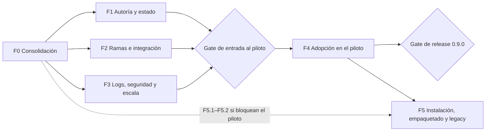

# Plan de mejoras posterior al primer corte (0.8.0)

Fecha: 17 de noviembre de 2026, revisado el 19 de noviembre de 2026. **Estado: diagnóstico histórico.** Las decisiones vigentes y el seguimiento del hito se mantienen en las secciones 13 y 14 del [plan global](plan-global.md).

## 1. Punto de partida

- Primer corte determinista C1/C2/C3 implementado localmente en 0.8.0. Suite actual: 63 tests en verde (unos 104 s); harness por wheel documentado en [evidencia C3](../implementation/c3.md).
- El núcleo es sólido en integridad: digests canónicos, rutas sin symlinks ni escapes, journals con guardas, planes reconstruidos en lugar de confiados, subprocesos sin shell y timeouts que matan el grupo de procesos.
- Los huecos están en operación del repositorio, uso con ramas Git, autoría de registros, seguridad de logs, escala, empaquetado y en la desalineación entre el plan global y lo implementado.
- La validación determinista y las tres campañas semánticas con agentes usaron consumidores sintéticos. La primera campaña heredó contexto con los oráculos. La campaña ciega dejó tres recorridos sin completar y la regresión posterior obtuvo 10/10 en casos conocidos. El piloto sigue pendiente y cualquier nueva campaña requiere acordar alcance y presupuesto. [Informe de evaluación C1–C3](../evaluation/semantic-c1-c3.md)

## 2. Reglas de este plan

1. Ninguna mejora entra sin hallazgo (sección 3) y escenario que la verifique.
2. No se añaden subsistemas nuevos antes del hito de adopción en el piloto (fase F4). Lo que no sea necesario para ese hito se pospone con un disparador explícito. La sustitución explícita de F2 no cuenta como subsistema nuevo: es el modelo de precedencia que D1 necesita para que los IDs no secuenciales sean seguros, porque sin ella los gates seguirían dependiendo del orden de los IDs.
3. Cada fase termina con: `PYTHONPATH=src python3 -m unittest discover -s tests -v`, wheel construido, `scripts/harness.py` sobre ese wheel (con `--spec-kit` si cambian assets o adaptador) y evidencia resumida. La evidencia pesada no se guarda en Git.
4. Umbrales numéricos (rendimiento, tamaños) se fijan al diseñar el escenario, antes de medir, nunca después.
5. Las decisiones D1–D4 quedan resueltas por la aprobación de este plan. D5–D8 siguen siendo del usuario; mientras no se resuelvan, no se implementa el trabajo que dependa de ellas.
6. Versionado: F1–F3 forman el alcance técnico de una release normal 0.9.0 (X.Y.0), pero el gate del piloto permite probar antes un subconjunto explícito. 0.9.0 no se cierra ni publica hasta completar F0 (incluida F0.3b) y F1–F3, resolver D1–D4, ejecutar el gate de release de esta sección y obtener evidencia de al menos un recorrido real de F4. El cambio de IDs y orden causal sube `model_schema` y, junto con `change start --actor` obligatorio y el nuevo formato de perfil (D4), se documenta como ruptura de 0.9.0; no hay consumidores reales que migrar (decisión 3 del plan global).

## 3. Hallazgos

| ID | Hallazgo | Evidencia | Fase |
| --- | --- | --- | --- |
| M-01 | Todo 0.8 sin commit (69 entradas), sin remoto; CI nunca ejecutado | `git status`, `git remote -v` vacío, [check.yml](../../.github/workflows/check.yml) | F0 |
| M-02 | ~30 MB de evidencia en `docs/*/evidence` con rutas personales absolutas. `MANIFEST.in` incluye parte en el sdist. La exclusión de todo `docs/evaluation` también oculta el informe que debe quedar disponible en un clon | `docs/evaluation/evidence`, `docs/implementation/evidence`, [MANIFEST.in](../../MANIFEST.in), [.gitignore](../../.gitignore) | F0 |
| M-03 | Plan global con estado contradictorio y obsoleto (L3, L15, L137, L373) y enlace fuera del repo (L365). El hito 01 conserva como pendiente la ejecución semántica ya documentada | [plan-global.md](plan-global.md), [hito 01](../definition/hito-01.md), [informe semántico](../evaluation/semantic-c1-c3.md) | F0 |
| M-04 | AGENTS.md pide subir versión de preset/extensión ya eliminados; versión duplicada en `__init__` y `pyproject` | [AGENTS.md](../../AGENTS.md), [pyproject.toml](../../pyproject.toml) | F0 |
| M-05 | Hashes, revisiones y `proposal_digest` calculados a mano por personas/agentes | [model.md](../../src/roclec_spec_kit/assets/project/model.md) (receta Python) | F1 |
| M-06 | Fundación (`references.json`, decisiones `foundation`) sin CLI; JSON con hashes escritos a mano | [kernel.py:115](../../src/roclec_spec_kit/kernel.py), [c1.md](../c1.md) | F1 |
| M-07 | Sin `status`/`list`; salida no JSON es el mismo JSON indentado; `next_action` impreciso | [native_cli.py:277](../../src/roclec_spec_kit/native_cli.py) | F1 |
| M-08 | `change start` registra actor fijo `"cli"` | [kernel.py:460](../../src/roclec_spec_kit/kernel.py) | F1 |
| M-09 | Errores internos (`TypeError/KeyError/ValueError`) se presentan como entrada inválida | [native_cli.py:263](../../src/roclec_spec_kit/native_cli.py) | F1 |
| M-10 | IDs secuenciales (RUN/EVD `max+1`, `sequence` de decisiones) colisionan al fusionar ramas o worktrees. El orden de RUN/EVD también determina qué intento, observación o revisión prevalece en la verificación | [verification.py:151](../../src/roclec_spec_kit/verification.py), [verification.py:362](../../src/roclec_spec_kit/verification.py), [kernel.py:380](../../src/roclec_spec_kit/kernel.py) | F2 |
| M-11 | `current.json` e `identities.json` son archivos únicos: conflictos de merge si se escriben en varias ramas | [kernel.py:49](../../src/roclec_spec_kit/kernel.py), L51, [store.py:98](../../src/roclec_spec_kit/store.py) (escritores) | F2 |
| M-12 | Duplicados de `sequence` solo se detectan dentro del subconjunto filtrado por entidad | [kernel.py:374](../../src/roclec_spec_kit/kernel.py) | F2 |
| M-13 | La preparación, la aplicación y la recuperación de una integración carecen de una comprobación de la rama destino | [integration.py](../../src/roclec_spec_kit/integration.py), [store.py:190](../../src/roclec_spec_kit/store.py) | F2 |
| M-14 | La salida de checks se acumula en memoria sin tope y se guarda sin redacción en `.roclec/runs`. Los checks heredan el entorno completo | [verification.py:185](../../src/roclec_spec_kit/verification.py) | F3 |
| M-15 | Frontera de confianza no documentada: `argv` del perfil ejecuta código arbitrario | [config.py:161](../../src/roclec_spec_kit/config.py) | F3 |
| M-16 | `npx -y skills experimental_install` sin versión fijada ni verificación de `computedHash` | [external_skills.py:66](../../src/roclec_spec_kit/external_skills.py) | F3 |
| M-17 | `Store.token()` hashea todo `.roclec/**` (logs y recibos incluidos) varias veces por comando; `check` O(runs²); `inspect --change` ejecuta gates con `git ls-files` | [store.py:19](../../src/roclec_spec_kit/store.py), [kernel.py:776](../../src/roclec_spec_kit/kernel.py), [kernel.py:480](../../src/roclec_spec_kit/kernel.py) | F3 |
| M-18 | Lock sin dueño (PID/host/hora); tras SIGKILL se retira a mano | [store.py:125](../../src/roclec_spec_kit/store.py) | F3 |
| M-19 | Instalación no poda skills retiradas y sobrescribe archivos con marcador aunque el consumidor los editara | [installation.py](../../src/roclec_spec_kit/installation.py) `owned` | F5 |
| M-20 | Adaptador escribe rutas absolutas de la máquina y declara `UNLICENSED` sobre contenido MIT | [adapter.py:42](../../src/roclec_spec_kit/adapter.py), [adapter.py:60](../../src/roclec_spec_kit/adapter.py) | F5 |
| M-21 | Sin licencia del proyecto ni metadatos de paquete; plataformas soportadas no declaradas (Windows no funciona) | [pyproject.toml](../../pyproject.toml) | F5 |
| M-22 | ~90 KB de código legacy (oráculo 0.7) distribuido en el wheel; comando público `product` que siempre falla | `cli.py`, `workflow.py`, `lifecycle.py`, `product.py`, `reviews.py`, `assets/legacy/` | F5 |
| M-23 | `kernel.py` concentra cambios, decisiones, FUT, releases y consultas (895 líneas); imports circulares diferidos store→kernel→verification→releases | [kernel.py](../../src/roclec_spec_kit/kernel.py), [store.py:190](../../src/roclec_spec_kit/store.py) | F5 |
| M-24 | Tests monolíticos por escenario (un fallo corta el resto), sin cobertura medida ni tests de propiedades que el plan global prevé | `tests/`, [plan-global.md:155](plan-global.md) | F5 |
| M-25 | Plan global promete elementos no modelados: ubicación de plan/tareas, publicación por entorno y comprobación operativa, verificación de artefactos de build | [plan-global.md:46](plan-global.md), L57–59, L123 | F4 |
| M-26 | Métricas del plan global ("minutos por cambio") no son derivables: decisiones y recibos no llevan tiempo y no hay línea base del piloto | [plan-global.md:141](plan-global.md) | F4 |
| M-27 | Contenido específico de polish-car dentro del plan del framework | [plan-global.md](plan-global.md) título, secciones 8–11 | F4 |

## 4. Fases

F1, F2 y F3 pueden avanzar en paralelo tras F0 si tocan archivos distintos; F2 y F3 comparten `store.py` y deben coordinarse. F5 no forma parte de 0.9.0: espera al piloto, salvo sus puntos 1 y 2, que pueden adelantarse si lo bloquean.

### F0 — Consolidación (sin cambios de comportamiento)

Objetivo: que el trabajo existente sea recuperable, revisable y comprobado por CI.

1. Tras verificar la copia local y preparar las exclusiones de F0.3a, crear commits por bloques coherentes: C1 (model/store/kernel/config), C2 (verification/integration), C3 (releases/installation/adapter), skills y assets, scripts/harness, tests, docs. (M-01)
2. Remoto privado según D8 y CI activo. Matriz: Python 3.11–3.13; Ubuntu y macOS; identidad Git configurada para los tests; job de harness sobre el wheel construido; job `--spec-kit` cuando cambien assets o adaptador. (M-01)
3. Evidencia, en dos pasos (M-02):
   - **F0.3a, sin D7:** antes del primer commit de consolidación, guardar los originales en una copia local fuera del árbol Git y verificar sus SHA-256 con un inventario. Excluir del historial Git los artefactos pesados: todos los tarballs y cualquier otro archivo de evidencia mayor de 64 KB (hoy, entre otros, los JSON de harness de 160 KB a 2 MB). Los archivos de hasta 64 KB, como síntesis de validación y salidas de unittest o build, pueden versionarse una vez normalizadas sus rutas. Versionar los resúmenes con el inventario y las huellas, usando rutas relativas o marcadores (`$WORKSPACE`, `$TMP`). Si se normaliza una copia de la evidencia, registrar su huella por separado e identificar qué versión verifica cada huella. Excluir `docs/*/evidence` del sdist con `prune` en `MANIFEST.in`.

     Ajustar `.gitignore` para versionar el [informe semántico](../evaluation/semantic-c1-c3.md) y su inventario normalizado. En los informes versionados, enlazar al inventario para los artefactos que queden fuera de Git. Cada entrada identifica el archivo, su SHA-256 y el procedimiento de recuperación desde la copia verificada. F0.3b actualiza la ubicación tras verificar la transferencia.
   - **F0.3b, con D7:** transferir la evidencia pesada desde la copia local al almacenamiento elegido y definir su retención. Verificar las huellas tras transferir. La copia local verificada basta para entrar al piloto. Completar la transferencia es requisito del gate de release 0.9.0.
4. Corregir el estado factual del plan global (L3, L15, L137, L373), alinear el hito 01 con los resultados y límites de las campañas semánticas y sustituir el enlace externo por una referencia textual al repo del piloto. La incorporación de las fases y decisiones al plan global se hace al aprobar esta propuesta. (M-03)
5. Versión única (`dynamic = ["version"]` leyendo `__init__`), actualizar AGENTS.md y reconstruir el wheel. (M-04)

La salida de F0 se verifica con estas comprobaciones.

- Antes del primer push, inspeccionar los commits que se van a subir, incluidos los intermedios, y el contenido del sdist construido. Los artefactos pesados quedan fuera del historial y `docs/*/evidence` queda fuera del sdist. Las huellas de los originales en la copia local coinciden con el inventario de los resúmenes versionados.
- Un clon limpio contiene el informe semántico y el inventario. Los enlaces resuelven y el inventario permite identificar y verificar los originales externos.
- `git status` limpio, CI verde en el remoto, búsqueda de rutas personales en los archivos versionados sin resultados y estado del plan global coherente con la implementación.
- Con F0.3b pendiente de D7, la copia local verificada y el resto de las salidas de F0 satisfacen el gate de entrada al piloto.

### F1 — Autoría y estado (mínimo para usar el flujo sin errores mecánicos)

Objetivo: que personas y agentes no calculen hashes a mano y puedan ver el estado del proyecto.

1. `change seal DIR`: calcula `files`, revisiones de snapshots propuestos y `proposal_digest`; ordena listas; valida igual que `change new` sin escribir en `.roclec`. Idempotente. `--check` solo informa diferencias. (M-05)
2. `reference add|update` y `foundation agree --ref ID --actor --reason`: escriben `references.json` y la decisión `foundation` con huellas reales, usando el store con journal. (M-06)
3. `status` (resumen por componente: cambios, gates pendientes, runs sin finalizar, releases en planificación) y `list changes|futs|releases|runs`. Salida legible sin `--json`; JSON idéntico al actual con `--json`. `next_action` específico por estado. (M-07)
4. `change start --actor` obligatorio, sin valor por defecto (no se deduce de `git config`). Es ruptura de la CLI pública según D4. (M-08)
5. Errores internos como `INTERNAL_ERROR` (exit 70) con `--debug` para traza; `SkillLockError` con su propio código. (M-09)
6. Skills y `model.md` usan `change seal` y `foundation agree` en lugar de la receta Python.

Salida, con escenarios en `c1_scenarios.py` y harness:
- Un bundle creado sin hashes importa tras `change seal`; dos ejecuciones producen bytes idénticos.
- `seal` sobre un snapshot aprobado o integrado se rechaza sin escrituras.
- `foundation agree` habilita `foundation check`; editar la fuente después lo vuelve a bloquear.
- `status` refleja draft → approved → in-progress → verified → integrated en el fixture C2.
- Un error interno inducido devuelve `INTERNAL_ERROR`, no `INVALID_INPUT`.

### F2 — Ramas Git e integración real

Objetivo: que `.roclec` sobreviva a ramas y worktrees paralelos y que "integrado" signifique código en la rama destino.

1. IDs y precedencia según D1. RUN y EVD usan ULID (48 bits de milisegundos y 80 de `os.urandom`, base32 Crockford, monótono dentro del proceso, sin dependencias). Las decisiones conservan su digest de contenido y forman cadenas causales mediante `previous`, el digest de la decisión anterior de la misma cadena. Cada entidad tiene una cadena para sus decisiones solo de troncal (aprobación, cancelación, política de revisión, FUT y fundación). Las decisiones `change-start`, las únicas que se emiten en ramas, forman una cadena aparte por (cambio, componente): la primera no tiene `previous` y cita el `proposal_digest` aprobado. Así, iniciar en paralelo componentes distintos de un mismo cambio o fijar su política de revisión en la troncal mientras una rama ya registró su inicio no produce forks. Se elimina `sequence` global. Los ULIDs identifican registros y pueden ordenar su presentación. Los gates calculan la precedencia mediante referencias explícitas de sustitución (`supersedes`).

   - El ámbito base es (cambio o versión de release, componente). Un run pertenece a ese ámbito. Una observación participa en un alcance independiente por cada `acceptance_id` que cita dentro de ese ámbito. Una revisión independiente añade al ámbito el revisor declarado.
   - La cabeza de un alcance es el registro que ningún otro del mismo alcance sustituye. El CLI rellena `supersedes` con la unión de las cabezas visibles de los alcances del nuevo registro. Cada referencia surte efecto únicamente en los alcances que ambos registros comparten. Si un informe cubre dos AC y se vuelve a observar uno, el informe original sigue siendo la cabeza del otro AC.
   - Un alcance aplicable al gate con varias cabezas bloquea con un error que lista todas las cabezas, sea cual sea su estado o candidato. El remedio es registrar un nuevo run, observación o revisión en ese alcance para sustituirlas. Con una sola cabeza se comprueba su vigencia según el candidato exacto y, para la revisión, la política aplicable. La evidencia de una release pertenece a su versión, separada de los cambios miembros y de otras releases.
   - Con revisión habilitada, el gate exige al menos una cabeza vigente en `ready` con comprobaciones. Toda cabeza vigente de otro revisor en `changes-needed` o `incomplete` bloquea. Una revisión posterior del mismo revisor sustituye su propio dictamen. (M-10)

2. Escrituras bajo ramas según D2. El perfil declara un único `trunk_ref` global para el repositorio de specs como rama local completa (por ejemplo `refs/heads/main`). Un HEAD desacoplado o en otra rama está fuera de la troncal. Solo tres operaciones de escritura admiten ramas, porque escriben registros propios de una entidad o un alcance: `change start`, `run verify` y `evidence record`. `operation recover` y `operation unlock --if-stale` (F3.5) también admiten ramas cuando el journal o el lock pertenecen a una de esas tres operaciones, para que una interrupción en un worktree se resuelva en ese worktree; si pertenecen a otra operación, devuelven `OFF_TRUNK`. Las consultas (`inspect`, `check`, `status`, `list`, `views` sin `--write`, `change seal`, `operation inspect`) funcionan en cualquier rama. También funcionan en cualquier rama los exportadores de planes, que solo escriben el archivo indicado en `--out` (`integrate prepare`, `release prepare`, `release record`); el plan exportado solo surte efecto con `operation apply`, que es solo de troncal y rechaza el plan si el estado difiere del preparado. La instalación (`skills`, `speckit`) queda fuera de esta regla. Toda otra operación de escritura es solo de troncal y devuelve `OFF_TRUNK` sin escrituras fuera de ella: `init`, `change new`, `change approve`, `change cancel`, `fut capture`, `fut decide`, `release plan`, `review policy`, `views --write`, `operation apply`, `operation recover` y `operation unlock` de operaciones de troncal, y las nuevas `foundation agree` y `reference add|update`. Cada operación de escritura que se añada declara su grupo; si no lo declara, es solo de troncal.

   `current.json` e `identities.json` siguen siendo archivos únicos y no se particionan: solo los escriben `init`, `change new`, `change approve` e `integrate` (vía `operation apply`), todas solo de troncal, así que ninguna rama los modifica. Los registros que se crean en ramas (runs, evidencias, decisiones de inicio y recibos) ya viven en un archivo por ID. Aprobar y asignar cada cambio a una release en la troncal antes de iniciar el trabajo en sus ramas. Actualizar los worktrees con ese estado y ejecutar `change start`, los checks y la captura de evidencia en cada rama. Para cada cambio, fusionar el código en su destino, validar los registros en el merge candidato de specs y llevarlos a la troncal tras resolver cualquier fork de decisiones según F2.3. Volver a verificar y renovar la evidencia si el merge la invalida. Aplicar la integración en la troncal antes de pasar al siguiente cambio. (M-11)
3. `check` detecta digests duplicados sobre el conjunto completo de decisiones y rechaza dos decisiones de una misma cadena con igual `previous`, o dos `change-start` sin `previous` en la misma cadena. El error identifica la cadena (entidad y, para `change-start`, componente), el predecesor común y los digests en conflicto. Antes de incorporar el merge a la troncal, conservar en el árbol resultante la cadena que parte de la cabeza vigente de la troncal. Si ninguna de las dos ramas tiene sus decisiones en la troncal, la persona responsable elige la cadena que se incorpora primero. La otra cadena queda en el historial Git de su rama. Para incorporar una decisión de esa rama que siga siendo pertinente, volver a validar sus precondiciones y emitirla con el CLI sobre la cabeza vigente. Revisar los registros que dependían de las decisiones excluidas y ejecutar `check` sobre el árbol resultante antes de avanzar la troncal. (M-12)
4. El perfil declara un `target_ref` remoto completo por componente, por ejemplo `refs/remotes/origin/main`. `integrate prepare` resuelve esa referencia a `target_commit`, exige que el `head` del candidato sea ancestro de ese commit y fija ambos valores en el plan. `operation apply` comprueba la punta exacta antes de escribir y guarda ambos valores en el journal. Si la punta cambió antes de aplicar, se rechaza el plan sin escrituras y se prepara uno nuevo. El journal guarda los bytes y las huellas previas de cada archivo afectado o registra su ausencia. Tras aplicar y verificar las escrituras, se vuelve a comprobar la punta antes de persistir el recibo. Persistir el recibo válido confirma la operación.

   - **Antes del recibo.** Si la punta sigue igual, `operation recover` puede completar la operación con sus guardas habituales. Si la punta cambió o la referencia desapareció, comprueba primero que todos los archivos estén en su estado previo o en el escrito por la operación. Si encuentra divergencias, conserva el journal, lista los archivos y sus estados esperados y se detiene antes de escribir. El remedio es devolverlos a un estado esperado y repetir la recuperación. Cuando puede revertir, deja constancia de la reversión en el journal antes de restaurar bytes o retirar archivos creados por la operación. Un reintento reanuda esa reversión aunque la punta vuelva a cambiar. Tras verificar las huellas y ausencias previas, retira el journal y el lock. El resultado deja `check` en verde y permite preparar un plan nuevo. Repetir la recuperación tras completar la reversión devuelve `INVALID_REFERENCE` sin modificar el proyecto.
   - **Después del recibo.** Si el proceso se interrumpió con el journal aún presente, `operation recover` comprueba que el recibo corresponda al plan y que las escrituras coincidan con sus huellas. Si coinciden, conserva la integración y el recibo, y retira el journal y el lock aunque la punta haya cambiado. Si divergen, conserva el journal e informa el conflicto antes de escribir. Repetir la recuperación de una operación confirmada devuelve el mismo recibo.
   - El gate de release comprueba que el candidato integrado siga siendo ancestro de la punta actual de `target_ref` y admite avances que conserven esa ascendencia. El consumidor o CI actualiza la referencia mediante `fetch` antes de preparar y deja constancia en la evidencia. (M-13)

Las pruebas de salida de F2 se ejecutan en `c2_scenarios.py` y `c3_scenarios.py`, con fallos inducidos en `c2_faults.py`.

- **Flujo en ramas.** Dos cambios compatibles del mismo componente se aprueban y se asignan en la troncal. Cada worktree parte de ese estado y registra su inicio, run y evidencia. El merge incorpora los registros sin conflictos textuales, las integraciones se aplican secuencialmente en la troncal y `check` pasa. Se comprueba que `change start` se rechaza si falta la aprobación o la asignación, que `change start`, `run verify` y `evidence record` funcionan en un worktree y que cada operación solo de troncal devuelve `OFF_TRUNK` sin escrituras desde un worktree y con HEAD desacoplado. Los exportadores de planes funcionan en un worktree, y su plan solo se aplica en la troncal. Un `run verify` interrumpido en un worktree se recupera allí con `operation recover`, y su lock huérfano se libera allí con `operation unlock --if-stale`; con el journal o el lock de una operación de troncal, ambos devuelven `OFF_TRUNK` sin escrituras.
- **Inicio paralelo sin forks.** Un cambio aprobado con dos componentes se inicia en dos worktrees en paralelo y, mientras tanto, la troncal fija su política de revisión. El merge de ambos worktrees no produce forks de decisiones y `check` pasa.
- **Precedencia de RUN/EVD.** Dos ramas generan, cada una, un intento y un reporte que sustituyen a la misma cabeza del mismo alcance, con relojes desfasados. En ambos órdenes de merge el gate informa el mismo conflicto y lista las mismas cabezas, aunque ambas tengan estado `pass`. Un nuevo intento o reporte creado después del merge, sin indicar `supersedes` a mano, sustituye a ambas cabezas y resuelve el conflicto correspondiente. Los escenarios comprueban unicidad, formato y relaciones entre IDs sin depender de sus valores concretos.
- **Evidencia y revisión de release.** En un cambio y en una release, registrar un informe para dos AC y volver a observar solo uno. El nuevo dictamen gobierna ese AC y el informe original sigue vigente para el otro. Comprobar el aislamiento entre las evidencias de dos versiones y las de sus cambios miembros. Con revisión de release habilitada, un `ready` y un `changes-needed` vigentes de revisores distintos bloquean el gate en ambos órdenes de registro. El gate pasa tras sustituir el dictamen bloqueante con un `ready` vigente del mismo revisor, cumplidas las demás condiciones.
- Tras crear las identidades en troncal, dos worktrees registran runs, evidencias y decisiones de inicio sobre entidades distintas sin modificar archivos compartidos, incluidos `current.json` e `identities.json`. El merge se completa sin conflictos textuales y `check` pasa.
- **Fork de decisiones.** Validar un merge candidato que deja dos decisiones de la misma cadena con el mismo `previous`, por ejemplo dos `change-start` del mismo cambio y componente registrados en worktrees distintos. `check` debe identificar el fork. Reconciliar en un worktree según F2.3, reemitir una decisión pertinente con el CLI y demostrar que se conserva una única cadena, que ambos originales siguen localizables en Git y que `check` pasa antes de avanzar la troncal. Comprobar también que `check` detecta digests duplicados sobre el conjunto completo de decisiones.
- **Rama destino y recuperación.** Preparar con un candidato que no sea ancestro de la punta de `target_ref`, con una referencia ausente o con una rama local (`refs/heads/*`) se rechaza sin escrituras. Aplicar tras un cambio de punta se rechaza sin escrituras. Probar dos interrupciones con cambio posterior de punta. Antes del recibo, se restauran byte a byte los archivos previos y la ausencia de los nuevos. Una nueva interrupción en esa reversión debe permitir reanudarla. Una edición divergente detiene la reversión hasta restaurar el archivo a un estado esperado. Una vez revertida, se comprueba la ausencia de recibo y que un nuevo intento de recuperación deja intacto el proyecto. Después del recibo y antes de retirar el journal, la recuperación mantiene la integración y el recibo original aunque cambie la punta, y un reintento devuelve ese recibo sin repetir escrituras. En ambos casos resueltos se libera el lock, se retira el journal y `check` pasa. La integración confirmada conserva `target_ref` y `target_commit` exactos. El gate de release acepta un avance que preserve la ascendencia y rechaza una reescritura que excluya al candidato. Un escenario documenta la actualización externa de la referencia.

### F3 — Logs, seguridad y escala

Objetivo: minimizar la persistencia y exposición de información sensible, no hinchar el repo y no degradarse con el uso. Roclec no promete detectar todos los secretos.

1. Logs según D3. Capturar stdout y stderr por bloques de tamaño acotado en `.roclec/runtime/logs/`, fuera de Git, y calcular sus huellas y tamaños durante la escritura. Una cuota local por run limita el total de bytes capturados de ambos flujos. Si se agota la cuota o falla la escritura, detener el check y marcar el run como incompleto. El registro versionado conserva el estado, la ubicación lógica, la huella y el tamaño de cada captura y distingue la salida parcial de la completa. Si el fallo impide guardar el resultado, el run queda sin finalizar. Los gates rechazan ambos estados. El nuevo campo de perfil `max_log_bytes` (D4) limita el extracto versionado optativo, que se redacta antes de escribir. La redacción sustituye los valores de las variables que el perfil marca como secretas y las coincidencias de patrones configurables en el perfil; no promete detectar otros secretos. Los logs locales se conservan hasta que el consumidor los borra, y borrarlos solo produce `LOG_UNAVAILABLE`. Un comando de limpieza se pospone con un disparador: que el piloto registre el crecimiento de disco como fricción. Cada check recibe una allowlist explícita de entorno: por defecto `PATH`, `HOME`, `TMPDIR` y las variables de locale, ampliable por check en el perfil. En un clon sin el log de un run completo, `check` informa `LOG_UNAVAILABLE` como limitación y los gates siguen evaluando el registro versionado. Si hace falta auditoría, los logs se exportan con la evidencia al almacenamiento de D7. (M-14)
2. Documentar la frontera de confianza en README, `c2.md` y skills: el perfil ejecuta comandos; no ejecutar `run verify` sobre repos no confiables. `check` avisa cuando cambian los `argv` del perfil respecto del último run. (M-15)
3. Skills externas: fijar versión del instalador (`skills@X.Y.Z`), verificar `computedHash` tras instalar y registrar el resultado. (M-16)
4. Rendimiento: el token cubre índices, decisiones y archivos mutables; los logs y recibos inmutables quedan fuera porque sus huellas ya están en manifiestos. `check` en una pasada con índice de runs. `inspect --change` no ejecuta gates salvo `--deep`. (M-17)
5. Lock con `owner.json` (PID, host, hora, operación) y `operation unlock --if-stale` que comprueba que el proceso no existe en el mismo host. Fuera de la troncal solo libera locks de operaciones admitidas en ramas (F2.2). (M-18)
6. Escenario de escala en el harness (por ejemplo cientos de runs y cambios sintéticos), con umbrales fijados antes de medir.

La salida de F3 se verifica con estas pruebas.

- Por defecto, stdout/stderr no quedan versionados; un secreto de prueba presente en el log local no aparece en archivos rastreados.
- Cuando se habilita un extracto versionado, un log mayor que el tope del extracto y dentro de la cuota local se redacta y trunca en el extracto. La huella y el tamaño del flujo completo se verifican contra el log local.
- **Captura y cuota local.** Un check emite un volumen de salida superior a la cuota. El escenario verifica que el consumo de memoria no supera el umbral fijado antes de medir, que los bytes guardados no exceden la cuota y que el check se detiene. El registro identifica la captura parcial y el gate rechaza el run incompleto. Un fallo de escritura inducido produce el mismo estado incompleto sin presentarlo como captura total.
- En un clon sin `.roclec/runtime/logs/`, `check` informa `LOG_UNAVAILABLE` y los gates de evidencia siguen evaluándose con el registro versionado.
- **Skills externas.** La restauración invoca el instalador con la versión fijada, nunca una versión flotante. Una skill instalada cuyo `computedHash` no coincide con el lock se rechaza, se informa con un error específico y el resultado queda registrado; una que coincide queda registrada como verificada.
- El escenario de escala cumple los umbrales acordados; los tiempos quedan como evidencia.
- Un lock de un proceso muerto se libera con `--if-stale`; uno vivo no.

### Gate de entrada al piloto

Para entrar al piloto deben cumplirse estos requisitos.

- **F0.** Completar las salidas de consolidación, incluida la copia local verificada, la inspección del historial antes del primer push y la comprobación del sdist. F0.3b puede esperar a D7.
- **F1.** Completar la fase y sus pruebas de salida.
- **F2.** Implementar `OFF_TRUNK` con la recuperación en ramas de F2.2, los IDs y el orden causal de D1 para fusionar decisiones, runs y evidencia, y la validación de `target_ref` en preparación, aplicación, recuperación y gate de release. Deben pasar los escenarios **Flujo en ramas**, **Inicio paralelo sin forks**, **Precedencia de RUN/EVD**, **Evidencia y revisión de release**, **Fork de decisiones** y **Rama destino y recuperación**.
- **F3.** Completar los logs, la documentación de la frontera de confianza y la fijación del instalador de skills externas (punto 3), porque `skills --restore` ejecuta ese instalador en el piloto. Deben pasar las pruebas de logs fuera de Git, extractos redactados y acotados, clon sin logs, **Captura y cuota local** (incluido el fallo de escritura) y **Skills externas**.
- **Evidencia.** Registrar las pruebas en verde, el wheel y el harness según la regla 3 de este plan.

Este gate autoriza el recorrido del piloto. El cierre de 0.9.0 se rige por su propio gate. La decisión pendiente es si se hará otra campaña semántica antes del piloto. Cualquier nueva campaña requiere acordar alcance y coste, y distinguir si mide regresión en casos conocidos o generalización con casos reservados nuevos. Las tres ejecuciones anteriores y sus límites quedan en el [informe de evaluación C1–C3](../evaluation/semantic-c1-c3.md).

### F4 — Adopción en el piloto (hito 02)

Objetivo: primer uso real del flujo, sin publicar.

1. Retirar del plan global el contenido específico de polish-car y dejarlo en el repo del piloto con un enlace textual. Las fases y decisiones quedan incorporadas al aprobar la propuesta en las secciones 13 «Hito 02» y 14 «Riesgos no funcionales» del plan global. (M-27)
2. Resolver los elementos prometidos y no modelados (D5): ubicación de plan y tareas; publicación por entorno y comprobación operativa; verificación de artefactos de build. Para cada uno: modelar, posponer con disparador o recortar. (M-25)
3. Métricas: registro no autoritativo de tiempos y eventos (extender `scripts/semantic_record.py` o una telemetría local opcional) fuera de los digests. Fijar la línea base antes del primer cambio. (M-26)
4. Un cambio real del piloto recorre definición → aprobación → verificación → integración en la rama destino, con harness mínimo del consumidor.

Salida: un CHG real integrado con evidencia vigente; métricas capturadas desde el primer paso; lista de fricciones convertida en FUTs del framework, separada del backlog del producto.

### Gate de release 0.9.0

Se exige F0 completa incluida F0.3b, F1–F3 completas, D1–D4 incorporadas al modelo y a sus escenarios, las rupturas de 0.9.0 (`model_schema`, `change start --actor`, `OFF_TRUNK` y perfil 3) documentadas, todos los comandos y formatos públicos documentados, y al menos un recorrido real de F4. La suite, el wheel y el harness deben pasar según la regla 3; la referencia destino exacta del piloto y los límites de sus logs quedan en la evidencia resumida. Este gate permite cerrar 0.9.0, pero no autoriza publicar el paquete, crear tags ni desplegar consumidores.

### F5 — Instalación, empaquetado y legacy

Objetivo: distribución mantenible y código más fácil de cambiar. Los puntos 1 y 2 pueden adelantarse si bloquean el piloto.

1. Instalación: comparar con el `installation.json` previo para podar archivos retirados y detectar ediciones locales de archivos administrados (rechazo con remedio). Lectura y escritura UTF-8 explícitas. (M-19)
2. Adaptador con rutas relativas y licencia coherente con la procedencia MIT. (M-20)
3. Licencia del proyecto según D6, metadatos del paquete y plataformas soportadas declaradas. (M-21)
4. Legacy fuera del wheel: el oráculo pasa a fixtures de test o a un paquete aparte; se elimina el comando `product`. Criterio: tras F4 sin regresiones. (M-22)
5. Refactor sin cambio de conducta, con el harness en verde antes y después: separar `kernel.py` en cambios, decisiones, FUT, planificación de releases y consultas; inyectar los guardas de recuperación en `Store` para eliminar imports circulares. (M-23)
6. Tests: subtests con nombre dentro de los escenarios, medición de cobertura y tests de propiedades (dependencias solo de desarrollo) para digest canónico, `validate_delta` y `version_key`. (M-24)

Salida: wheel sin `assets/legacy` ni módulos 0.7; refresh que poda una skill retirada y rechaza una editada; cobertura medida y publicada en CI; tests de propiedades en verde.

## 5. Decisiones del usuario

| ID | Decisión | Estado | Resolución o recomendación |
| --- | --- | --- | --- |
| D1 | Formato de IDs y precedencia de registros | Se resuelve al aprobar este plan | Decisiones por digest y cadenas lineales `previous`: una por entidad para las decisiones de troncal y otra por (cambio, componente) para `change-start`, con reconciliación de forks en el merge candidato. RUN/EVD por ULID con `supersedes` rellenado por el CLI. La precedencia se calcula por AC para observaciones y por revisor para revisiones, con ámbitos separados para cambios y releases. Varias cabezas en un alcance bloquean el gate hasta que se sustituyan. Un dictamen adverso vigente bloquea la revisión habilitada. Sube `model_schema`. |
| D2 | Escrituras e índices bajo ramas | Se resuelve al aprobar este plan | Fuera de `trunk_ref` solo se admiten `change start`, `run verify`, `evidence record` y la recuperación o el desbloqueo de esas operaciones; los exportadores de planes funcionan en cualquier rama y el resto de escrituras devuelve `OFF_TRUNK`. `current.json` e `identities.json` siguen siendo archivos únicos porque solo se escriben en la troncal. |
| D3 | Dónde viven los logs y cómo se limitan | Se resuelve al aprobar este plan | Captura progresiva en `.roclec/runtime/logs/`, fuera de Git, con cuota local por run. Una captura parcial deja el run incompleto. Extractos versionados optativos, limitados y redactados. |
| D4 | Nombres y rupturas de la CLI y del perfil | Se resuelve al aprobar este plan | Comandos nuevos `change seal`, `foundation agree`, `reference add\|update`, `status`, `list` y `operation unlock --if-stale`. La CLI exige `change start --actor` y devuelve `OFF_TRUNK` en las operaciones solo de troncal. El perfil 3 exige un único `trunk_ref` global y un `target_ref` por componente. Incluye una allowlist de entorno por check (por defecto `PATH`, `HOME`, `TMPDIR` y locale), una cuota de logs por run y `max_log_bytes` del extracto, con valores por defecto fijados antes de medir (regla 4). Los perfiles 2 se rechazan con remedio, sin migración automática, como ya ocurre con el perfil 1. Todo se documenta como ruptura de 0.9.0. |
| D5 | Elementos prometidos no modelados | Pendiente del usuario | Plan/tareas: carpeta de trabajo del cambio fuera de `semantic.files`; entorno y build: posponer con disparador. |
| D6 | Licencia del proyecto | Pendiente del usuario | Elegir MIT, Apache-2.0 o propietaria antes de publicar el paquete. |
| D7 | Almacenamiento de evidencia pesada | Pendiente del usuario | Assets de release del remoto elegido en D8. |
| D8 | Remoto del repositorio | Pendiente del usuario | Servicio y cuenta del remoto privado, y quién lo crea. Bloquea F0.2 (CI verde en el remoto) y, por tanto, el gate de entrada al piloto. |

## 6. Riesgos

- **Seguir construyendo framework sin uso real.** Mitigación: el gate de entrada limita el subconjunto previo y F5 espera al piloto.
- **Cambio de formato de IDs.** Rompe fixtures y evidencia histórica sintética. Mitigación: sube `model_schema`, se regeneran fixtures y la evidencia anterior queda como histórica.
- **Refactor del kernel.** Puede introducir regresiones sutiles. Mitigación: solo tras F4, con harness y oráculos en verde antes y después.
- **Complejidad de la precedencia.** La sustitución por alcance y la detección de varias cabezas añaden casos sutiles a los gates. Mitigación: alcances cerrados en F2.1, `supersedes` rellenado por el CLI y escenarios de merge en ambos órdenes.
- **Fricción de la integración en serie.** Aprobar, asignar e integrar solo en la troncal, un cambio tras otro, puede frenar el piloto. Mitigación: medirla con las métricas de F4 y convertirla en FUT del framework si supera lo acordado en la línea base.
- **Pérdida de la copia local de evidencia antes de D7.** Hasta F0.3b, la evidencia pesada solo existe fuera de Git en una máquina. Mitigación: inventario con SHA-256 versionado, una segunda copia local y resolver D7 antes del gate de release.
- **Cuota de logs demasiado baja.** Una suite verbosa puede acabar en runs incompletos sin fallo real. Mitigación: valor por defecto fijado antes de medir, configurable en el perfil, y error que indica la cuota agotada.
- **Allowlist de entorno demasiado estrecha.** Herramientas comunes fallan sin ciertas variables (Git sin `HOME` no encuentra la identidad; sin locale cambia la salida), y el fallo puede confundirse con un defecto del código. Mitigación: mínimo por defecto con `HOME`, `TMPDIR` y locale, ampliable por check, y el registro del run guarda los nombres de las variables pasadas, nunca sus valores.
- **Campaña semántica.** Tiene coste y no es determinista. Mitigación: alcance y presupuesto acordados explícitamente, como exige el plan global.

## 7. Fuera de alcance

Motor de workflows arbitrarios, coordinación distribuida entre máquinas, backends de persistencia alternativos, migrador 0.7, benchmark masivo de agentes, automatizaciones periódicas, publicación del paquete y despliegues reales. Se mantienen las exclusiones del plan global.
