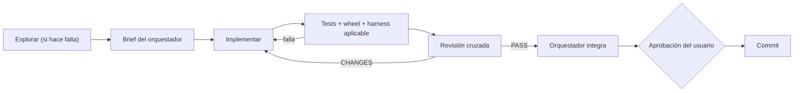

# Plan de orquestacion de sub-agentes

Fecha: 17 de noviembre de 2026. **Estado: propuesta, no autorizada.** No modifica código ni consumidores.

Relación con otros documentos:

- El [plan de mejoras](plan-mejoras-2026-11-17.md) define **qué** se mejora y **por qué**: hallazgos M-01…M-27, fases F0–F5 y decisiones D1–D7.
- Este documento define **cómo** se ejecuta: tareas, orden, rol de agente responsable, verificación, ramas y aprobaciones.
- El [plan global](plan-global.md) sigue siendo la autoridad de dirección. Este plan no amplía alcance: si una tarea no corresponde a un hallazgo, no entra.

Ninguna tarea empieza sin la aprobación del plan de mejoras. Las tareas que dependen de una decisión Dn esperan a que el usuario la resuelva.

## 1. Modelo operativo de agentes

### Roles

| Rol | Claude Code | Codex | Herramientas | Responsabilidad | Prohibido |
| --- | --- | --- | --- | --- | --- |
| Orquestador | Sesión principal, Opus | Sesión principal, Sol | Todas | Planificar, redactar briefs, integrar resultados, preparar commits, pedir decisiones | Aprobar en nombre del usuario; commit o push sin aprobación |
| Explorador | Subagente Haiku | Subagente Luna | Solo lectura | Localizar código, usos e impacto; citar `archivo:línea` | Editar; emitir juicios de diseño |
| Implementador estándar | Subagente Sonnet | Subagente Terra | Lectura, edición, tests | Cambios con especificación cerrada fuera de zonas críticas | Commit; tocar archivos fuera del brief; cambiar interfaces públicas sin aviso |
| Implementador crítico | Sesión principal o subagente Opus | Sesión principal o subagente Sol | Lectura, edición, tests | Cambios en zonas críticas (abajo) | Igual que el estándar |
| Revisor | Opus si implementó Codex | Sol si implementó Claude | Solo lectura | Revisión independiente del diff contra brief, AGENTS.md e invariantes | Editar; revisar su propio trabajo |

La planificación y las decisiones se quedan en la sesión principal porque necesitan todo el contexto y diálogo con el usuario. "Decidir" significa recomendar; las decisiones D1–D7, los commits, el remoto y cualquier publicación son del usuario.

### Zonas críticas

Requieren implementador crítico y revisión cruzada: `model.py`, `store.py`, `kernel.py`, `verification.py`, `integration.py`, `releases.py` e `installation.py`. Ahí viven digests, journals, recuperación, gates y escrituras sobre archivos del consumidor. El resto (`native_cli.py` en su superficie, docs, CI, scripts, tests, skills) admite implementador estándar.

### Dónde viven las definiciones

- A nivel de usuario: `~/.claude/agents/` y `~/.codex/agents/`. No en este repo ni en el wheel: los nombres de modelo cambian y el paquete debe seguir siendo independiente del proveedor.
- Codex requiere activar multiagente (`multi_agent`). Los nombres de modelo se validan en las versiones instaladas antes de usarlos (tarea T0.1).
- Las definiciones no copian el contenido de las skills de roclec: lo referencian.

### Contrato de traspaso

Cada brief del orquestador incluye:

1. Objetivo y hallazgo M-xx que atiende.
2. Archivos permitidos; todo lo demás queda fuera.
3. Criterios de aceptación y escenarios que deben existir o pasar.
4. Comandos de verificación.
5. Prohibiciones específicas de la tarea.

Cada resultado vuelve con:

- **Explorador:** hallazgos con `archivo:línea`, sin propuestas de diseño.
- **Implementador:** resumen del diff, salida de tests y lo que no pudo verificar.
- **Revisor:** veredicto `PASS` o `CHANGES`, y hallazgos con severidad y `archivo:línea`.

### Flujo por tarea

Escalado:

- Dos iteraciones fallidas de implementación o revisión: la tarea pasa al orquestador.
- Cualquier cambio en interfaz pública (comandos, flags, esquema JSON, `model_schema`, formato de perfil): se detiene y se consulta al usuario.
- Un hallazgo del revisor en zona crítica lo resuelve el orquestador; no se descarta sin motivo escrito.

### Definición de terminado

Una tarea está terminada cuando:

- `PYTHONPATH=src python3 -m unittest discover -s tests -v` pasa;
- el wheel se construye;
- el harness corre sobre ese wheel cuando la tarea toca CLI, operaciones o assets (`--spec-kit` si toca assets o adaptador);
- el revisor dio `PASS`;
- la documentación afectada está actualizada;
- no hay cambios fuera de los archivos del brief.

## 2. Ramas, paralelismo y aprobaciones

- Una rama por pista (`mejoras/f0`, `mejoras/f1`, …), en su propio worktree. Ninguna se fusiona sin aprobación del usuario.
- Antes de que exista remoto (T0.2) todo es local; después, una PR por fase.
- Paralelismo posible tras F0: F1 en un worktree y F2 en otro. Para no chocar en `kernel.py`, `change seal` y los comandos de fundación se implementan en un módulo nuevo (por ejemplo `authoring.py`) que solo lee del kernel.
- F2 y F3 tocan `store.py`: los cambios de F3 en el store (T3.4, T3.5) van después de T2.3 y T2.4.
- Requieren al usuario siempre: commits, creación del remoto, mover evidencia fuera del repo, decisiones Dn, ejecución de campañas semánticas y cualquier acción en el repo del piloto.

## 3. Tareas

Columnas: rol responsable (O orquestador, X explorador, S implementador estándar, C implementador crítico, R revisor, U usuario).

### Sprint 0 — Preparación del modelo de agentes

| ID | Tarea | Rol | Depende | Verificación |
| --- | --- | --- | --- | --- |
| T0.1 | Validar nombres de modelo y soporte de subagentes en las versiones instaladas de Claude Code y Codex | O | — | Un subagente de cada rol responde en cada herramienta |
| T0.2 | Redactar definiciones de los roles a nivel de usuario | O | T0.1 | Revisión del usuario |
| T0.3 | Fijar métricas y umbrales del experimento de subagentes (sección 4) antes de medir | O + U | T0.2 | Umbrales escritos en este documento |

### F0 — Consolidación

| ID | Tarea | Hallazgo | Rol | Depende | Verificación |
| --- | --- | --- | --- | --- | --- |
| T0.4 | Inventariar cambios pendientes y agruparlos por bloque | M-01 | X | — | Lista de archivos por bloque, sin huérfanos |
| T0.5 | Proponer y crear commits por bloque | M-01 | O + U | T0.4 | `git status` limpio; usuario aprueba cada commit |
| T0.6 | Crear remoto privado | M-01 | U | T0.5 | `git remote -v` |
| T0.7 | CI: matriz 3.11–3.13, Ubuntu y macOS, identidad Git, job de harness sobre wheel | M-01 | S | T0.6 | CI verde en el remoto |
| T0.8 | Normalizar rutas personales en evidencia y excluir `docs/*/evidence` del sdist | M-02 | S | T0.5 | Búsqueda de rutas personales sin resultados; sdist sin evidencia |
| T0.9 | Mover evidencia pesada fuera de Git según D7 | M-02 | U | D7 | Resumen con huellas en el repo |
| T0.10 | Corregir estado del plan global y enlace externo | M-03 | O | — | Sin contradicciones de estado |
| T0.11 | Versión única, AGENTS.md actualizado, wheel reconstruido | M-04 | S | — | Wheel construido con la versión correcta |
| T0.12 | Revisión de F0 | — | R | T0.7–T0.11 | `PASS` |

### F1 — Autoría y estado

| ID | Tarea | Hallazgo | Rol | Depende | Verificación |
| --- | --- | --- | --- | --- | --- |
| T1.1 | Mapear puntos de extensión de la CLI y funciones de digest reutilizables | M-05, M-06 | X | F0 | Informe con `archivo:línea` |
| T1.2 | Especificar interfaces de los comandos nuevos | M-05–M-07 | O + U | T1.1, D4 | Interfaces aprobadas |
| T1.3 | `change seal` en módulo nuevo, con escenarios de idempotencia y rechazo de snapshots aprobados | M-05 | C | T1.2 | Escenarios nuevos en `c1_scenarios.py`; harness |
| T1.4 | `reference add\|update` y `foundation agree` con operaciones journaled nuevas en el store | M-06 | C | T1.2 | Escenario: agree habilita, edición posterior bloquea |
| T1.5 | `status` y `list`, salida legible y `next_action` por estado | M-07 | S | T1.2 | Escenario sobre el fixture C2 |
| T1.6 | `change start --actor`; `INTERNAL_ERROR` con `--debug` | M-08, M-09 | S | T1.2 | Tests de error inducido |
| T1.7 | Actualizar skills y `model.md` para usar los comandos nuevos | M-05, M-06 | S | T1.3, T1.4 | Harness `--spec-kit` |
| T1.8 | Revisión cruzada de F1 | — | R | T1.3–T1.7 | `PASS` |

### F2 — Ramas Git e integración

| ID | Tarea | Hallazgo | Rol | Depende | Verificación |
| --- | --- | --- | --- | --- | --- |
| T2.1 | Inventariar usos de `identifier`, `next_id`, `sequence`, `current.json` e `identities.json` | M-10, M-11 | X | F0 | Informe con `archivo:línea` |
| T2.2 | Diseñar formato de IDs, cadena causal de decisiones y subida de `model_schema` | M-10 | O + U | T2.1, D1 | Diseño aprobado |
| T2.3 | Implementar IDs y cadena causal; regenerar fixtures | M-10 | C | T2.2 | Escenarios C1–C3 actualizados en verde |
| T2.4 | Implementar opción D2: regla troncal con detección en `check` o layout por archivo | M-11 | C | T2.2, D2 | Escenario de merge |
| T2.5 | Comprobar duplicados sobre el conjunto completo de decisiones | M-12 | C | T2.3 | Test de regresión |
| T2.6 | `target_ref` por componente en perfil, integrate y gate de release | M-13 | C | T2.2 | Integrar desde rama no fusionada se rechaza sin escrituras |
| T2.7 | Escenarios de dos worktrees con runs, evidencias y decisiones paralelas | M-10, M-11 | S | T2.3, T2.4 | Merge sin conflictos textuales; `check` en verde |
| T2.8 | Revisión cruzada de F2 | — | R | T2.3–T2.7 | `PASS` |

### F3 — Logs, seguridad y escala

| ID | Tarea | Hallazgo | Rol | Depende | Verificación |
| --- | --- | --- | --- | --- | --- |
| T3.1 | Tope de logs con huella completa, redacción y `env` explícito por check | M-14 | C | D3 | Secreto de prueba no llega al repo; log truncado verificable |
| T3.2 | Documentar frontera de confianza; aviso en `check` si cambian los `argv` | M-15 | S | — | Docs y test del aviso |
| T3.3 | Fijar versión del instalador de skills y verificar `computedHash` | M-16 | S | — | Test con hash alterado |
| T3.4 | Token acotado, `check` en una pasada, `inspect --deep` | M-17 | C | T2.3, T2.4 | Suite completa en verde |
| T3.5 | Lock con dueño y `operation unlock --if-stale` | M-18 | C | T2.3, T2.4 | Lock de proceso muerto se libera; vivo no |
| T3.6 | Fijar umbrales y escribir escenario de escala en el harness | M-17 | O + S | T3.4 | Tiempos registrados contra umbrales previos |
| T3.7 | Revisión cruzada de F3 | — | R | T3.1–T3.6 | `PASS` |

### Gate de entrada al piloto

| ID | Tarea | Rol | Verificación |
| --- | --- | --- | --- |
| TG.1 | Comprobar checklist: F0 y F1 completas; T2.4 y T2.6; T3.1 y T3.2 | O | Checklist con enlaces a evidencia |
| TG.2 | Decidir si se ejecuta la campaña semántica preparada, con alcance y coste | U | Decisión registrada |

### F5 — Adopción en el piloto

| ID | Tarea | Hallazgo | Rol | Depende | Verificación |
| --- | --- | --- | --- | --- | --- |
| T5.1 | Incorporar plan de mejoras al plan global y mover contenido del piloto a su repo | M-27 | O | TG.1 | Plan global sin contenido específico del piloto |
| T5.2 | Resolver elementos prometidos no modelados | M-25 | O + U | D5 | Cada elemento modelado, pospuesto con disparador o recortado |
| T5.3 | Registro no autoritativo de tiempos y eventos; línea base | M-26 | S | TG.1 | Línea base registrada antes del primer cambio real |
| T5.4 | Recorrer un cambio real del piloto hasta integración, en el repo del piloto | — | U + O | T5.3 | CHG integrado con evidencia vigente; fricciones como FUTs del framework |

### F4 — Instalación, empaquetado y legacy

| ID | Tarea | Hallazgo | Rol | Depende | Verificación |
| --- | --- | --- | --- | --- | --- |
| T4.1 | Poda de archivos retirados y detección de ediciones locales en instalación | M-19 | C | — | Refresh poda una skill retirada y rechaza una editada |
| T4.2 | Adaptador con rutas relativas y licencia coherente | M-20 | S | D6 | Harness `--spec-kit` |
| T4.3 | Licencia, metadatos y plataformas soportadas | M-21 | S | D6 | Metadatos en el wheel |
| T4.4 | Sacar el oráculo legacy del wheel y eliminar `product` | M-22 | S | F5 | Wheel sin `assets/legacy` ni módulos 0.7 |
| T4.5 | Partir `kernel.py` e inyectar guardas de recuperación en el store, sin cambio de conducta | M-23 | C | F5 | Harness idéntico antes y después |
| T4.6 | Subtests con nombre, cobertura en CI y tests de propiedades | M-24 | S | — | Cobertura publicada; propiedades en verde |
| T4.7 | Revisión cruzada de F4 | — | R | T4.1–T4.6 | `PASS` |

T4.1 y T4.2 pueden adelantarse si bloquean el piloto.

## 4. Experimento de subagentes

El reparto por modelos es una hipótesis, no una decisión. Se mide con la regla del plan global: línea base, hipótesis, comparación y decisión.

- **Hipótesis:** explorar con modelo barato e implementar con modelo medio reduce coste sin empeorar la corrección, siempre que haya revisión cruzada.
- **Línea base:** T1.5 y T1.6 las ejecuta el orquestador solo; T1.3 y T1.4 con el flujo de subagentes. Si el orden de tareas lo impide, se usan dos tareas comparables de F0.
- **Qué se registra por tarea:** iteraciones de implementación, hallazgos del revisor por severidad, defectos detectados después de terminar la tarea, intervenciones del usuario y tokens o coste si la herramienta los expone (si no, se registra como desconocido).
- **Umbrales:** se fijan en T0.3, antes de medir.
- **Decisión:** al cerrar F1 se mantiene, ajusta o abandona el reparto. Los defectos escapados pesan más que el ahorro.

## 5. Riesgos de ejecución

- **Traspaso costoso:** los subagentes empiezan sin contexto; en tareas pequeñas el traspaso cuesta más que el ahorro. Mitigación: tareas pequeñas las hace el orquestador.
- **Errores sutiles en zonas críticas:** mitigación con implementador crítico, revisión cruzada y harness.
- **Cambio de catálogo de modelos o del soporte de subagentes:** mitigación con T0.1 al inicio de cada fase y definiciones fuera del repo.
- **Colisiones entre pistas paralelas:** mitigación con worktrees, módulo nuevo para autoría y orden fijo de cambios en el store.
- **Decisiones pendientes que bloquean:** D1–D4 bloquean F1 y F2. Conviene resolverlas al aprobar el plan de mejoras.
