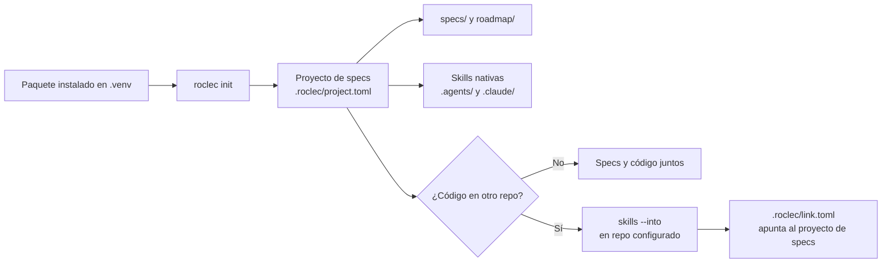
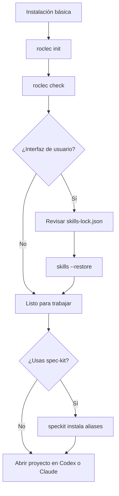

> Referencia histórica 0.7/perfil 1. Para 0.8/C1 usar [la guía vigente](c1.md); el adaptador del modelo nuevo continúa pendiente de C3.

# Tutorial de instalación de Roclec

Esta guía instala `roclec-spec-kit` dentro de un proyecto consumidor. Al terminar tendrás la CLI, un perfil propio, el flujo de trabajo y las skills de Roclec disponibles para Codex y Claude Code. La [guía de uso](tutorial-uso.md) empieza donde termina esta instalación.

## 1. Preparar el entorno

Necesitas Python 3.11 o posterior y acceso a este repositorio o a un wheel construido desde él. Git es recomendable para versionar los archivos del proyecto. Node.js con `npx` solo hace falta si vas a restaurar skills externas; `specify` solo hace falta para la integración opcional con spec-kit.

El ejemplo usa rutas de macOS/Linux y una instalación editable para probar el kit localmente. Sustituye `/ruta/a/roclec-spec-kit` por la ruta real de este repositorio.

```bash
mkdir mi-proyecto
cd mi-proyecto
python3 -m venv .venv
.venv/bin/python -m pip install -e /ruta/a/roclec-spec-kit
.venv/bin/roclec --help
```

Para distribuirlo a un equipo, construye un wheel y fija la versión del paquete en las dependencias del proyecto. No dependas de una instalación editable de la máquina de una persona.

```bash
cd /ruta/a/roclec-spec-kit
uv build --wheel

cd /ruta/a/mi-proyecto
.venv/bin/python -m pip install /ruta/a/roclec-spec-kit/dist/roclec_spec_kit-*.whl
```

Si `dist/` contiene varios wheels, elige explícitamente el de la versión que fijará tu equipo.

## 2. Elegir la topología

Roclec puede guardar specs y código en el mismo repositorio o en repositorios hermanos. Las rutas de `--component` son relativas a la raíz donde quedará `.roclec/project.toml`.



### Un solo repositorio

Desde `mi-proyecto`, ejecuta:

```bash
.venv/bin/roclec init . --name "Mi proyecto" --component app=.
./.roclec/run check
```

`app` es un nombre de ejemplo. Usa el nombre que represente a tu componente. Si tiene interfaz para usuarios, añade `--user-facing app` al comando `init`.

### Varios repositorios

Supón que `mi-producto-specs`, `mi-servicio` y `mi-cliente` son carpetas hermanas ya creadas. Primero crea `.venv` e instala el kit en `mi-producto-specs` como en el paso 1. Después, desde esa carpeta:

```bash
.venv/bin/roclec init . --name "Mi producto" \
  --component servicio=../mi-servicio \
  --component cliente=../mi-cliente \
  --user-facing cliente

./.roclec/run skills --into ../mi-servicio
./.roclec/run skills --into ../mi-cliente
./.roclec/run check
```

`skills --into` instala las skills nativas y un lanzador en cada repositorio de código; el archivo `.roclec/link.toml` permite encontrar el proyecto de specs sin duplicarlas. El agente que implemente desde un repositorio de código necesita acceso de escritura al repositorio de specs para actualizar tareas y estados.

## 3. Verificar qué se instaló

Después de `init`, la estructura principal es:

```text
mi-proyecto/
├── .roclec/
│   ├── project.toml       # componentes y rutas
│   ├── workflow.md        # mapa operativo
│   ├── run                # lanzador local de la CLI
│   └── templates/         # plantillas propias del proyecto
├── .agents/skills/        # skills para Codex y agentes compatibles
├── .claude/skills/        # skills para Claude Code
├── AGENTS.md              # sección Roclec junto a reglas existentes
├── CLAUDE.md              # sección Roclec junto a reglas existentes
├── FUTURE.md              # ideas aún no comprometidas
├── specs/                 # specs por feature
└── roadmap/               # releases y vistas generadas
```

Ejecuta `./.roclec/run check` desde la raíz. En un proyecto nuevo debe terminar sin errores. Revisa `.roclec/project.toml`: ahí deben figurar exactamente los componentes, las rutas y los valores `user_facing` que elegiste.

## 4. Instalar las skills de diseño, si hay interfaz

Al usar `--user-facing`, `init` crea o completa `skills-lock.json` con las dependencias de diseño fijadas. **No se descargan durante `init`**. Cuando hayas revisado el lock, instálalas con:

```bash
./.roclec/run skills --restore
```

En proyectos existentes, `./.roclec/run skills` añade al lock las dependencias de diseño predeterminadas que falten, sin reemplazar versiones elegidas por el proyecto. `design-taste-frontend` pertenece a este conjunto y se aplica a páginas web públicas; para dashboards y pantallas de aplicación se usan las demás skills pertinentes.

Un repositorio de código separado administra su propio `skills-lock.json`. Si allí fijaste otras skills, puedes restaurarlas junto con las skills nativas:

```bash
./.roclec/run skills --into ../mi-cliente --restore
```

## 5. Integración opcional con spec-kit

Roclec funciona sin spec-kit. Si el proyecto lo usa, instala una versión compatible de `specify-cli` (`>=0.13.4,<0.14.0`) y, **en un proyecto nuevo**, inicializa spec-kit antes que Roclec:

```bash
specify init --here --integration codex
.venv/bin/roclec init . --name "Mi proyecto" --component app=.
./.roclec/run speckit
```

Si el proyecto ya estaba inicializado con Roclec, ejecuta solo `./.roclec/run speckit` después de tener `specify` disponible y la carpeta `.specify/` creada. Los aliases instalados siguen las mismas skills nativas; no crean un segundo flujo.



## 6. Primer paso después de instalar

Abre **el proyecto inicializado** en Codex o Claude Code. Las skills de Roclec son mensajes al agente; los comandos `./.roclec/run` se ejecutan en terminal. Continúa con el [tutorial de funcionamiento](tutorial-uso.md), que muestra una feature completa y cómo retomar el trabajo más adelante.
