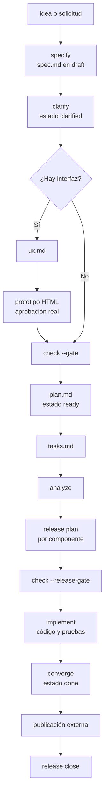
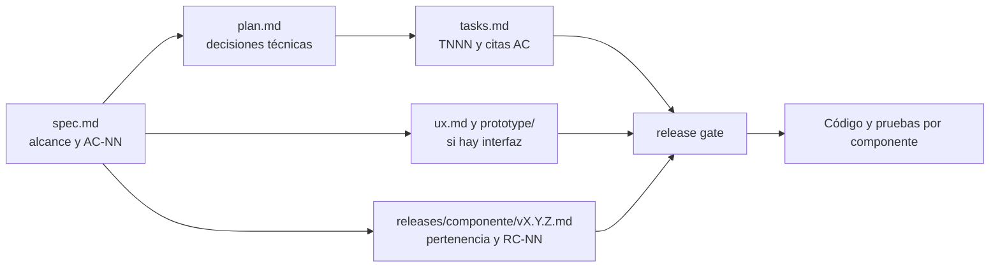

> Referencia histórica 0.7/perfil 1. Para 0.8/C1 usar [la guía vigente](c1.md); el adaptador del modelo nuevo continúa pendiente de C3.

# Tutorial de funcionamiento de Roclec

Esta guía comienza con Roclec ya instalado en un proyecto. Si aún no tienes `.roclec/project.toml` y `./.roclec/run`, sigue primero el [tutorial de instalación](tutorial-instalacion.md).

Roclec conserva el estado en archivos del proyecto: la conversación con el agente ayuda a producirlos, pero no sustituye `spec.md`, el plan, las tareas ni los archivos de release. Ejecuta los ejemplos desde la raíz del proyecto de specs; cambia `app`, `001` y `v0.1.0` por los valores que elijas para tu proyecto.

## 1. Entender las dos interfaces

| Dónde | Ejemplo | Qué hace |
| --- | --- | --- |
| Terminal | `./.roclec/run inspect 001 --json` | Lee estado y rutas reales de la feature. |
| Terminal | `./.roclec/run check --gate 001` | Comprueba requisitos deterministas antes del plan. |
| Chat de Codex | `$roclec-clarify 001` | Trabaja contigo para resolver ambigüedades. |
| Chat de Claude Code | `/roclec-clarify 001` | Ejecuta la misma etapa con la skill instalada para Claude. |

Pide **una etapa por mensaje** y revisa su resultado antes de avanzar. Para saber qué sigue, usa `$roclec-coordinator 001` o `/roclec-coordinator 001`. El coordinador lee el estado y recomienda una etapa; no la ejecuta automáticamente.

## 2. Ver el ciclo completo



Los estados de la spec avanzan `draft → clarified → ready → in-progress → done`. Roclec bloquea saltos y comprueba los artefactos necesarios. Una idea que aún no se va a ejecutar puede vivir en `FUTURE.md`; `$roclec-idea` ayuda a registrarla sin crear una spec.

## 3. Crear y aclarar una feature

Puedes empezar con una solicitud al agente:

```text
$roclec-specify búsqueda de registros para el componente app
```

La skill elegirá un ID disponible, creará `specs/NNN-slug/spec.md` y redactará historias y criterios `AC-NN`. Si prefieres crear el borrador desde terminal, usa un ID libre y luego pide al agente que complete **ese mismo borrador**:

```bash
./.roclec/run new 001-busqueda --title "Búsqueda de registros" --component app
./.roclec/run inspect 001 --json
```

```text
$roclec-specify 001: completa el borrador existente
$roclec-clarify 001
```

`roclec-clarify` integra tus respuestas en la spec y solo cambia el estado a `clarified` cuando desaparecen las decisiones importantes pendientes. Los IDs `AC-NN` se conservan: tareas y pruebas los citarán como `[001/AC-01]`.

## 4. Resolver UX y aprobar el prototipo, si corresponde

Para un componente marcado `user_facing = true`, pide:

```text
$roclec-ux 001
$roclec-prototype 001
```

La etapa UX documenta flujos, estados, accesibilidad y vínculos con los AC en `ux.md`. En prototipo, primero revisas el plan visual; después revisas el HTML real bajo `prototype/`. La aprobación del plan **no** aprueba automáticamente el prototipo. La aceptación del prototipo debe constar en `prototype/review.md` con `**Status:** approved`, fecha, responsable y referencia de tu decisión. Mientras no lo aceptes, el estado permanece `pending` y el gate de preparación falla.

Para una página web pública, el proceso puede usar la skill fijada `design-taste-frontend`; para dashboards y pantallas de aplicación emplea otras skills de diseño pertinentes. Las decisiones de producto y marca del proyecto tienen prioridad.

Si la feature no tiene interfaz, omite UX y prototipo. En ambos casos, comprueba la preparación antes de planificar:

```bash
./.roclec/run check --gate 001
```

## 5. Planificar, desglosar y revisar

```text
$roclec-plan 001
$roclec-tasks 001
$roclec-analyze 001
```

`roclec-plan` investiga los repositorios afectados, crea o actualiza `plan.md` y pasa la spec a `ready` cuando el plan está completo. `roclec-tasks` crea `tasks.md` con tareas `TNNN`, un propietario configurado por tarea y citas `[001/AC-NN]` suficientes para cubrir todos los criterios. `roclec-analyze` revisa la consistencia entre artefactos sin comenzar la implementación.

Puedes consultar el estado en cualquier momento:

```bash
./.roclec/run inspect 001 --json
./.roclec/run check --write
```

`check --write` valida y regenera `roadmap/ROADMAP.md` y los `INDEX.md` de releases. Esas vistas no se editan manualmente.

## 6. Asignar un release antes de implementar

Elige la versión y las specs de **cada componente afectado**. Para una feature que solo afecta a `app`:

```bash
./.roclec/run release plan app v0.1.0 001 --title "Primer release"
./.roclec/run check --release-gate 001
```

El archivo `roadmap/releases/app/v0.1.md` es la fuente de pertenencia al release. Sustituye su criterio `RC-01` de ejemplo por criterios reales de publicación y compatibilidad; los `AC-NN` siguen en `spec.md`. Si la feature afecta a varios componentes, ejecuta `release plan` para cada uno antes de implementar. El agente `$roclec-release` puede ayudarte a preparar estas decisiones, pero no debe elegir por ti una versión que no hayas indicado.



## 7. Implementar y cerrar la spec

Desde el repositorio de código configurado, pide `$roclec-implement 001` o `/roclec-implement 001`. La skill identifica el componente por la ruta del repositorio, ejecuta los gates, cambia el estado a `in-progress` y trabaja únicamente en sus tareas. En un proyecto con varios repositorios, repite la etapa en cada componente afectado. Cada componente ejecuta sus pruebas reales; las citas `[001/AC-01]` dan trazabilidad, pero no demuestran por sí solas que las pruebas pasaron.

Cuando todos los componentes estén terminados, vuelve al proyecto de specs:

```text
$roclec-converge 001
```

`roclec-converge` contrasta los AC con código, tareas y pruebas. Solo pasa a `done` si la verificación está completa. Confirma el resultado con:

```bash
./.roclec/run check --coverage --write
./.roclec/run inspect 001 --json
```

## 8. Publicar y cerrar el release

La publicación del software ocurre fuera de Roclec. Cuando tengas evidencia de que se publicó, completa los `RC-NN`, escribe notas de release significativas y cierra **cada versión publicada**:

```bash
./.roclec/run release close app v0.1.0 --commit <SHA-publicado>
./.roclec/run check
```

`release close` registra el cierre; no despliega. Los archivos de releases cerrados son inmutables. En CI puedes comprobarlos frente a la rama base:

```bash
./.roclec/run check --immutable-base origin/main
```

## 9. Retomar trabajo otro día

Desde el proyecto de specs o un repositorio enlazado, selecciona una feature existente y examina su estado:

```bash
./.roclec/run use 001
./.roclec/run inspect 001 --json
./.roclec/run check
```

`use` guarda solo la selección local del worktree; el progreso real sigue en los archivos versionados. También puedes pasar el ID directamente a la skill del agente, por ejemplo `$roclec-coordinator 001`, sin depender de la selección guardada. Si actualizas el paquete, ejecuta `./.roclec/run skills` para refrescar las instrucciones administradas sin reemplazar las plantillas propias del proyecto.

## 10. Comandos de agentes y subagentes

Estas son las **17 skills nativas** instaladas por Roclec. Escríbelas en el chat del agente, una etapa por mensaje. `001`, `app` y `v0.1.0` son ejemplos: sustitúyelos por el ID, componente y versión reales. Los comandos de terminal siguen usando `./.roclec/run`.

| Para qué sirve | Codex | Claude Code |
| --- | --- | --- |
| Consultar estado y siguiente etapa | `$roclec-coordinator 001` | `/roclec-coordinator 001` |
| Establecer contexto de producto y diseño | `$roclec-foundation app` | `/roclec-foundation app` |
| Crear o revisar principios del proyecto | `$roclec-constitution revisa principios` | `/roclec-constitution revisa principios` |
| Revisar calidad de requisitos | `$roclec-checklist 001` | `/roclec-checklist 001` |
| Registrar una idea futura | `$roclec-idea registrar nueva oportunidad` | `/roclec-idea registrar nueva oportunidad` |
| Crear o revisar una spec | `$roclec-specify búsqueda de registros para app` | `/roclec-specify búsqueda de registros para app` |
| Aclarar una spec | `$roclec-clarify 001` | `/roclec-clarify 001` |
| Diseñar flujos y estados de interfaz | `$roclec-ux 001` | `/roclec-ux 001` |
| Crear y revisar un prototipo | `$roclec-prototype 001` | `/roclec-prototype 001` |
| Elaborar el plan técnico | `$roclec-plan 001` | `/roclec-plan 001` |
| Desglosar tareas | `$roclec-tasks 001` | `/roclec-tasks 001` |
| Analizar consistencia entre artefactos | `$roclec-analyze 001` | `/roclec-analyze 001` |
| Planear un release elegido por ti | `$roclec-release plan app v0.1.0 001` | `/roclec-release plan app v0.1.0 001` |
| Implementar desde el repo de código | `$roclec-implement 001` | `/roclec-implement 001` |
| Verificar y completar la feature | `$roclec-converge 001` | `/roclec-converge 001` |
| Cerrar un release ya publicado | `$roclec-release close app v0.1.0` | `/roclec-release close app v0.1.0` |

### Subagentes

Roclec no instala comandos adicionales para subagentes. Si tu entorno permite delegar trabajo, pídeselo al agente principal dentro de **una sola etapa Roclec**. El agente principal reúne los resultados y responde por las ediciones, los gates y las transiciones. Dos ejemplos de mensajes para Codex son:

```text
$roclec-analyze 001. Si tienes subagentes disponibles, delega por separado la revisión de spec/AC y de plan/tareas; reúne los hallazgos sin modificar archivos.

$roclec-implement 001. Si hay tareas [P] realmente independientes en este componente y tienes subagentes disponibles, delega solo esas tareas, coordina los archivos y ejecuta las pruebas antes de marcarlas completas.
```

En Claude Code, cambia el prefijo `$` por `/`. La marca `[P]` indica independencia de tareas; no obliga a crear subagentes. Ningún subagente debe adelantar otra etapa, aprobar un prototipo en nombre del usuario ni implementar componentes hermanos desde el repo actual.

Para amendments, revisión independiente, hotfixes/bugfixes y producto opcional, consulta las secciones de 0.5–0.7 del README. Los comandos release close de terminal requieren --commit con el SHA realmente publicado; la skill ayuda a obtener esa evidencia.
