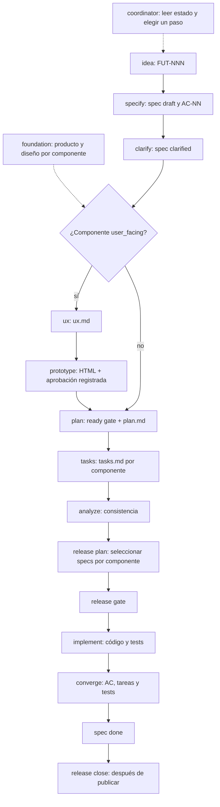

> Referencia histórica de Roclec 0.7. No corresponde a la CLI pública 0.8/C1. Conservada para revisar los cambios anteriores; no ejecutar estas instrucciones con el wheel nuevo.

# roclec-spec-kit

Framework configurable para gestionar el ciclo de vida de un proyecto de software con Claude Code o Codex: ideas, specs, UX, prototipos, planes, tareas, implementación y releases. Se instala dentro del proyecto consumidor; allí quedan su configuración, instrucciones de agentes, skills, producto, decisiones, specs y versiones en Git.

**Estado:** versión `0.7.0` para uso interno. Requiere Python 3.11 o posterior. El flujo Roclec funciona sin spec-kit; la integración opcional requiere `specify`. La restauración de skills externas requiere Node.js con `npx`.

Guías paso a paso: [instalación](tutorial-instalacion.md) y [funcionamiento después de instalar](tutorial-uso.md), ambas con diagramas.

## Instalar dentro de un proyecto

En un entorno virtual del proyecto consumidor:

```bash
python3 -m venv .venv
.venv/bin/python -m pip install -e /ruta/a/roclec-spec-kit
.venv/bin/roclec init . --name "Mi proyecto" --component app=.
./.roclec/run check
```

La instalación editable sirve para desarrollar el kit. Para un equipo, fija una versión del paquete desde un tag Git privado en las dependencias del proyecto y usa esa misma versión en CI. `init` deja `.roclec/project.toml`, `.roclec/workflow.md`, `FUTURE.md`, `specs/`, `roadmap/` y las skills bajo `.agents/skills/` y `.claude/skills/`. Añade una sección delimitada a `AGENTS.md` y `CLAUDE.md` sin borrar instrucciones existentes. `./.roclec/run` usa la CLI del `.venv` del proyecto o la que esté en `PATH`.

Abre **el proyecto ya inicializado** en Claude Code o Codex. Para retomar una feature, envía `$roclec-coordinator 001` a Codex o `/roclec-coordinator 001` a Claude Code. El coordinador lee el estado persistido y recomienda una sola etapa; envíala en otro mensaje. Los comandos `$roclec-*` y `/roclec-*` son mensajes al agente, mientras que `./.roclec/run ...` se ejecuta en terminal. No hace falta instalar skills de Roclec en el directorio global del agente.

Si además usas [spec-kit](https://github.com/github/spec-kit), inicialízalo en el proyecto e instala el preset y la extensión que vienen dentro del paquete. En un proyecto nuevo, ejecuta `specify init` antes de `roclec init`; en uno existente, revisa la combinación de archivos que propone spec-kit:

```bash
specify init --here --integration codex
roclec speckit
```

El adaptador genera el preset y la extensión a partir de las mismas skills nativas y plantillas del proyecto. `speckit.plan`, por ejemplo, ejecuta las instrucciones de `roclec-plan`; no mantiene un segundo flujo ni encadena etapas mediante hooks. Requiere `specify-cli >=0.13.4,<0.14.0` y está probado con `0.13.4`. Tras actualizar `roclec-spec-kit`, ejecuta `./.roclec/run skills` para refrescar las skills y, si usas spec-kit, `./.roclec/run speckit` para refrescar sus comandos.

Para varios componentes o repositorios:

```bash
roclec init . --name "Mi producto" \
  --component api=../mi-api \
  --component web=../mi-web --user-facing web
```

Las rutas `repo` son relativas a la raíz que contiene `.roclec/project.toml`. El repositorio de specs puede ser el mismo repositorio de código o uno hermano. Desde otro directorio, pasa `--project` antes del subcomando:

```bash
roclec --project ../mi-producto-specs check --release-gate 001
```

El perfil creado es TOML estándar:

```toml
schema = 1
name = "Mi producto"

[components.api]
repo = "../mi-api"
user_facing = false

[components.web]
repo = "../mi-web"
user_facing = true
```

`user_facing = true` exige `ux.md`, un prototipo HTML y su aprobación explícita registrada en `prototype/review.md` antes de que una spec esté `ready`. Cada componente se versiona de forma independiente. Las reglas de dominio, seguridad y contratos se escriben en la constitución del proyecto; no están codificadas en el kit.

## Flujo



La memoria está en los archivos del proyecto, especialmente `spec.md`, `tasks.md` y los archivos de release. El mapa operativo instalado queda en `.roclec/workflow.md`. Envía una etapa por mensaje al agente.

Ejemplo de conversación desde la raíz del proyecto:

```text
Codex:       $roclec-specify búsqueda de expedientes
Codex:       $roclec-clarify 001
Codex:       $roclec-ux 001                  # si hay interfaz
Codex:       $roclec-prototype 001           # si hay interfaz; pide aprobar el plan visual
Codex:       $roclec-plan 001
Codex:       $roclec-tasks 001
Codex:       $roclec-analyze 001
Codex:       $roclec-release plan app v0.1.0 001
Codex:       $roclec-implement 001           # desde el repo de código
Codex:       $roclec-converge 001
Codex:       $roclec-release close app v0.1.0  # tras publicar
Claude Code: usa /roclec-... en lugar de $roclec-...
```

`roclec-foundation` prepara el contexto visual una vez por componente. `roclec-idea` guarda ideas todavía no comprometidas. El coordinador se puede invocar entre cualquier par de etapas y al iniciar otra sesión. Para API u otros componentes sin interfaz se omiten UX y prototipo. Cada componente tiene releases independientes.

Comandos principales, ejecutados desde la raíz del proyecto:

```bash
roclec new 001-mi-funcion --title "Mi función" --component api
roclec use 001
roclec inspect 001 --json
# Después de completar y revisar cada artefacto:
roclec transition 001 clarified
roclec artifact 001 plan
roclec transition 001 ready
roclec artifact 001 tasks
roclec check --gate 001
roclec release plan api v0.1.0 001 --title "Primer release"
roclec check --release-gate 001
roclec transition 001 in-progress
# Después de implementar, ejecutar pruebas y verificar todos los componentes:
roclec transition 001 done
roclec check --write
roclec check --coverage
roclec release close api v0.1.0 --commit <SHA-publicado>
roclec skills
```

`new` crea un borrador; se editan sus criterios y artefactos antes de cambiarlo a `ready`. `release plan` selecciona explícitamente las specs para una versión. La pertenencia al release solo vive en `roadmap/releases/<component>/vX.Y.Z.md`; el roadmap y cada `INDEX.md` se regeneran con `check --write`. `in-progress` y `done` requieren plan, tareas y una asignación por cada componente. `done` requiere tareas cerradas y referencias a todos los AC en los tests de cada componente. `release close` requiere todas las specs en `done`, criterios `RC-NN` reales completados, trazabilidad y notas de release escritas; el archivo publicado queda inmutable y debe protegerse en CI.

Las ideas aún no comprometidas viven en `FUTURE.md` con encabezados `## FUT-NNN`. Al promover o descartar una idea, retírala de allí y registra su ID en `roadmap/fut-archive.md`; no reutilices IDs. La spec promovida conserva `origin: FUT-NNN`.

Para verificar la inmutabilidad frente a la rama base:

```bash
roclec check --immutable-base origin/main
```

La cobertura busca referencias `[NNN/AC-NN]` en archivos de pruebas de los repositorios configurados. Usa `roclec check --coverage` cuando estén presentes. No sustituye la ejecución de las pruebas propias de cada componente.

## Agentes y CI

`roclec init` instala las skills de cada etapa en `.agents/skills/` y `.claude/skills/`. Tras actualizar el paquete, `./.roclec/run skills` sincroniza únicamente los archivos administrados. Las skills leen el perfil y las instrucciones propias del proyecto. En un repo de código separado, `roclec skills --into` instala las mismas skills, el lanzador y un enlace al proyecto de specs.

Si declaras algún componente `--user-facing`, `init` crea o completa `skills-lock.json` con cinco skills de diseño fijadas: `design-taste-frontend` (la skill predeterminada de [Taste Skill](https://github.com/Leonxlnx/taste-skill)), `ui-ux-pro-max`, `frontend-design`, `impeccable` y `web-design-guidelines`. `design-taste-frontend` se usa para páginas web públicas; su propio alcance excluye dashboards y pantallas de aplicación. Los archivos se descargan únicamente al ejecutar:

```bash
./.roclec/run skills --restore
```

La restauración usa `npx -y skills experimental_install`, respeta las versiones/hashes del lock y comprueba que cada skill aparezca instalada. Roclec expone después las skills en `.agents/skills/` y `.claude/skills/`, mediante un enlace relativo cuando el instalador solo crea una de esas rutas. Si ya hay un lock, Roclec conserva las versiones elegidas y añade solo las skills de diseño que falten.

En un repositorio de código separado, puedes instalar las mismas skills allí sin duplicar las specs:

```bash
roclec --project ../mi-producto-specs skills --into ../mi-api
```

Esto crea `.roclec/link.toml` en el repo de código, apuntando al perfil del repositorio de specs. Desde allí, `roclec check` encuentra el proyecto sin pasar `--project`. El link y las skills pueden guardarse en Git; no duplican las specs. La carpeta de specs necesita estar accesible para los cambios de tareas y estados que produzca la implementación.

Cada repo de código declara sus propias dependencias de agente en su `skills-lock.json` (por ejemplo, React Native o TanStack Query). Para instalar **todas** las skills fijadas allí junto con las skills de Roclec:

```bash
roclec --project ../mi-producto-specs skills --into ../mi-api --restore
```

El paquete no adivina skills según el framework del código: el lock de cada repo es la lista completa y versionada. Skills opcionales vendorizadas por un proyecto también pueden permanecer en ese proyecto; no se descargan como dependencias del núcleo.
El ejecutable `roclec` debe estar instalado en el `.venv` del proyecto de specs o disponible en `PATH`; el lanzador del repo de código busca primero el `.venv` del proyecto de specs y luego el del repo de código. Para Codex, da acceso de escritura al repo de specs cuando trabajes desde un repo de código separado (por ejemplo, `codex --add-dir ../mi-producto-specs`).

Ejemplo mínimo de CI desde la raíz del proyecto, después de instalar su versión fijada del paquete:

```bash
roclec check
roclec check --immutable-base "$BASE_REF"
```

Usa `roclec check --write` localmente y confirma los archivos generados antes de la PR. `check` sin `--write` falla si están desactualizados.

## Alcance de esta primera versión

El kit aporta validación, proyecciones y skills locales para todo el ciclo, además de la integración opcional con spec-kit. Las skills guían la redacción, UX y decisiones; la CLI automatiza las partes deterministas. Cada proyecto consumidor mantiene sus propias reglas de dominio y puede migrar sus datos por separado.

## Mejoras adaptadas de spec-kit

RK incorpora métodos seleccionados de [GitHub spec-kit](https://github.com/github/spec-kit): historias verificables, revisión de ambigüedades, investigación técnica con decisiones y alternativas, tareas por historia con dependencias, análisis cruzado de artefactos y gobierno versionado de la constitución. Se adaptaron al modelo de componentes/releases de Roclec; no se requiere instalar spec-kit para usarlos. La atribución MIT y las huellas de los archivos de origen están en `THIRD_PARTY_NOTICES.md` y `assets/notices/spec-kit-provenance.json` dentro del paquete.

Hay 17 skills nativas, incluidas `$roclec-constitution` para principios y `$roclec-checklist 001` para calidad de requisitos. La CLI verifica estructura y trazabilidad; las skills revisan significado y ejecutan las pruebas del proyecto. Pasar los gates no demuestra que una spec sea correcta ni que el código funcione.

### Memoria y selección

La memoria de trabajo sigue en los artefactos versionados. `.roclec/feature.json` guarda únicamente la selección local del worktree; `new` y `use` la actualizan. `inspect` no modifica archivos. Si instalas el adaptador, se sincroniza `.specify/feature.json`. Un ID explícito siempre tiene prioridad; si no hay selección, se solicita una en lugar de adivinar.

Las plantillas se instalan en `.roclec/templates/` y son del proyecto: `skills` conserva sus modificaciones. La constitución nativa es `.roclec/constitution.md`; si ya existía `.specify/memory/constitution.md`, se mantiene esa autoridad. Evita dos constituciones distintas. Los archivos de licencia se entregan en `.roclec/notices/`.

### Actualizar desde 0.3

1. Actualiza el paquete a `0.7.0` y ejecuta `./.roclec/run skills`.
2. Completa las nuevas plantillas según las convenciones del proyecto; la actualización preserva cualquier plantilla propia.
3. Para specs `ready`, verifica que exista plan. Antes de implementar, las tareas necesitan IDs únicos, un solo propietario y citas `[NNN/AC-NN]` que cubran los AC. Los ejemplos comentados no cuentan.
4. Para interfaces, registra la aprobación **real** del prototipo en `prototype/review.md`, con `**Status:** approved`, fecha, responsable y decisión. La herramienta comprueba el registro, no autentica al revisor.
5. Antes de cerrar una versión, sustituye el placeholder por criterios `RC-NN` de publicación/compatibilidad y complétalos. No modifiques releases ya publicados para adoptar esta versión: conserva su kit anterior o migra la validación mediante un cambio revisado.
6. Ejecuta `check --coverage --write`. Si usas spec-kit, ejecuta `speckit` para reemplazar los comandos anteriores por los aliases generados. Los antiguos `speckit.roclec.sync` y `speckit.roclec.gate` se sustituyen por operaciones explícitas de la CLI.

## Desarrollo y harness

```bash
PYTHONPATH=src python3 -m unittest discover -s tests -v
uv build
python3 scripts/harness.py \
  --wheel dist/roclec_spec_kit-0.7.0-py3-none-any.whl \
  --report /tmp/roclec-harness.json
# Incluye instalación real del adaptador para Codex y Claude, con specify-cli 0.13.4:
python3 scripts/harness.py \
  --wheel dist/roclec_spec_kit-0.7.0-py3-none-any.whl \
  --report /tmp/roclec-harness-compat.json --spec-kit
```

El harness instala el **wheel** sin dependencias en un entorno virtual temporal, crea un proyecto con dos componentes, enlaza un repo de código y recorre el ciclo hasta cerrar releases. Inyecta fallos de tareas, esfuerzo, aprobación, asignaciones, cobertura, notas e inmutabilidad; comprueba que los rechazos no cambien archivos. Produce JSON con evidencia y la huella del wheel, y devuelve un código distinto de cero ante un fallo. No descarga skills externas, despliega ni invoca modelos. Consulta [la guía del harness](harness.md) y [la decisión de arquitectura](decisions/001-native-workflow.md).

## Cambios posteriores a done (0.5.0)

Una spec terminada conserva su estado. `$roclec-amend 001 descripción` clasifica un cambio como fix, amendment o nueva spec. Un amendment solo amplía comportamiento dentro de pantallas, permisos, operaciones y componentes existentes; sus nuevos AC permanecen en spec.md y las tareas llevan [A1]. Cada componente tiene su propia asignación y cierre.

```bash
roclec release plan app v0.2.0 001-A1
roclec use 001-A1
roclec inspect --json
roclec check --release-gate 001-A1
roclec release fix app v0.2.0 001 "Restaurar comportamiento documentado" abc1234
roclec release fix app v0.1.1 001 "Corregir regresión publicada" abc1234 --kind hotfix --base-tag v0.1.0
# Después de publicar, completar RC-NN y escribir Release Notes:
roclec release close app v0.2.0 --commit <SHA-publicado> --tag v0.2.0
```

Versiones y tags nuevos usan siempre **vX.Y.Z**: versiones normales aumentan X o Y, con Z=0; al aumentar X, Y también vuelve a 0. Solo hotfixes y bugfixes incrementan Z; contienen exclusivamente fixes, parten del último tag publicado de su línea X.Y y se declaran con --kind hotfix o --kind bugfix. No se exigen incrementos consecutivos. La CLI registra el commit y tag esperado, comprueba colisiones y no crea ni publica tags. No prueba por sí sola que hubo publicación. Archivos históricos vX.Y se leen sin renombrarlos; v1.2 y v1.2.0 no pueden coexistir para un mismo componente.

## Revisión opcional y contexto (0.6.0)

```bash
roclec review enable 001 --reason "Revisión solicitada por la persona responsable"
roclec inspect 001 --component app --json
# Invocar $roclec-reviewer 001 en otro contexto o sesión.
roclec review disable 001 --reason "La persona responsable dio por terminado el piloto"
```

El revisor mantiene reviews/implementation-<componente>.md (o implementation-<componente>-A1.md), con evidencia por AC, limitaciones, historial y huellas. La plantilla instalada explica el bloque JSON roclec-review. inspect distingue disabled, missing, incomplete, stale, changes-needed y ready. Solo status y checkboxes de tareas se normalizan como cambios administrativos; los demás cambios requieren revisión de la evidencia. Las skills comprueban informes vigentes cuando se habilita la participación; no existe un gate global nuevo de CI ni autenticación automática de independencia. El coordinador incluye contexto del componente y requiere --component si varios comparten repositorio.

## Producto y prototipos (0.7.0)

La generación de producto es opcional. Para adoptarla en un componente user_facing, añade esta tabla; sus rutas son relativas al proyecto y pueden personalizarse:

```toml
[components.app.product]
core = "product/core.md"
source = "product/app.md"
output = "components/app/PRODUCT.md"
design = "components/app/DESIGN.md"
```

Las fuentes usan encabezados ##. Platform y Stack son obligatorios en la fuente específica y no se permiten en core. Se combinan secciones compartidas primero y específicas después. El diseño sigue siendo una fuente escrita por el proyecto.

```bash
roclec product --write
roclec product
roclec check
```

check detecta vistas desactualizadas solo para componentes que adoptaron la configuración; check --write no regenera producto. El generador valida todas las fuentes antes de escribir y rechaza salidas existentes no administradas. Para adoptar una salida previa, revisa y conserva su contenido en fuentes antes de retirar el archivo anterior; no basta cambiar un marcador para migrarla.

Para mantenimiento sin cambios de interacción, estados ni disposición, prototype/references.md puede enlazar HTML aprobado de otra spec, con rutas relativas a ese archivo. Se exige aprobación de origen y una nueva aprobación del alcance actual en prototype/review.md. Las referencias deben permanecer dentro de specs/; cambios visuales requieren actualizar y aprobar el prototipo.

## Actualizar desde 0.4–0.6

Actualiza el paquete, ejecuta skills y, si corresponde, speckit. Se preservan constitución y plantillas del consumidor: incorpora las reglas nuevas mediante un cambio revisado. Los aliases se regeneran desde las skills y los manifests toman la versión del paquete. No alteres releases publicados. Las nuevas entregas usan las reglas de versión de 0.5.0; revisión y producto se activan explícitamente. Consulta docs/decisions/002-lexia-improvements.md para las decisiones de adaptación.
